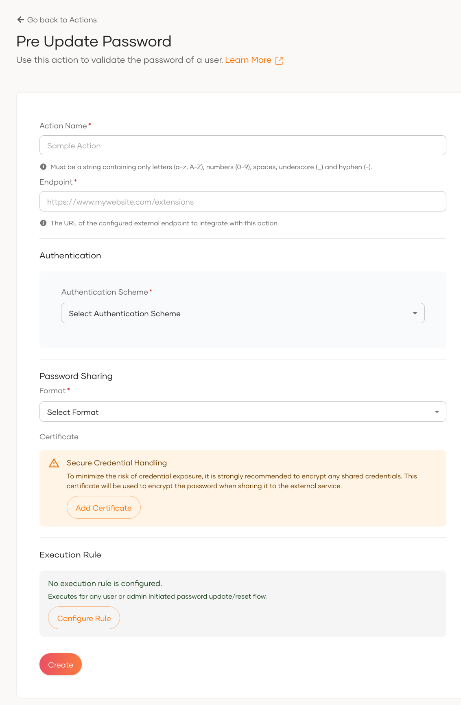
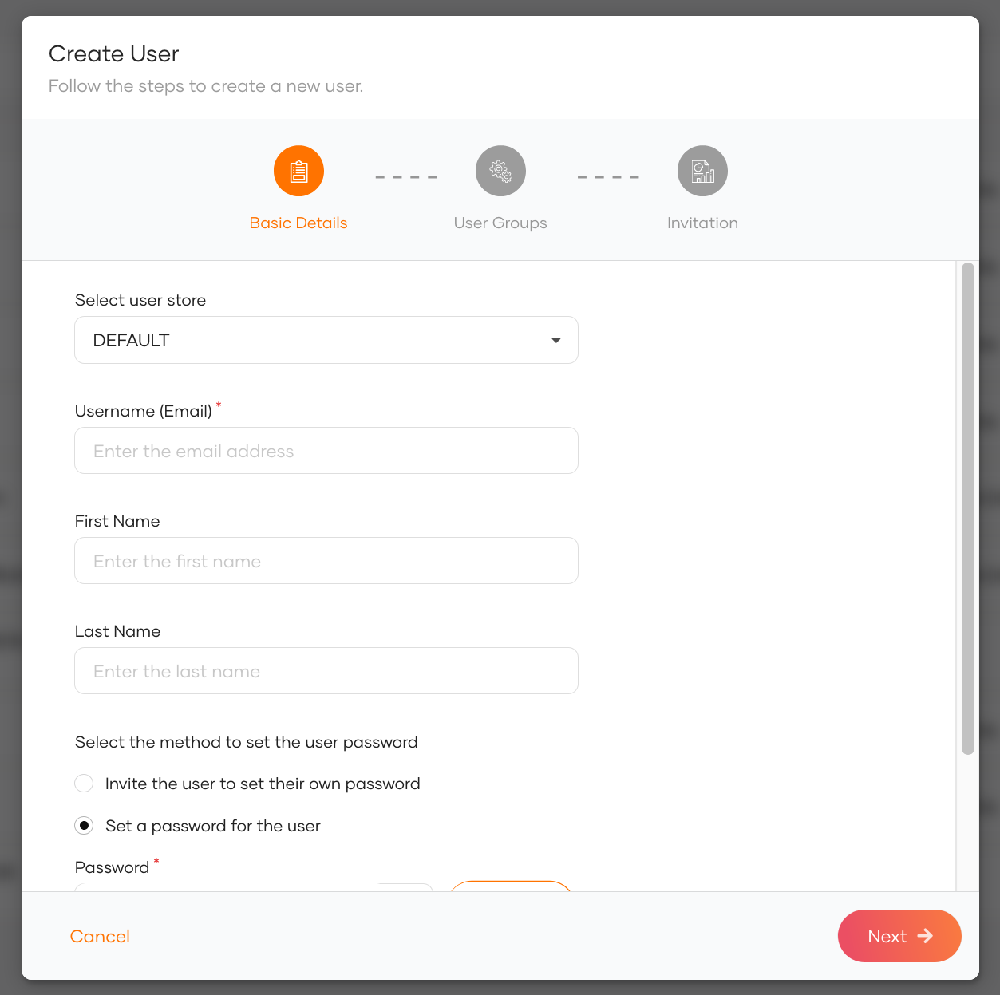

Once the action is configured, make sure it is marked as active to ensure it is triggered during relevant operations.
Then, log in to the Console application using the administrator account, navigate to the **User Management > Users**
section, and add a new user with a predefined password. This user will be used to test the configured pre-password
update action.

