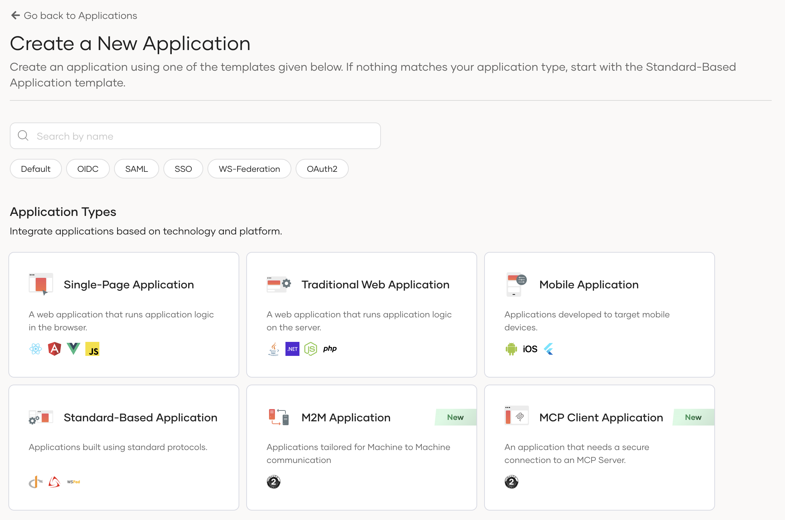
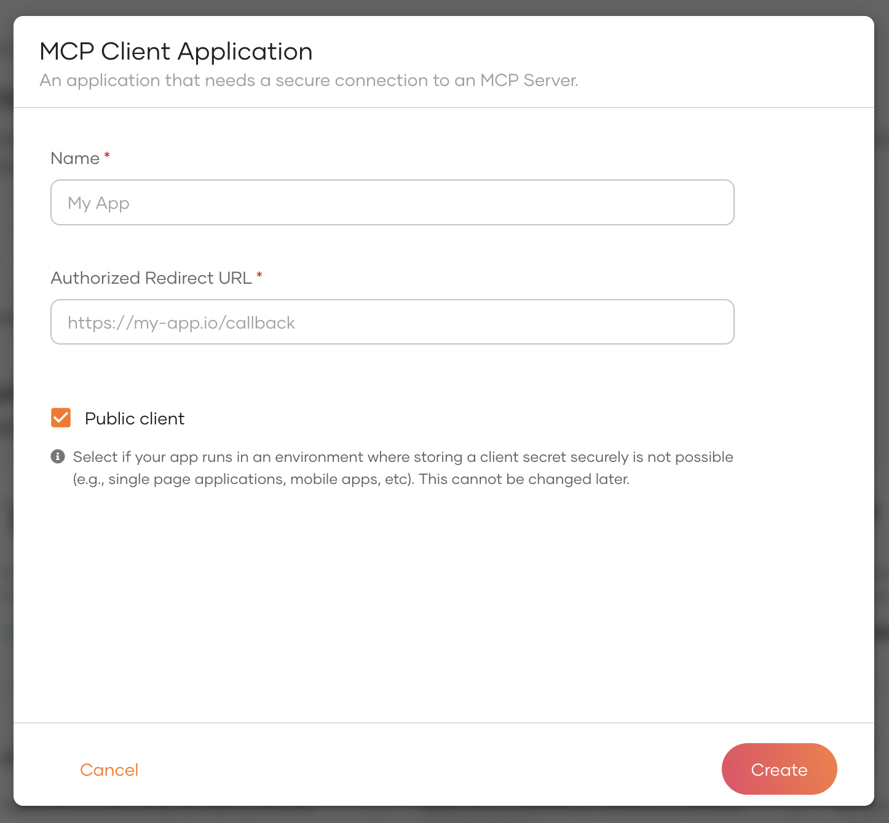

# Setting up MCP Clients

The Model Context Protocol (MCP) specification defines that authorization is initiated by MCP clients. These clients handle authorization flows, manage tokens and sessions with MCP servers, and provide end-user experiences based on user permissions.

<Applies to="WSO2 Cloud">

WSO2 Identity Platform provides an **MCP Client Application** template with default configurations to register an MCP client with minimal effort. This template has been configured to create an OAuth application that adheres to the guidelines and best practices outlined in the [MCP authorization specification](https://modelcontextprotocol.io/specification/2025-06-18/basic/authorization).

:::info[Other Application Types]

While the MCP Client Application template is optimized for MCP connections, MCP servers can also be accessed by most other application types in WSO2 Identity Platform, including Single Page Applications, Traditional Web Applications, Mobile Applications, and M2M Applications. The only exception is Digital Wallet applications, which cannot access MCP servers.

:::

</Applies>

<Applies to="Self-hosted">

WSO2 Identity Server provides an application template with default configurations to register an MCP client with minimal effort. This template has been configured to create an OAuth application that adheres to the guidelines and best practices outlined in the [MCP authorization specification](https://modelcontextprotocol.io/specification/2025-06-18/basic/authorization).

</Applies>

## Register an MCP Client Application

To regiser an MCP Client application,  

1. On WSO2 Identity Platform Console, go to **Applications** > **New Application** to navigate to the application template selection wizard.

    

2. Select **MCP Client Application**. The application creation wizard will appear.

    

    The MCP application creation wizard includes the following fields.

    <table>
    <thead>
        <tr>
        <th>Parameter</th>
        <th>Description</th>
        </tr>
    </thead>
    <tbody>
        <tr>
            <td>Name</td>
            <td>A unique name to identify your application.</td>
        </tr>
        <tr>
            <td>Authorized redirect URL</td>
            <td>The URL to which the authorization code is sent upon user authentication and where the user is redirected upon logout.</td>
        </tr>
        <tr>
            <td>Public client</td>
            <td>Keep this enabled if your MCP client application cannot securely store client secrets. (Eg: mobile apps, single page web apps etc).</td>
        </tr>
    </tbody>
    </table>

    !!!note
        MCP Authorization specification recommends that MCP clients should be public clients with authorization code grant flow enabled. However, if your MCP client runs on a server side environment where you can keep a secret, you can untick the *public client* option.

3. Click **Create** to complete the registration.

## What's next?

- [Obtain an M2M token using client credential grant](../../../references/grant-types.md#client-credentials-grant)

<Applies to="WSO2 Cloud">

- [End-to-end MCP Authorization with WSO2 Identity Platform](../../../tutorials/end-to-end-mcp-authorization-with-identity-platform.md)

</Applies>

<Applies to="Self-hosted">

- [Implement authorization code flow with PKCE](../../../guides/authentication/oidc/implement-auth-code-with-pkce.md)

</Applies>
