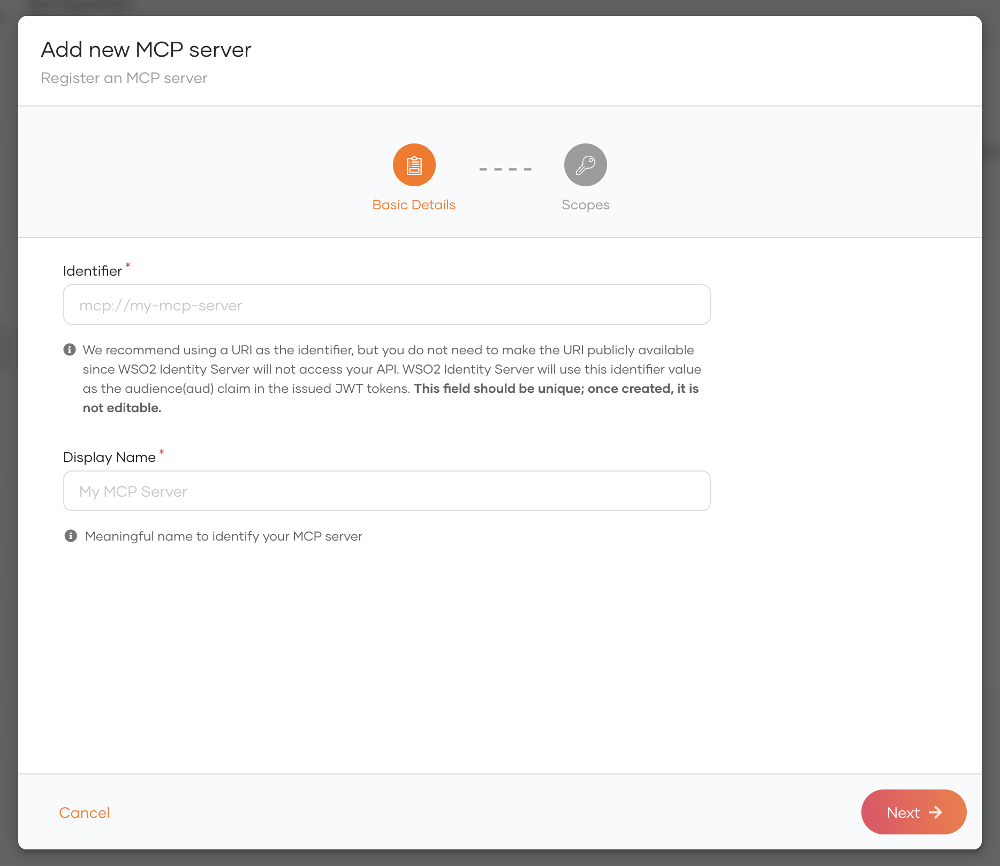
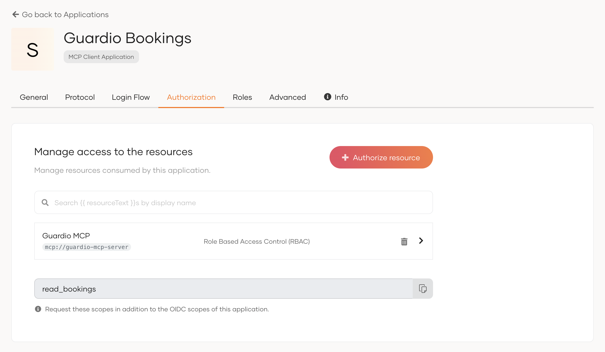

# Model Context Protocol (MCP) server authorization

Just like APIs, MCP (Model Context Protocol) servers need fine-grained access control so that only authorized users can access the tools they expose. WSO2 Identity Platform provides robust support for securing MCP servers, letting you configure access policies and monitor how users and applications interact with them.

## Register an MCP server

Organization administrators can define their MCP servers and configure scopes to enable fine-grained access control to the MCP server tools.

To register an MCP server,

1. On the WSO2 Identity Platform Console, go to **Resources** > **MCP Servers**.

2. Click **+ New MCP Server** to register a new MCP server.

    

3. Enter the following details and click **Next**.
    <table>
        <tr>
            <th>Parameter</th>
            <th>Description</th>
        </tr>
        <tr>
            <td><b>Identifier</b></td>
            <td>This value will be used as the <code>aud</code> attribute in the issued JWT token. Although any value is acceptable, it's recommended to use the URI of the MCP server.</td>
        </tr>
        <tr>
            <td><b>Display Name</b></td>
            <td>A meaningful name to identify your MCP server in WSO2 Identity Platform.</td>
        </tr>
    </table>

4. In the **Scopes** tab, enter the following details and click **Add Scope**. Repeat this for all scopes.

    <table>
        <tr>
            <th>Parameter</th>
            <th>Description</th>
        </tr>
        <tr>
            <td><b>Scope (Permission)</b></td>
            <td>Maps to an action in your MCP server. This value should match the scopes requested by your application.</td>
        </tr>
        <tr>
            <td><b>Display Name</b></td>
            <td>A meaningful name for your scope (permission). This will be displayed on your application's user consent page.</td>
        </tr>
        <tr>
            <td><b>Description</b></td>
            <td>A description for your scope (permission). This will be displayed on your application's user consent page.</td>
        </tr>
    </table>

5. Once done, click **Create** to complete the MCP server registration.

## Authorize apps to access MCP servers

Applications, by default, don't have permissions to access MCP servers. Administrators can selectively grant authorization for applications to use specific MCP servers, so that users logging into the application will have access to that MCP server, provided they're assigned to a role that grants the necessary permissions.

:::note

<Applies to="WSO2 Cloud">

MCP servers can be authorized to all OIDC application types including Custom OIDC applications, Traditional Web applications, Single-Page applications (SPA), Mobile applications, and Machine-to-Machine (M2M) applications. The [MCP Client Application](../../../guides/applications/register-mcp-client-app.md) template provides a pre-configured option for MCP-specific use cases. Digital Wallet applications can only access Verifiable Credential resources and cannot authorize MCP servers.

</Applies>

<Applies to="Self-hosted">

Currently MCP servers can only be authorized to applications that are created from the [MCP client Application](../../../guides/applications/register-mcp-client-app.md) template.

</Applies>

:::

    

To authorize an application to consume an MCP server,

1. On the WSO2 Identity Platform Console, go to **Applications**.

<Applies to="WSO2 Cloud">

2. Select your application and go to its **Authorization** tab.

</Applies>

<Applies to="Self-hosted">

2. Select the MCP client application and go to its **Authorization** tab.

</Applies>

3. Click **Authorize a resource**.

4. Enter the following details:
    <table>
        <tr>
            <th>Parameter</th>
            <th>Description</th>
        </tr>
        <tr>
            <td><b>Resource</b></td>
            <td>Select the MCP server from the list of resources</td>
        </tr>
        <tr>
            <td><b>Authorized Scopes</b></td>
            

            <Applies to="WSO2 Cloud">

            <td>Select the scopes that the application should be able to request.</td>

            </Applies>

            

            <Applies to="Self-hosted">

            <td>Select the scopes that the MCP client should be able to request.</td>

            </Applies>

            
        </tr>
    </table>

5. Click **Finish**.

    
