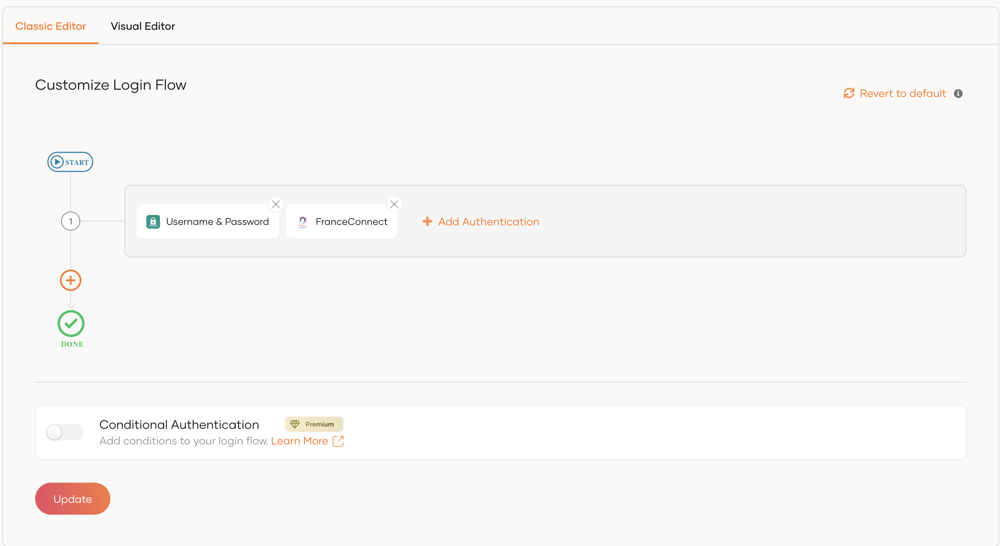
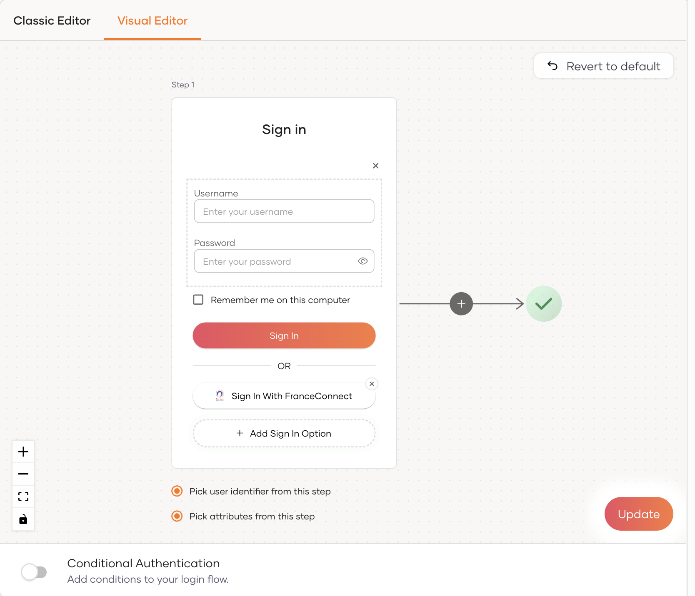
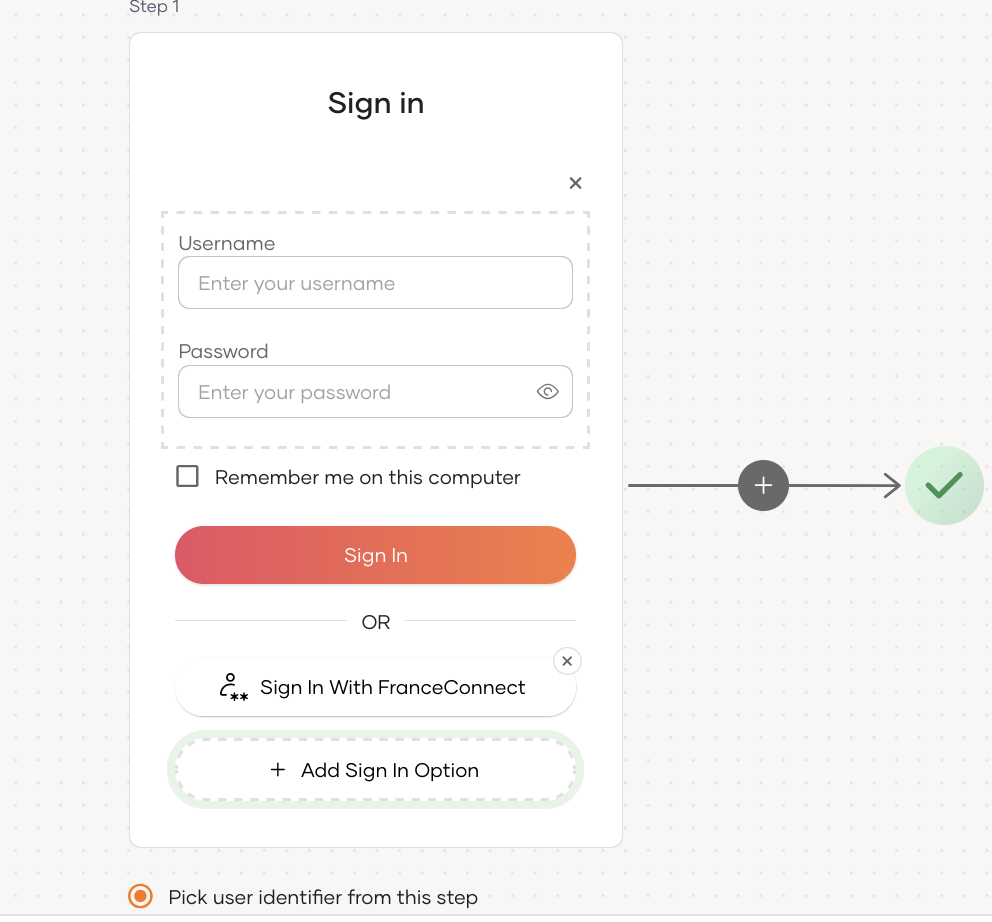

import Recommendation from '../recommendation.mdx';

:::note[Before you begin]

You need to [register an application with WSO2 Identity Platform](../../../../../guides/applications/index.md). You can register your own application or use one of the [sample applications](../../../../../get-started/try-samples/index.md) provided.

:::

1. On the WSO2 Identity Platform Console, go to **Applications**.
2. Select your application, go to the **Login Flow** tab and add FranceConnect login from your preferred editor:

    

    <Applies to="WSO2 Cloud">

    <Tabs>
    <TabItem value="tab-0" label="Classic Editor">

    To add FranceConnect login using the Classic Editor:

     1. If you haven't already defined a sign-in flow, click **Start with Default configuration** to get started.
     2. Click **Add Authentication** on the step, select your FranceConnect identity provider, and click **Add**.
        

    </TabItem>
    <TabItem value="tab-1" label="Visual Editor">

    To add FranceConnect login using the Visual Editor:

    1. Switch to the **Visual Editor** tab, by default the `Username & Password` login flow will be added onto the Visual Editor's workspace.
    2. Click on `+ Add Sign In Option` to add a new authenticator to the same step and select your FranceConnect connection.
      

    </TabItem>
    </Tabs>

    ---

    </Applies>

    

    <Applies to="Self-hosted">

    1. Click **Add Sign In Option** to add a new authenticator to the first step.

    2. Select the FranceConnect connection.

    3. Click **Confirm** to add login with FranceConnect to the sign-in flow.

      

    </Applies>

    

    <Recommendation />

3. Click **Update** to save your changes.
