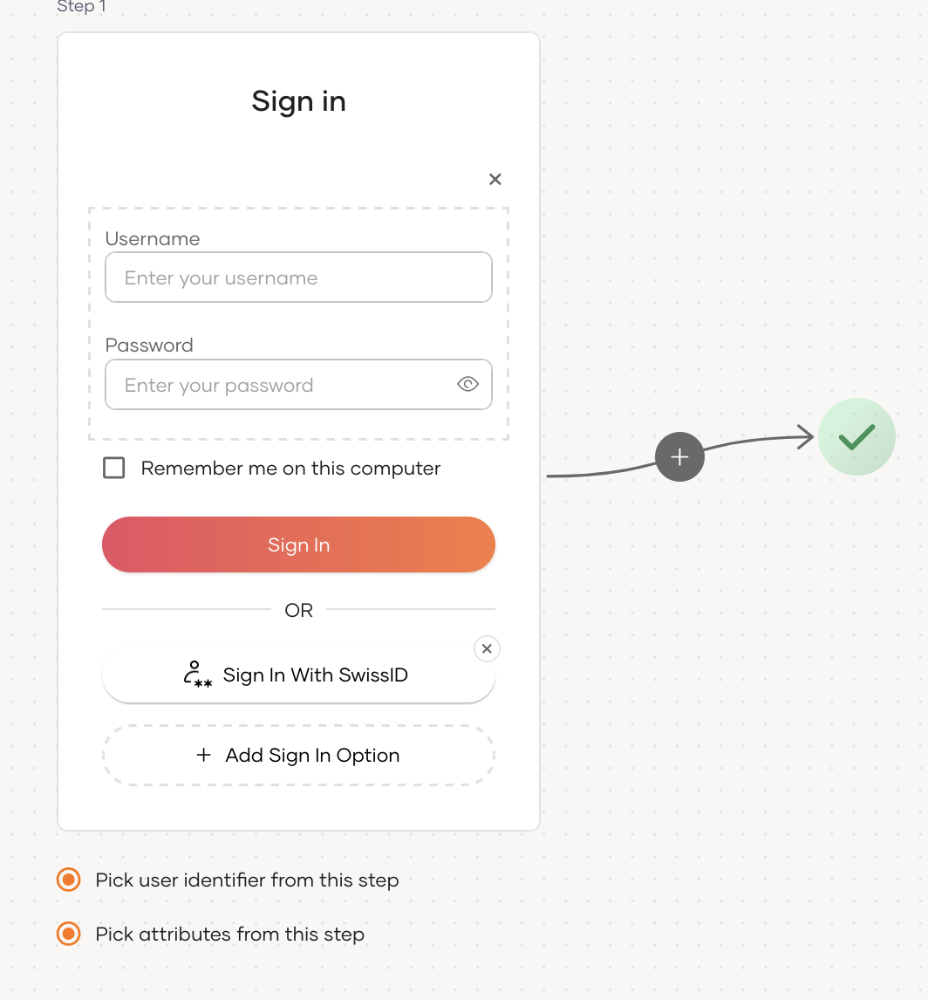

:::note[Before you begin]

You need to [register an application with WSO2 Identity Platform](../../../../../guides/applications/index.md). You can register your own application or use one of the [sample applications](../../../../../get-started/try-samples/index.md) provided.

:::

1. On the WSO2 Identity Platform Console, go to **Applications**.
2. Select your application, go to the **Login Flow** tab and add SwissID login from your preferred editor:

    1. Click **Add Sign In Option** to add a new authenticator to the first step.

    2. Select the SwissID connection.

    3. Click **Confirm** to add login with SwissID to the sign-in flow.

       

3. Click **Update** to save your changes.
