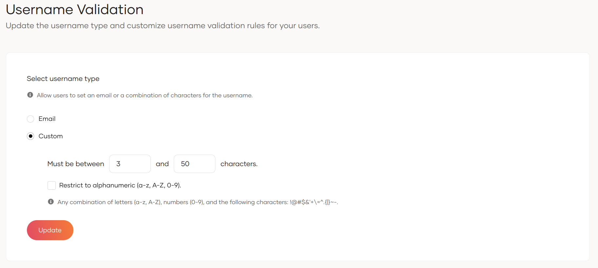

# Configure username validation

Your WSO2 Identity Platform organization could allow a user to log in with a custom alphanumeric username instead of an email address.

Follow the steps given below to change the username type for the users.

1. On the WSO2 Identity Platform Console, go to **Login & Registration**.
2. Under **Login Identifier**, click on **Username Validation**
3. Select **Custom** and configure the minimum and maximum length for a username.

    :::info[Use special characters in usernames]

    WSO2 Identity Platform allows the use of the following special characters for custom usernames: `! @ # $ & ' + \ = ^ . { | } ~ -`

    To enable the usage of special characters uncheck the **Restrict to alphanumeric (a-z, A-Z, 0-9)** checkbox.

    

    :::

4. Click **Update** to save the changes.

:::warning

If you select **Custom** as the username type, and not make the **Email** attribute mandatory for users, the following features will not be available for users who do not configure an email address.

- Email Notifications
- Password recovery
- Authentication with Magic Link, Email OTP

Learn how to [update attribute properties](/identity/guides/users/attributes/manage-attributes/#update-attributes).

:::
