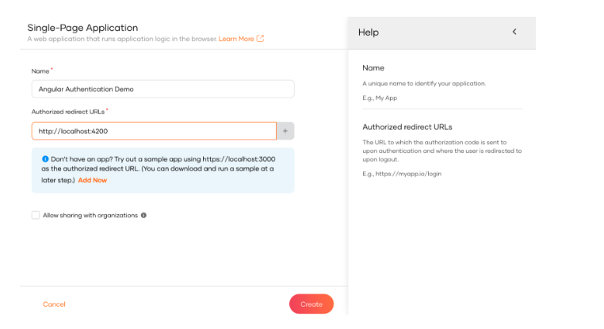

<Applies to="WSO2 Cloud">

First unless you already have done that, you need to create an organization in WSO2 Identity Platform and register your application as a single page application.

* Sign up for a [free WSO2 Identity Platform account](../../get-started/create-identity-platform-account.md)

* Sign into WSO2 Identity Platform console and navigate to **Applications > New Application.**
* Select **Single Page Application**

  

Next, complete the wizard popup by providing a suitable name and an authorized redirect URL.

:::note

name: asgardeo-angular

Authorized redirect URL: http://localhost:4200

:::

:::info

The authorized redirect URL determines where WSO2 Identity Platform should send users after they successfully log in. Typically, this will be the web address where your app is hosted. For this guide, we'll use [http://localhost:4200](http://localhost:4200), as the sample app will be accessible at this URL.

:::

Make a note of the following values from the **Protocol** and **Info** tabs of the registered application. You will need them to configure the authentication SDK

* **`client-id`** from the **Protocol** tab.
* **`issuer`** from the **Info** tab.

In this step, we have ve registered our Angular app as an application in the WSO2 Identity Platform console and generated the required metadata. Next, we will create a Angular app.

</Applies>

<Applies to="Self-hosted">

First unless you already have done that, you need to create an organization in WSO2 Identity Server and register your application as a single page application.

* Download and [setup WSO2 Identity Server](../../get-started/quick-set-up.md) 

* Sign into WSO2 Identity Server console and navigate to **Applications > New Application.**
* Select **Single Page Application**

  

Next, complete the wizard popup by providing a suitable name and an authorized redirect URL.

:::note

name: is-angular

Authorized redirect URL: http://localhost:4200

:::

:::info

The authorized redirect URL determines where WSO2 Identity Server should send users after they successfully log in. Typically, this will be the web address where your app is hosted. For this guide, we'll use [http://localhost:4200](http://localhost:4200), as the sample app will be accessible at this URL.

:::

Make a note of the following values from the **Protocol** and **Info** tabs of the registered application. You will need them to configure the authentication SDK

* **`client-id`** from the **Protocol** tab.
* **`issuer`** from the **Info** tab.

In this step, we have ve registered our Angular app as an application in the WSO2 Identity Server console and generated the required metadata. Next, we will create a Angular app.

</Applies>
