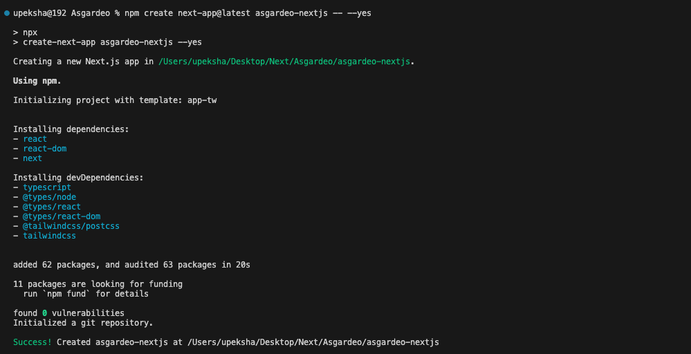
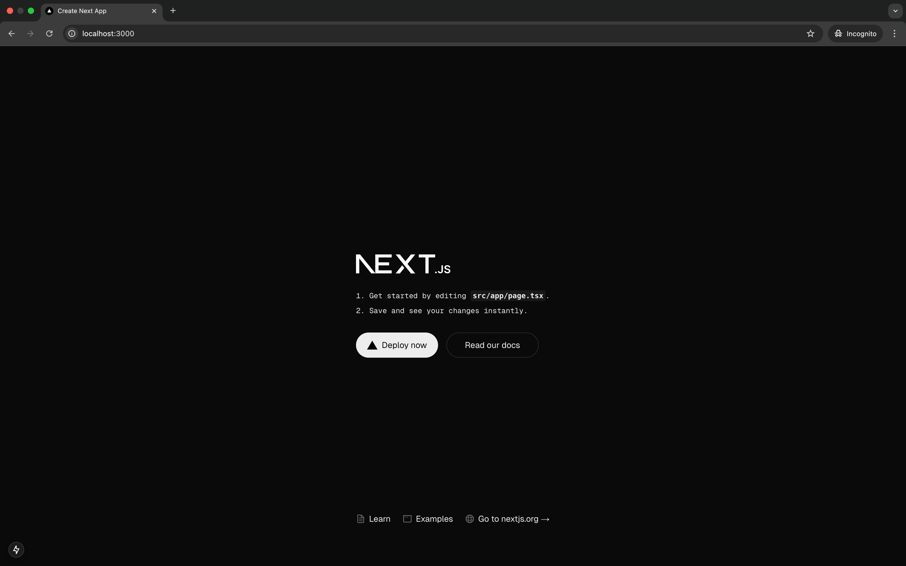

For this guide, we will walk you through setting up a simple Next.js application.

Open a terminal, change directory to where you want to initialize the project, and run the following command to create your first Next.js sample app.

Running the above command will generate a new folder named <DeploymentValue cloud="asgardeo" selfHosted="is" />-nextjs, containing a ready-to-use Next.js project set up with TypeScript. The project includes a development server that automatically reloads the app whenever changes are made.

<Tabs>
<TabItem value="tab-0" label="npm">


```bash
npm create next-app@latest <PRODUCT>-nextjs -- --yes
```

</TabItem>
<TabItem value="tab-1" label="yarn">


```bash
yarn create next-app@latest <PRODUCT>-nextjs -- --yes
```

</TabItem>
<TabItem value="tab-2" label="pnpm">


```bash
pnpm create next-app@latest <PRODUCT>-nextjs -- --yes
```

</TabItem>
</Tabs>

Once this command is executed, if everything goes smoothly, your terminal output should resemble the following.



Once the application is created, navigate to the app folder. Then run the sample in the development mode. This allows you to see real-time updates and debug the app as you make changes.

<Tabs>
<TabItem value="tab-0" label="npm">


```bash
cd <PRODUCT>-nextjs
npm run dev
```

</TabItem>
<TabItem value="tab-1" label="yarn">


```bash
cd <PRODUCT>-nextjs
yarn dev
```

</TabItem>
<TabItem value="tab-2" label="pnpm">


```bash
cd <PRODUCT>-nextjs
pnpm dev
```

</TabItem>
</Tabs>

This will start the Next.js development server, typically at [http://localhost:3000](http://localhost:3000), and you should see the default Next.js starter page. Confirm that everything is set up correctly by checking for the terminal output indicating that the server is running.



At this point, you have a simple yet fully functional Next.js app. Now, it's time to integrate user authentication within the application. For this guide, we will be using the auth.js library, which provides a simple and secure way to handle authentication in Next.js apps.
