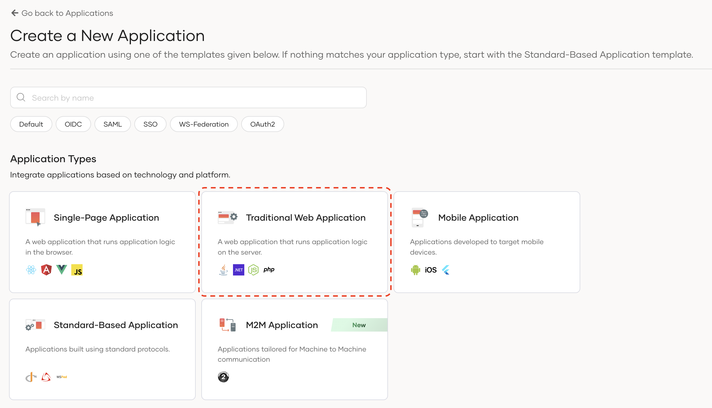
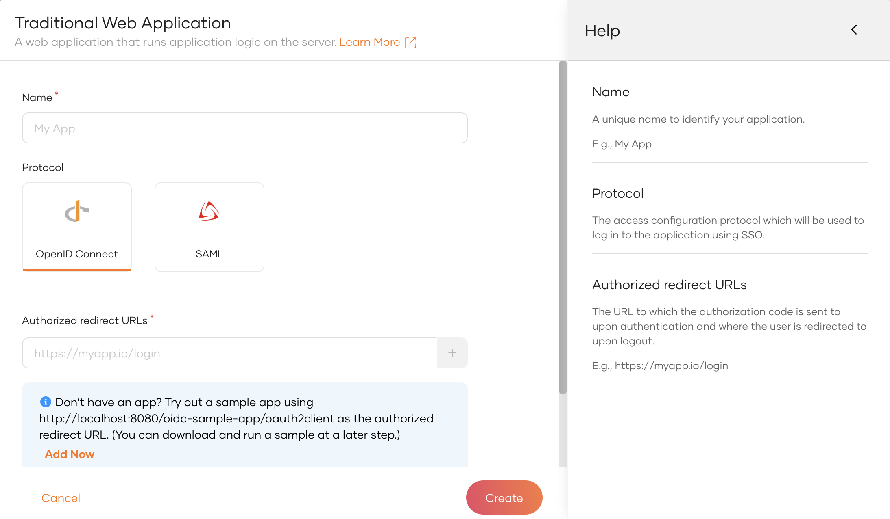
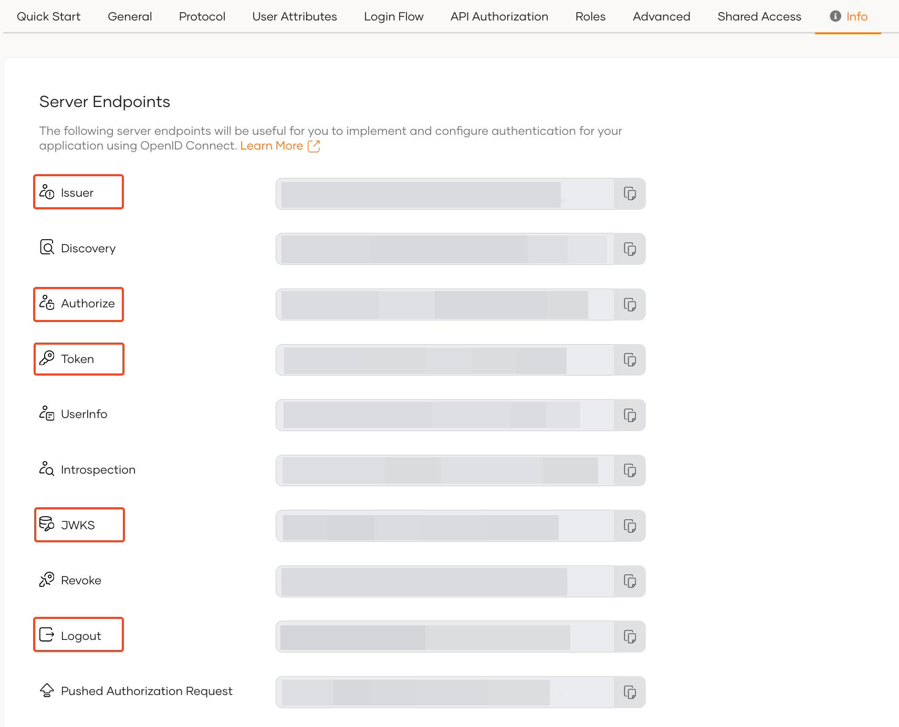

<Applies to="WSO2 Cloud">

If you have not already done so, you will need to create an organization in WSO2 Identity Platform and register your application as given below.

* Sign up for a [free WSO2 Identity Platform account](../../get-started/create-identity-platform-account.mdx)


* Sign into WSO2 Identity Platform console and navigate to **Applications > New Application.**
* Select **Traditional Web Application** (*Make sure that the protocol remains set to OpenID Connect (OIDC)*)



Next, complete the wizard popup by providing a suitable name, a suitable protocol, and the authorized redirect URLs. You also have the option to share the application across all organizations, which can be set according to your preference.

:::note


Name: `wso2-dotnet`

Protocol: `OIDC`

Authorized redirect URLs:

`https://localhost:5001/signout-callback-oidc`

`https://localhost:5001/signin-oidc`

:::



:::info


The authorized redirect URL determines where WSO2 Identity Platform should send users after they successfully log in. Typically, this will be the web address where your app is hosted. For this guide, we'll use `https://localhost:5001/signin-oidc` and `https://localhost:5001/signout-callback-oidc`. You would need to allow CORS for these URLs accordingly (which will be prompted).

:::

Once the application is created, let's configure the `Allowed origins` with the following URL:

```shell
https://localhost:5001
```

You will need the following information available in the `Quick Start` tab of your application or the `Protocol` tab to configure in the .NET application.

* Client ID
* Client Secret


Additionally, please take a note of the following endpoints that are available in the `Info` tab of your application.

* Issuer
* Authorize
* JWKS
* Logout



In this step, we have registered our .NET app as an application in the WSO2 Identity Platform console and generated the required metadata. Next, we will create a .NET Blazor Web Application.

</Applies>


<Applies to="Self-hosted">

* Sign into WSO2 Identity Server console and navigate to **Applications > New Application.**
* Select **Traditional Web Application** (*Make sure that the protocol remains set to OpenID Connect (OIDC)*)


Next, complete the wizard popup by providing a suitable name, a suitable protocol, and the authorized redirect URLs. You also have the option to share the application across all organizations, which can be set according to your preference.

:::note


Name: `wso2-dotnet`

Protocol: `OIDC`

Authorized redirect URLs:

`https://localhost:5001/signout-callback-oidc`

`https://localhost:5001/signin-oidc`

:::


:::info


The authorized redirect URL determines where WSO2 Identity Server should send users after they successfully log in. Typically, this will be the web address where your app is hosted. For this guide, we'll use `https://localhost:5001/signin-oidc` and `https://localhost:5001/signout-callback-oidc`. You would need to allow CORS for these URLs accordingly (which will be prompted).

:::

Once the application is created, let's configure the `Allowed origins` with the following URL:

```shell
https://localhost:5001
```

You will need the following information available in the `Quick Start` tab of your application or the `Protocol` tab to configure in the .NET application.

* Client ID
* Client Secret


Additionally, please take a note of the following endpoints that are available in the `Info` tab of your application.

* Issuer
* Authorize
* JWKS
* Logout


In this step, we have registered our .NET app as an application in the WSO2 Identity Server console and generated the required metadata. Next, we will create a .NET Blazor Web Application.

</Applies>
