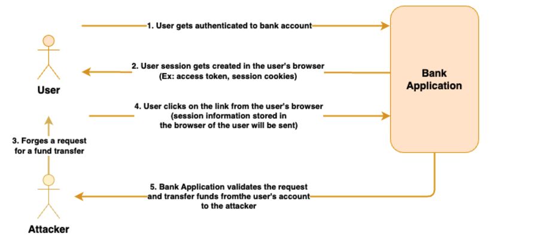

Cross-Site Request Forgery (CSRF) is an attack where an attacker tricks a user into performing unwanted actions on a web application where they are authenticated. This can lead to unauthorized actions being executed on behalf of the user, such as changing account details or making transactions.

CSRF exploits the trust that a web application has in the user's browser. If an application relies solely on cookies for authentication, an attacker can craft a request to the application from a different site, using the authenticated user's credentials to perform malicious actions.

To mitigate CSRF attacks:

1. Include a unique, unpredictable token in each request, also referred to as CSRF token. The server should validate this token to ensure the request is legitimate.
2. Set cookies with the SameSite attribute to Strict or Lax to prevent them from being sent in cross-site requests.
