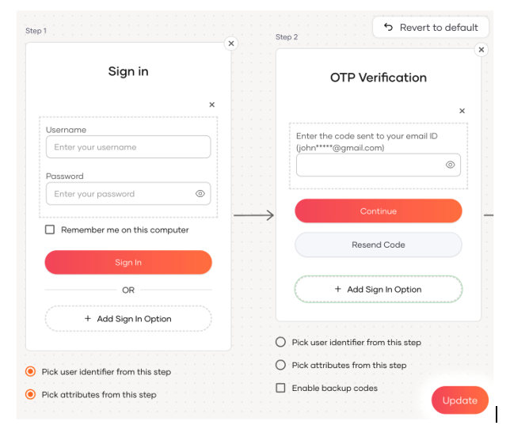

Multi-factor authentication (MFA) is essential in any application to enhance security by requiring multiple forms of verification from the user, reducing the risk of unauthorized access.

If you're using OIDC with PKCE and the WSO2 Identity Platform SDK for login, you can easily add the necessary [multi-factor authentication](../../guides/authentication/mfa/index.md) steps within the application configuration in WSO2 Identity Platform. You can also implement [conditional authentication](../../guides/authentication/conditional-auth/index.md) logic to tailor the login process based on risk factors, without requiring any changes to the SDK—simply configure it in the WSO2 Identity Platform console.

Additionally, WSO2 Identity Platform offers [App-Native authentication](../../guides/authentication/app-native-authentication/index.md), allowing you to create your own user interfaces while handling authentication via REST APIs. In this case, you must follow the [API specifications](../../references/app-native-authentication.md) and incorporate all required MFA steps to complete the authentication process. If the authentication flow involves a federated IdP, you'll also need to manage IdP redirection accordingly.
