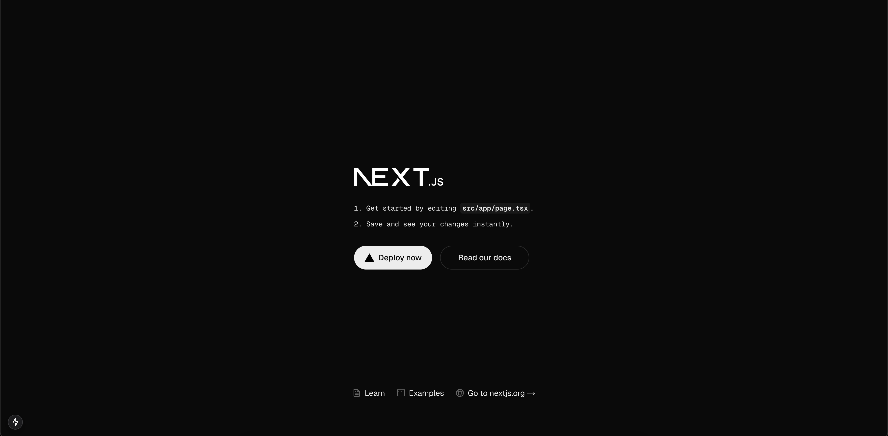

Let’s walk through setting up a Next.js application. Next.js is a React framework that simplifies creating web applications with features like server-side rendering (SSR) and static site generation (SSG).

Open a terminal, navigate to the directory where you'd like to create your project, and run the following command to set up a Next.js project:

Running the below command will generate a new folder named Teamspace, containing a ready-to-use Next.js project set up with TypeScript. The project includes a development server that automatically reloads the app whenever changes are made.

<Tabs>
<TabItem value="tab-0" label="npm">


```bash
npm create next-app@latest teamspace -- --yes
```

</TabItem>
<TabItem value="tab-1" label="yarn">


```bash
yarn create next-app@latest teamspace -- --yes
```

</TabItem>
<TabItem value="tab-2" label="pnpm">


```bash
pnpm create next-app@latest teamspace -- --yes
```

</TabItem>
</Tabs>

Once the application is created, navigate to the app folder. Then run the sample in the development mode. This allows you to see real-time updates and debug the app as you make changes.

<Tabs>
<TabItem value="tab-0" label="npm">


```bash
cd teamspace
npm run dev
```

</TabItem>
<TabItem value="tab-1" label="yarn">


```bash
cd Teamspace
yarn dev
```

</TabItem>
<TabItem value="tab-2" label="pnpm">


```bash
cd Teamspace
pnpm dev
```

</TabItem>
</Tabs>

This will start the Next.js development server, typically at [http://localhost:3000](http://localhost:3000), and you should see the default Next.js starter page. Confirm that everything is set up correctly by checking for the terminal output indicating that the server is running.



At this point, you have a simple Next.js app. Now, it's time to integrate WSO2 Identity Platform within the application.
