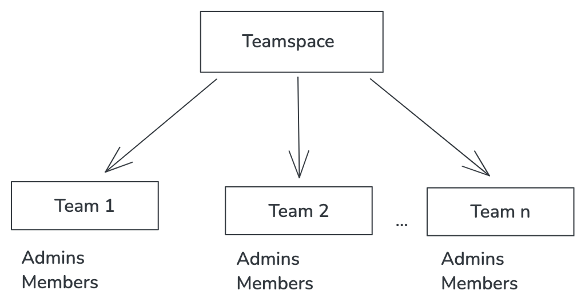

## Introduction

In today's business landscape, organizations need efficient ways to manage their teams, control access to resources, and handle user permissions across different organizational units. Building a B2B application that handles these requirements securely and efficiently can be challenging.

This guide demonstrates how to build a B2B team management application using **Next.js** and **WSO2 Identity Platform**. The application enables users to create and switch into teams, send user invitations, and manage access levels, all while maintaining security best practices.

## Learning Objectives

1. Register an application in WSO2 Identity Platform
2. Give access to API resources and create roles
3. Create a Next.js app
4. Configure app for login
5. Add user self sign up
6. Add login and logout
7. Manage teams
8. Switch to a team
9. Manage team members

## Use Case

Let's explore a use case to set the context for this guide.

"Teamspace" is an application designed to manage team spaces. It provides functionalities for adding multiple teams, switching into teams, and adding team members.

In Teamspace, each team is represented as an organization under the root organization. This hierarchical structure allows for multiple teams, each with their own administrators and members.

**Organizational hierarchy:**

Team 1, team2, ...team (n) etc are considered as organizations under the root organization, Teamspace.

:::tip[Tip]

This guide takes approximately 60 minutes to complete and covers managing organizations and users within an app. If you’re looking for a shorter guide, try the [Next.js Quick Start guide](../../quick-starts/nextjs.md), which takes around 15 minutes to complete, or the [Next.js Complete Guide.](../nextjs/introduction.md)

:::
