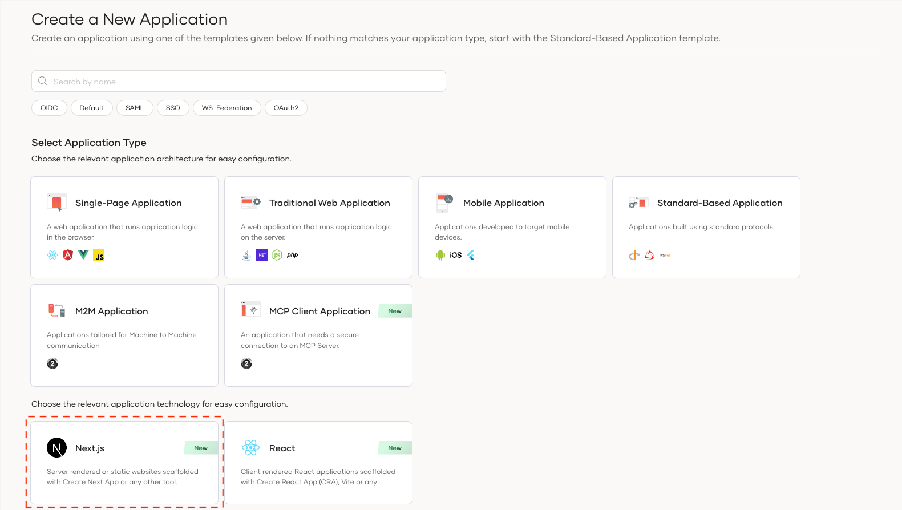
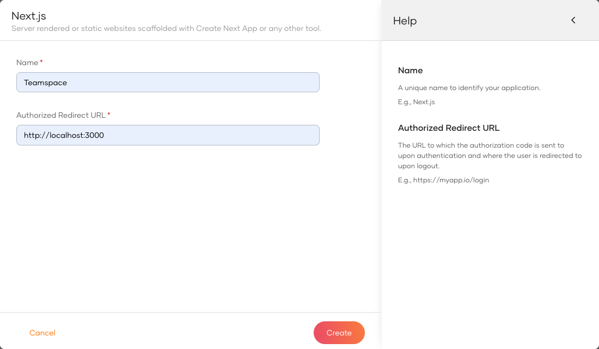
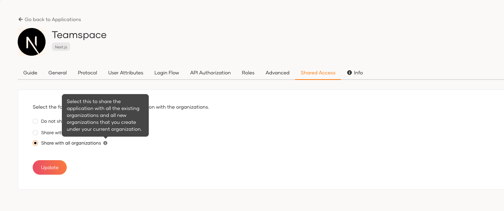
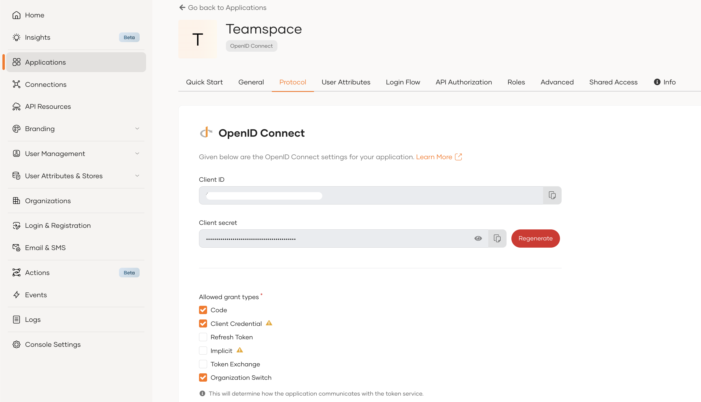

First unless you already have done that, you need to create an organization in WSO2 Identity Platform and register your Teamspace application as a Next Application.

1. Sign up for a [free WSO2 Identity Platform account](../../get-started/create-identity-platform-account.mdx)
2. Sign into WSO2 Identity Platform console and navigate to **Applications > New Application.**
3. Select **Next.js**

      

4. complete the wizard popup by providing a suitable name and an authorized redirect URL.

    :::note

    Name: Teamspace

    Authorized redirect URL: http://localhost:3000

    :::

    

    :::info


    The authorized redirect URL determines where WSO2 Identity Platform should send users after they successfully log in. Typically, this will be the web address where your application is hosted. For this guide, we'll use http://localhost:3000, as the sample application will be accessible at this URL

    :::

5. Make a note of the following values from the **Guide** tab of the registered application. You will need them to configure the WSO2 Identity Platform provider.

    ```bash
    NEXT_PUBLIC_ASGARDEO_BASE_URL="https://api.asgardeo.io/t/<your-org-name>"
    NEXT_PUBLIC_ASGARDEO_CLIENT_ID="<your-app-client-id>"
    ASGARDEO_CLIENT_SECRET="<your-app-client-secret>"
    ```

6. Navigate to the 'Shared Access' tab and select 'Share with all organizations'.

    

## Allow required grant types

To ensure seamless authentication and authorization in the Teamspace application, you must allow the necessary OAuth2 grant types in WSO2 Identity Platform. These grant types allow your app to authenticate users, retrieve access tokens, and interact with WSO2 Identity Platform’s APIs securely.

### Required Grant Types for Teamspace

Based on the features we are expecting to implement, the following grant types are enabled:

- **Authorization Code Grant** – Used for user authentication and obtaining access tokens interactively.
- **Client Credentials Grant** – Allows the app to make API calls on behalf of the organization (used for retrieving a root organization token).
- **Organization Switch Grant** – Enables switching between organizations.

### How to Enable Grant Types

1. Navigate to your application in the WSO2 Identity Platform console.
2. Click on "Protocols" tab
3. Allow the above grant types and update

  

:::info

Read more on [OAuth2 grant types](../../references/grant-types.mdx)

:::
