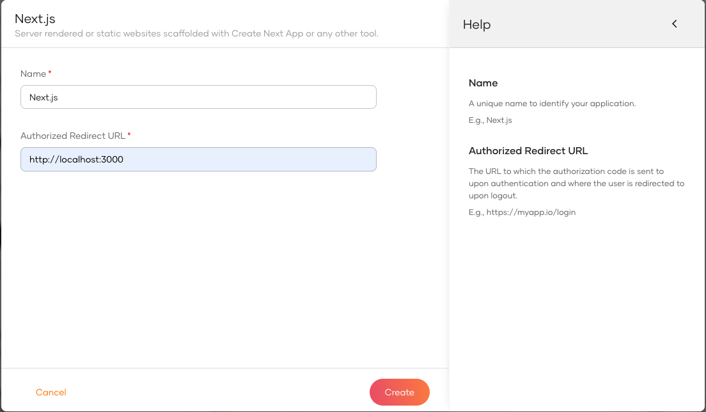

<Applies to="WSO2 Cloud">

First unless you already have done that, you need to create an organization in WSO2 Identity Platform and register your application as a Next Application.

* Sign up for a [free WSO2 Identity Platform account](../../get-started/create-identity-platform-account.md)
* Sign into WSO2 Identity Platform console and navigate to **Applications > New Application.**
* Select **Next.js**

  

Next, complete the wizard popup by providing a suitable name and an authorized redirect URL.

:::note

name: asgardeo-nextjs

Authorized redirect URL: http://localhost:3000

:::



:::info


The authorized redirect URL determines where WSO2 Identity Platform should send users after they successfully log in. Typically, this will be the web address where your application is hosted. For this guide, we'll use http://localhost:3000, as the sample application will be accessible at this URL

:::

Make a note of the following values from the **Guide** tab of the registered application. You will need them to configure the WSO2 Identity Platform provider.

```bash
NEXT_PUBLIC_ASGARDEO_BASE_URL="https://api.asgardeo.io/t/<your-org-name>"
NEXT_PUBLIC_ASGARDEO_CLIENT_ID="<your-app-client-id>"
ASGARDEO_CLIENT_SECRET="<your-app-client-secret>"
```


In this step, we have registered our Next.js app as an application in the WSO2 Identity Platform console and generated the required metadata. Next, we will create a Next.js app.

</Applies>


<Applies to="Self-hosted">

First unless you already have done that, you need to register your application as a Traditional Web Application.

* Download and [setup WSO2 Identity Server](../../get-started/quick-set-up.md)
* Sign into WSO2 Identity Server console and navigate to **Applications > New Application.**
* Select **Traditional Web Application** (*Make sure that the protocol remains set to OpenID Connect (OIDC)*)

  

Next, complete the wizard popup by providing a suitable name and an authorized redirect URL.

:::note

name: is-nextjs

Authorized redirect URL: http://localhost:3000

:::


:::info


The authorized redirect URL determines where Asgardeo should send users after they successfully log in. Typically, this will be the web address where your application is hosted. For this guide, we'll use http://localhost:3000, as the sample application will be accessible at this URL

:::

Make a note of the following values from the **Protocol** and **Info** tabs of the registered application. You will need them to configure the Asgardeo provider.

* **`client-id`** from the **Protocol** tab.
* **`client-secret`** from the **Protocol** tab.
* **`issuer`** from the **Info** tab.


In this step, we have registered our Next.js app as an application in the WSO2 Identity Server console and generated the required metadata. Next, we will create a Next.js app.

</Applies>
