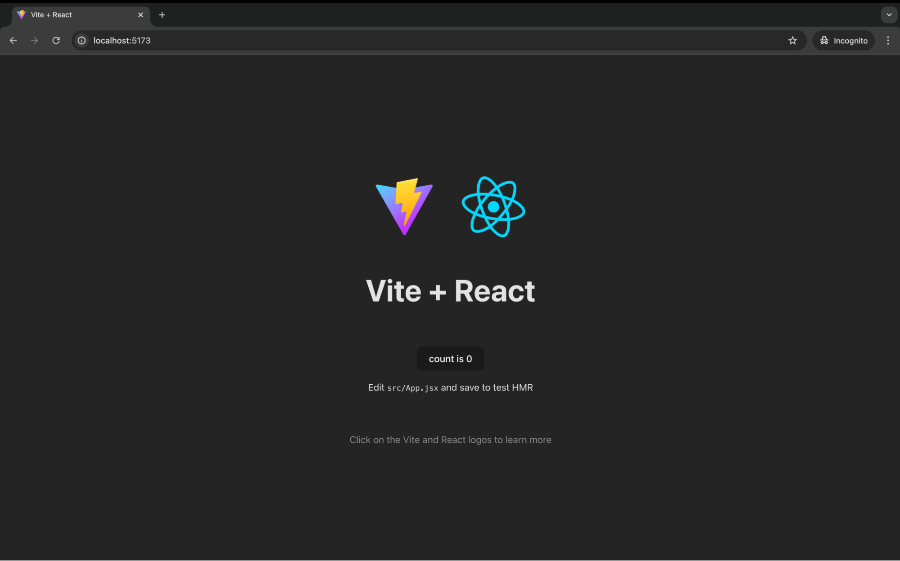

For this guide, you will be creating a simple React app using [Vite](https://vitejs.dev/), a modern, fast and lightweight tool that helps you quickly set up and develop modern JavaScript apps.

Open a terminal, change directory to where you want to initialize the project, and run the following command to create your first React sample app.

<Tabs>
<TabItem value="tab-0" label="npm">


```bash
npm create vite@latest <PRODUCT>-react -- --template react
```

</TabItem>
<TabItem value="tab-1" label="yarn">


```bash
yarn create vite@latest <PRODUCT>-react -- --template react
```

</TabItem>
<TabItem value="tab-2" label="pnpm">


```bash
pnpm create vite@latest <PRODUCT>-react -- --template react
```

</TabItem>
</Tabs>

Running this command will create a folder with a ready-to-run boilerplate React project, with a development server to run the project and instantly reload changes to the project in your browser without manual refresh.

Once the application is created, install the dependencies using the following command.

<Tabs>
<TabItem value="tab-0" label="npm">


```bash
cd <PRODUCT>-react
npm install
```

</TabItem>
<TabItem value="tab-1" label="yarn">


```bash
cd <PRODUCT>-react
yarn install
```

</TabItem>
<TabItem value="tab-2" label="pnpm">


```bash
cd <PRODUCT>-react
pnpm install
```

</TabItem>
</Tabs>

Then run the sample in the development mode. This allows you to see real-time updates and debug the app as you make changes.

<Tabs>
<TabItem value="tab-0" label="npm">


```bash
npm run dev
```

</TabItem>
<TabItem value="tab-1" label="yarn">


```bash
yarn dev
```

</TabItem>
<TabItem value="tab-2" label="pnpm">


```bash
pnpm dev
```

</TabItem>
</Tabs>

Confirm that the dev server is up and running by verifying the output in the terminal. Then, navigate to [http://localhost:5173](http://localhost:5173)  and you should see the sample app working in the browser.



At this point, you have a simple yet fully functional React app. In the next step, let’s try to integrate an OIDC SDK with the app.
