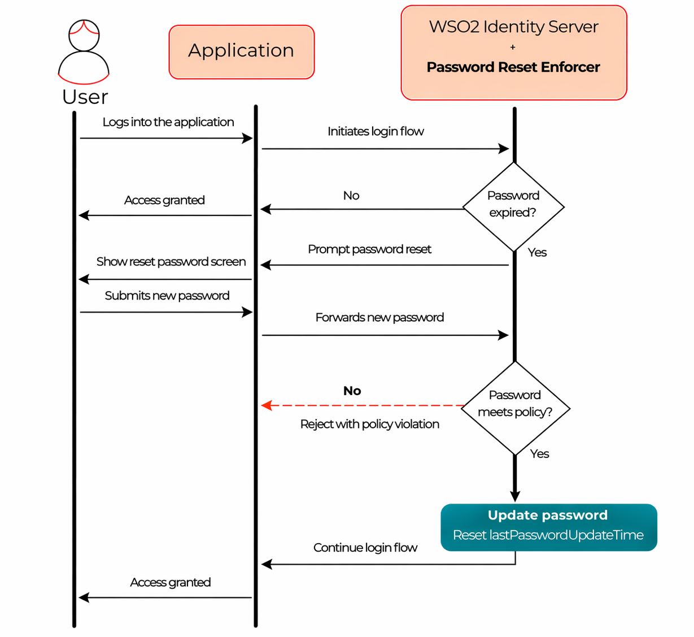

# Password Reset Enforcer

Password Reset Enforcer lets you enforce password reset upon expiration as part of an application's authentication flow. When a user signs in with an expired password, WSO2 Identity Server redirects the user to the password reset screen before completing authentication.

You can use this connector to:

- Ensure users update passwords on a defined schedule.
- Block access to an application until the user resets an expired password.
- Apply your organization’s password validation rules during password reset.

Configure password expiration rules from the WSO2 Identity Server Console. For instructions, see [Password validation](../../guides/account-configurations/login-security/password-validation.mdx).

How it works,

- A user starts a sign-in flow to your application.
- WSO2 Identity Server evaluates password expiration based on your configured password expiration rules.
- If the password has expired, WSO2 Identity Server shows the password reset screen.
- After the user resets the password successfully, WSO2 Identity Server continues the authentication flow.
