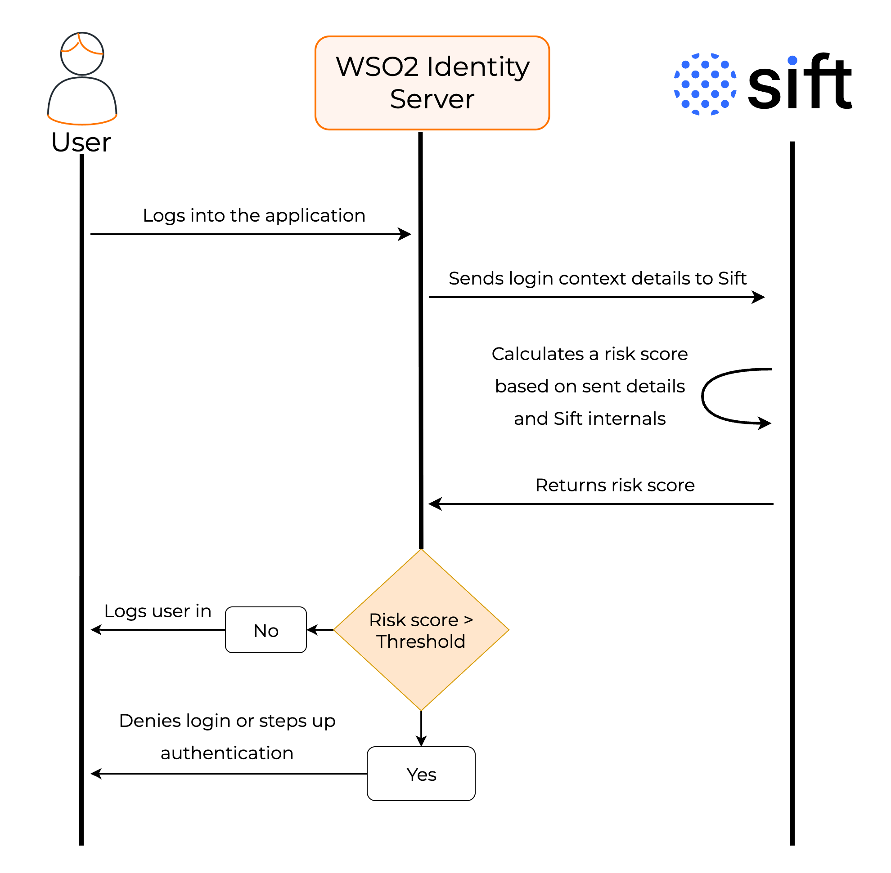
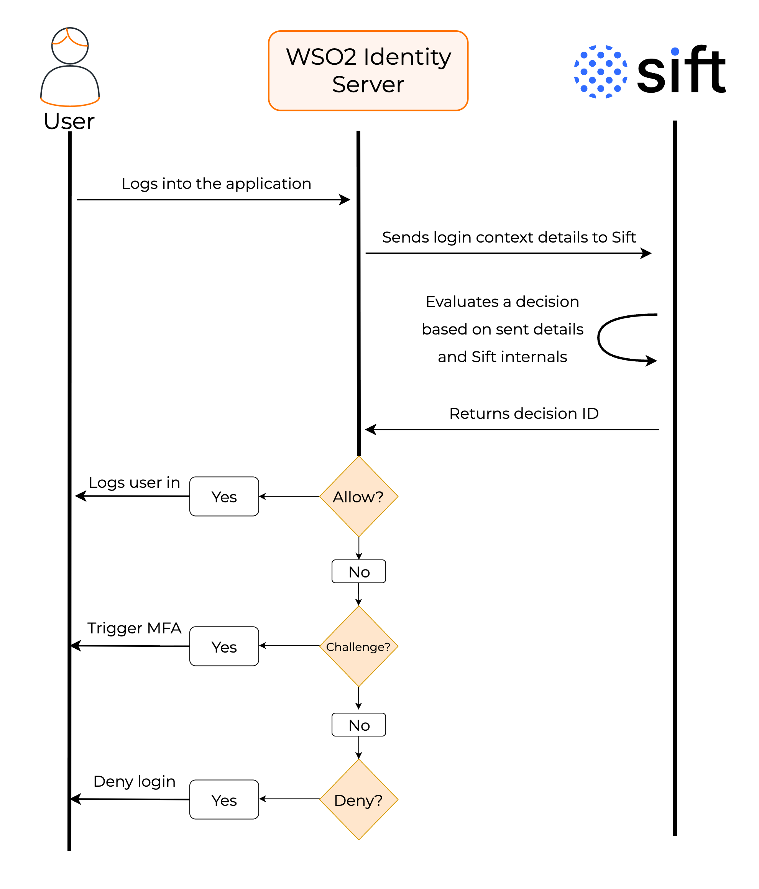

# Sift

[Sift](https://sift.com/) helps businesses prevent fraud, abuse, and account takeovers by analyzing user behavior and contextual data in real time. By combining signals like device fingerprinting, IP reputation, and behavioral patterns, Sift creates a dynamic risk score that helps businesses make smarter decisions and reduce false positives.

You can integrate WSO2 Identity Server with Sift to assess the risk level of login attempts. During authentication, WSO2 Identity Server sends relevant contextual data to Sift. Sift then evaluates the request and returns either a risk score or a decision ID. Based on this response, you can decide to:

- Allow the login.
- Deny the login.
- Trigger additional verification (e.g., MFA).

The following sections describe two common use cases for integrating WSO2 Identity Server with Sift.

## Decide based on risk score

Based on the login context data sent to Sift, it calculates a risk score, where a higher score indicates a higher likelihood of fraud.

You can configure WSO2 Identity Server to deny or step up authentication when the risk score of a login request exceeds a defined threshold.

How it works,

- When a user attempts to log in, WSO2 Identity Server sends the relevant contextual data such as IP address, device details, geolocation, to Sift.

- Sift analyzes these attributes along with its own data and calculates a risk score.

- Sift returns this value to WSO2 Identity Server.

- Based on the configured threshold, WSO2 Identity Server executes a predefined action:
  - Allow login if the score is within acceptable limits.
  - Deny login or enforce additional MFA if the score exceeds the threshold.

## Decide based on decision ID

You can use [Sift workflows](https://developers.sift.com/tutorials/workflows) to define decisions based on risk factors including the risk score.

Based on the login context data sent to Sift, it returns a decision ID instead of the raw risk score. This decision ID corresponds to a predefined action in the Sift console, such as `allow`, `deny`, or `challenge`.

By using decision IDs, organizations can offload complex risk logic to Sift, keeping WSO2 Identity Server policies cleaner and more maintainable. This approach also allows real-time policy adjustments in the Sift console without redeploying configurations in WSO2 Identity Server.

How it works,

- When a user attempts to log in, WSO2 Identity Server sends the relevant contextual data such as IP address, device details, geolocation, to Sift.
- Sift analyzes these attributes along with its own data and returns a decision ID to WSO2 Identity Server.
- Based on the decision ID received, WSO2 Identity Server executes the corresponding action:
  - Allow login if the decision is `allow`.
  - Deny login if the decision is `deny`.
  - Enforce additional MFA if the decision is `challenge`.
