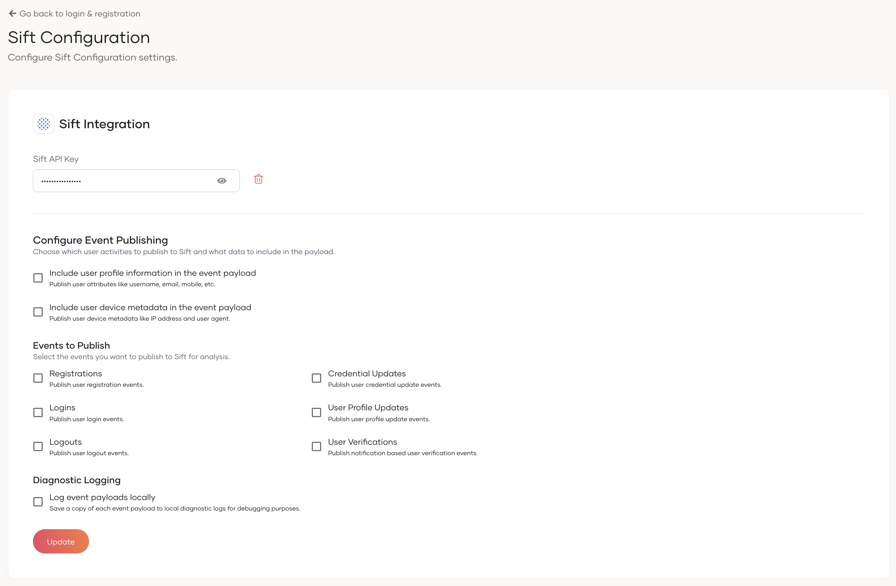

# Set up

The following guide explains how you can install and set up Sift in WSO2 Identity Server.

<Prerequisites>

## Prerequisites

You need to have a Sift account. If you don't have an account, create one by visiting the [Sift website](https://sift.com/).

</Prerequisites>

<Steps>

## Install the Sift connector {/* #step-1-install-the-sift-connector */}

Follow the steps below to install Sift in WSO2 Identity Server.

1. Download the following artifacts from the WSO2 Identity Server [connector store](https://store.wso2.com/connector/identity-fraud-detection-sift).
    - `org.wso2.carbon.identity.fraud.detection.sift-<version>.jar` - The Sift connector jar file.
    - `sift-java-<version>.jar` - The Sift Java SDK jar file.
2. Copy the `org.wso2.carbon.identity.fraud.detection.sift-<version>.jar` file to the `<IS_HOME>/repository/components/dropins` directory.
3. Copy the `sift-java-<version>.jar` file to the `<IS_HOME>/repository/components/lib` directory.
4. Restart WSO2 Identity Server.

## Add the API key {/* #step-2-add-the-api-key */}

To work with Sift, you need to register your Sift API key in WSO2 Identity Server. To do so,

1. On the WSO2 Identity Server Console, go to **Login & Registration**.
2. Click **Sift Configuratioin** and enter the API key.
    
3. Click **Update** to save the changes.

## Configure fraud detection settings {/* #step-3-configure-fraud-detection-settings */}

After adding the API key, you can further configure how WSO2 Identity Server interacts with Sift.

### Information to include in the event payload

- Enable **Include user profile information in the event payload** to include the user's `email`, `mobile`, and `name` in events sent to Sift.
- Enable **Include user device metadata in the event payload** to include the user's `IP address` and `User Agent` in events sent to Sift.

### Events to publish

You can select which user events are published to Sift for fraud analysis:

| Event | Description |
|---|---|
| **Registrations** | Publishes user registration events. |
| **Credential Updates** | Publishes user credential update events. |
| **User Profile Updates** | Publishes user profile update events. |
| **Logins** | Publishes user login events. |
| **Logouts** | Publishes user logout events. |
| **User Verifications** | Publishes notification-based user verification events. |

:::note

User self-registration and password reset related Sift events are only published when using the legacy self-registration and password recovery flows.

:::

### Diagnostic logging

Enable **Log event payloads locally** to log the event payloads sent to Sift as diagnostic logs in WSO2 Identity Server. This is useful for troubleshooting your Sift integration.

</Steps>
