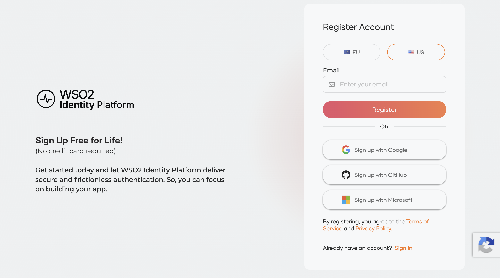
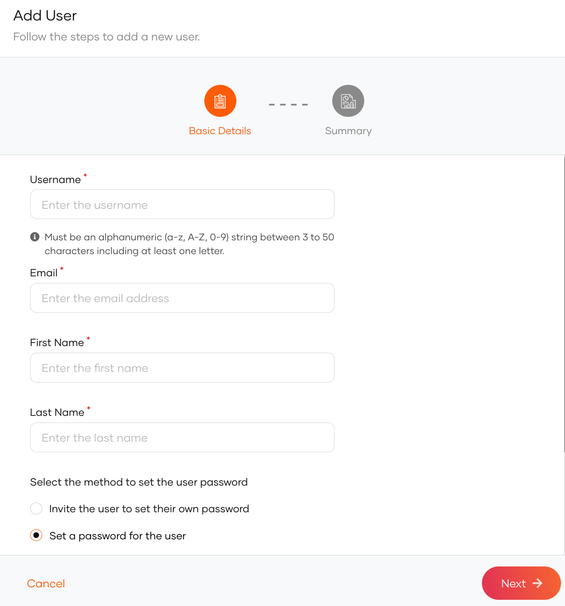

# Create your WSO2 Identity Platform account

Let's begin setting up your WSO2 Identity Platform account.

## Create an organization

An organization in WSO2 Identity Platform will be your own unique space and it will contain your users and application configurations. Let's sign up and create your first organization.

1. Go to the [WSO2 Identity Platform webpage](https://wso2.com/identity-platform/) and click **Sign up for free**.

2. Enter your email address and click **Register**. You will receive an email with instructions on how to complete your account creation.

    

:::tip[Access the WSO2 Identity Platform Console]

As an organization owner or administrator, you can manage your organizations, applications, and users through the WSO2 Identity Platform Console. Make sure to use the appropriate console URL based on the region chosen during registration.

- US Region: https://console.asgardeo.io
- EU Region: https://console.eu.asgardeo.io

:::

## Create a user

Users can log in to applications that you register in WSO2 Identity Platform. Let's create a user by following the steps below.

1. On the WSO2 Identity Platform Console, go to **User Management** > **Users**.
2. Click **Add User** > **Single User**.
3. Fill in the user's details.

    

4. Select **Set a password for the user** and enter a temporary password for the user. The user will be able to change the password later.
5. Click **Next** and then **Finish**.

You can now manage this user account from the **WSO2 Identity Platform Console**.

:::note

Users can also manage their own accounts from the WSO2 Identity Platform self-service portal. Learn more about [user self-service](../guides/user-self-service/index.mdx).

:::

## What's next?

Now that you've set up your own organization and created your first user, you can:

1. Use a test application to quickly try out WSO2 Identity Platform. See [Try login with WSO2 Identity Platform](try-it-application.mdx).
2. Set up WSO2 Identity Platform in your application or in a sample application. See [Start integrating WSO2 Identity Platform into applications](start-integrating-apps/index.mdx).
