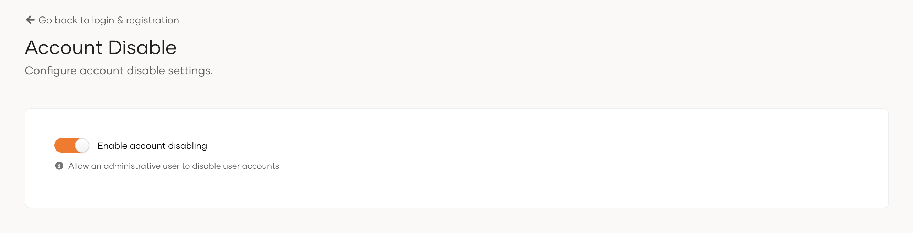

# Enable account disabling

When a user leaves your organization or stays inactive for a long period, you might want to disable their account instead of deleting it permanently. Disabling a user account prevents the user from logging into applications or to the self-service My Account portal, while retaining their information and activity history.

:::note

Account disabling serves as a long-term, permanent solution. If you only want to temporarily lock user accounts, use account locking instead. See [lock users](../users/manage-users.mdx#lock-a-user-account) for more details.

:::

By default, the WSO2 Identity Platform Console keeps the account disabling feature turned off in user profiles. To enable account disabling in user profiles,

1. On the WSO2 Identity Platform Console, go to **Login and Registration**.

2. Under **Account Management**, click **Account Disable**.

3. Toggle **Enable account disabling** on to enable.

    

Once enabled, every user profile displays an option to disable the user. Learn more about user profiles in [manage users](../users/manage-users.mdx).
