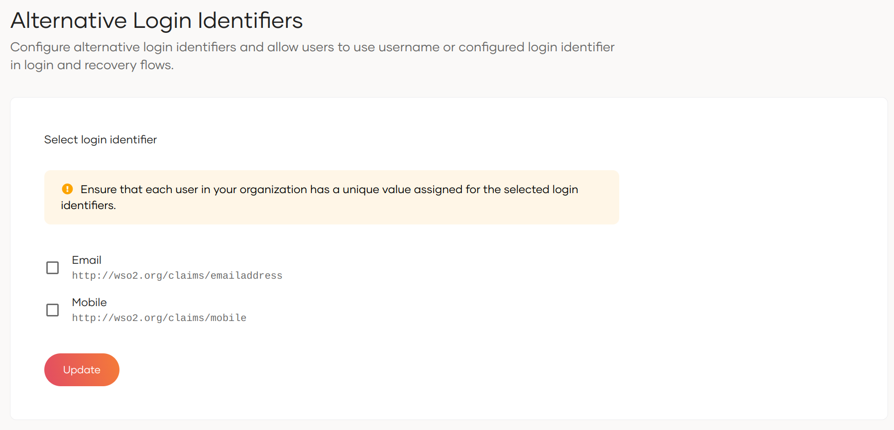

# Configure alternative login identifiers

You can now configure alternative login identifiers so that the users of your WSO2 Identity Platform organization have the capability to use these identifiers to log in.

:::note

The primary login identifier is the attribute you configure as your username. Learn more about [configuring username validation](../../user-accounts/account-login/username-validation.md).

:::

WSO2 Identity Platform allows admins to assign the following attributes as alternative login identifiers of the organization:

- `Email`
- `Mobile`

To configure alternative login identifiers for your organization:

1. On the WSO2 Identity Platform Console, go to **Login & Registration**.

2. Under **Login Identifier**, click on **Alternative Login Identifier**.

3. Select `Email` and/or `Mobile` as alternative login identifiers.

    

    :::note

    - Ensure that every user within your organization has a unique value assigned to the chosen login identifiers. For new users, WSO2 Identity Platform will ensure it's uniqueness.

    - If you have chosen `Email` as the [username type](../../user-accounts/account-login/username-validation.md), it automatically becomes the primary login identifier. Therefore, configuring it as an alternative login identifier will be disabled.

    :::

4. Click **Update** to save the changes.

    

Upon successful configuration, the login and recovery user interfaces will update according to the defined login identifier attributes.
