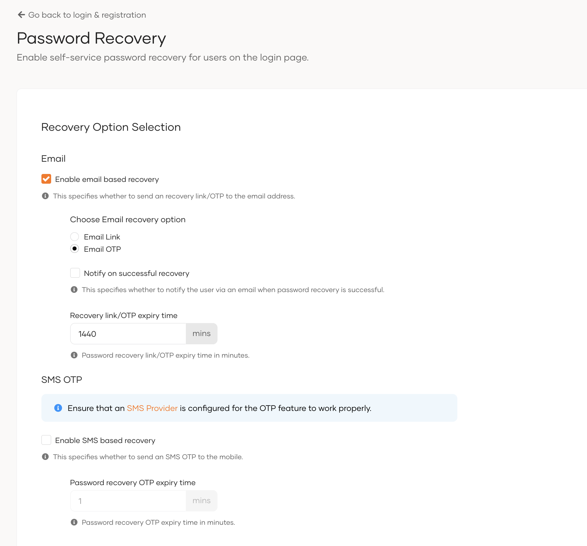

# Password recovery

<Applies to="WSO2 Cloud">

!!!note
    For organizations created after 08th March 2026, use the new flow-based password recovery experience. Refer to [Password Recovery](../../flows/password-recovery.md) for more details.

</Applies>

You may enable self-service password recovery for users so that they may reset their forgotten passwords right from the login page. Users can click the `Forgot password?` option and choose to receive either a Link or an OTP via Email or SMS to reset the password.

To configure password recovery options,

1. On the WSO2 Identity Platform Console, go to **Login & Registration**.
2. Under **Account Recovery**, click on **Password Recovery**.
4. Select both **Email** and **SMS OTP** or one of the options to enable them for your organization.
  
    

5. Configure the corresponding settings.
    <table>
        <tbody>
            <tr>
                <td><h3>Email Link/OTP</h3></td>
                <td></td>
            </tr>
            <tr>
                <td><b>Notify on successful recovery</b></td>
                <td>Specifies whether to notify the user via an email when password recovery is successful.</td>
            </tr>
            <tr>
                <td><b>Recovery link expiry time</b></td>
                <td>Specifies the duration (in minutes) after which the email link/OTP will expire.</td>
            </tr>
        </tbody>
    <table><tbody><tr><td><h3>SMS OTP</h3></td><td></td></tr><tr><td><b>Password recovery OTP expiry time</b></td><td>Specifies the duration (in minutes) after which the OTP code sent through SMS will expire.</td></tr></tbody></table>

6. Configure the following settings if you wish to customize the OTP pattern.
    
    <table><tbody><tr><td><b>Include upper case letters</b></td><td>If nothing else is selected, the code will have only upper case letters or else a combination of upper case letters and any other selected character types.</td></tr><tr><td><b>Include lower case letters</b></td><td>If nothing else is selected, the code will have only lower case letters or else a combination of lower case letters and any other selected character types.</td></tr><tr><td><b>Include numeric characters</b></td><td>If nothing else is selected, the code will have only digits or else a combination of digits and any other selected character types.</td></tr><tr><td><b>Password recovery OTP code length</b></td><td>Specify the length of the code</td></tr></tbody></table>

    :::info

    Including a character set does not guarantee that at least one of those characters will be included in each OTP code.

    :::

7. Set the following settings to configure the limitations for password recovery attempts.

    <table><tbody><tr><td><b>Max failed attempts count</b></td><td>Specifies the maximum number of incorrect entries allowed for a password recovery method.</td></tr><tr><td><b>Max resend attempts count</b></td><td>Specifies the maximum number of times a user can request to resend the OTP or recovery link.</td></tr></tbody></table>

8. Click **Update** once you configure the required settings.
