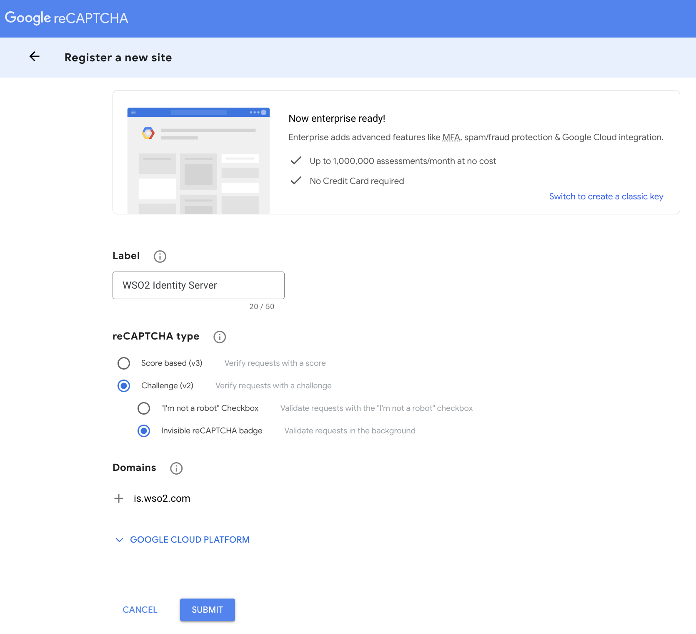
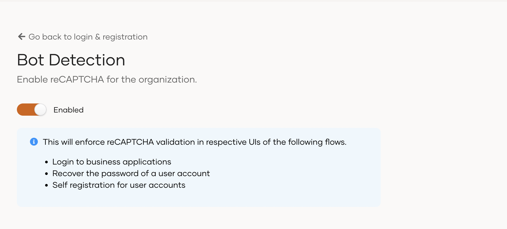

# Bot detection

This guide explains how you can enable bot detection for your applications to mitigate abuse from bots and other automated attacks. WSO2 Identity Platform supports [reCAPTCHA](https://developers.google.com/recaptcha/), a service provided by Google which can protect your applications from spam or other forms of internet abuse by distinguishing human requests from automated ones.


<Applies to="Self-hosted">

## Types of reCAPTCHA

Google allows you to configure two types of reCAPTCHA.

### reCAPTCHA v2

reCAPTCHA v2 does not require users to click a checkbox to prove that they are human. Instead, it uses an invisible reCAPTCHA badge that activates when the user clicks on an existing button on the website or through a JavaScript API call. Only the most suspicious traffic will be prompted to solve a puzzle.

### reCAPTCHA v3

reCAPTCHA v3 returns a score for each request without requiring user interaction. It allows you to take action inside the context of your website, such as adding more authentication factors, flagging a post for moderation, or slowing down scraping bots.

In the WSO2 Identity Server implementation, you are required to select a threshold value by looking at the traffic at [reCAPTCHA admin console](https://www.google.com/recaptcha/admin). If the score is less than the threshold, the request will be blocked by the server. The default value for the threshold is 0.5.

:::note

Since reCAPTCHA v3 learns from *actual traffic*, the scores may vary between the development and production environments.

:::

The following sections guide you through setting up reCAPTCHA with WSO2 Identity Server.

## Configure API keys in Google

You need to register and create an API key pair in Google. The key pair consists of a `site key` which is used to invoke reCAPTCHA, and a `secret key`.

:::tip

When a user interacts with your application, the reCAPTCHA service generates a response token, includes it in a new parameter called `g-recaptcha-response` and embeds the parameter into the request. From the server side, you can verify the submitted response by calling the Google API with the secret key.

:::

To configure the API keys,

1. Go to the [Google reCAPTCHA admin console](https://www.google.com/recaptcha/admin).

2. Fill in the fields to register your identity server domain. The following
    are sample values:
    - **Label:** WSO2 Identity Server
    - Select either the `Score based (v3)` or the `Challenge (v2)` option.
    - **Domains:** is.wso2.com  

        

4. Click **Submit**.

5. Take note of the site key and secret that you receive.

:::note

For more information on reCAPTCHA, refer to the [Google documentation](https://developers.google.com/recaptcha/intro).

:::

## Configure WSO2 Identity Server for reCAPTCHA

Follow the steps below to configure reCAPTHCA in WSO2 Identity Server.

1. Open the `deployment.toml` file located in the `<IS_HOME>/repository/conf/` directory and uncomment the following configuration block under `Google reCAPTCHA settings`. Replace `site_key` and `secret_key` with the values you obtained from the above section.

    ```toml
    [recaptcha]
    enabled = true
    api_url = "https://www.google.com/recaptcha/api.js"
    verify_url = "https://www.google.com/recaptcha/api/siteverify"
    site_key = "<site_key>"
    secret_key = "<secret_key>"
    ```

    :::note

    - For reCAPTCHA v3, WSO2 Identity Server sets a default value of 0.5. You can set a custom value using the `threshold` property.
       ```toml
       [recaptcha]
       ...
       threshold="0.4"
       ...
       ```

    - Enter the `login.do` URL paths (without the hostname) of any additional authorization endpoints that you wish to secure with reCAPTCHA as a comma-separated list in `redirect_urls` under `[recaptcha]`.
       ```toml
       [recaptcha]
       ...
       redirect_urls="/authenticationendpointone/login.do,/authenticationendpointtwo/login.do"
       ...
       ```

    :::

2. Restart the WSO2 Identity Server server.

&lt;!-- ## Selectively enable reCAPTCHA

WSO2 Identity Server allows you to selectively configure reCAPTCHA for various flows. Open the `deployment.toml` file found in the `<IS_HOME>/repository/conf/` directory, add the required configurations and restart WSO2 Identity Server.

### Single sign-on

To enable reCAPTCHA for single sign-on (SSO) flows, add the following configuration.

 ```toml
 [sso_login.recaptcha]
 enabled=true
 enable_always=false
 max_attempts="3"
 ```

### Self-registration

To enable reCAPTCHA for self-registration flows, add the following configuration.

```toml
[identity_mgt.user_self_registration]
enable_recaptcha=true
```

### Password recovery

To enable reCAPTCHA for password recovery flows, add the following configuration.

```toml
[identity_mgt.password_reset_email] 
enable_recaptcha=true
```

### Account recovery

To enable reCAPTCHA for account recovery flows, add the following configuration.

```toml
[identity_mgt.username_recovery.email] 
enable_recaptcha= true
``` -->

&lt;!-- !!! note

    If you wish to enable reCAPTCHA globally for all the workflows, add the following configuration in the `deployment.toml` file found in the `<IS_HOME>/repository/conf/` directory.

     ```toml
     [recaptcha]
     forcefully_enabled_for_all_tenants=true
     ``` -->

</Applies>


## Enable reCAPTCHA from the Console

To enable bot detection, proceed with the following:

1. On the WSO2 Identity Platform Console, go to **Login & Registration** > **Login Security** > **Bot Detection**.
2. Toggle the switch on to activate reCAPTCHA for your organization.



!!! tip
    Bot detection enables reCAPTCHA for the following flows:
    <ul>
    <li>Single sign-on (SSO)</li>
    <li>Self-registration</li>
    <li>Password recovery</li>
    <li>Account recovery</li>
