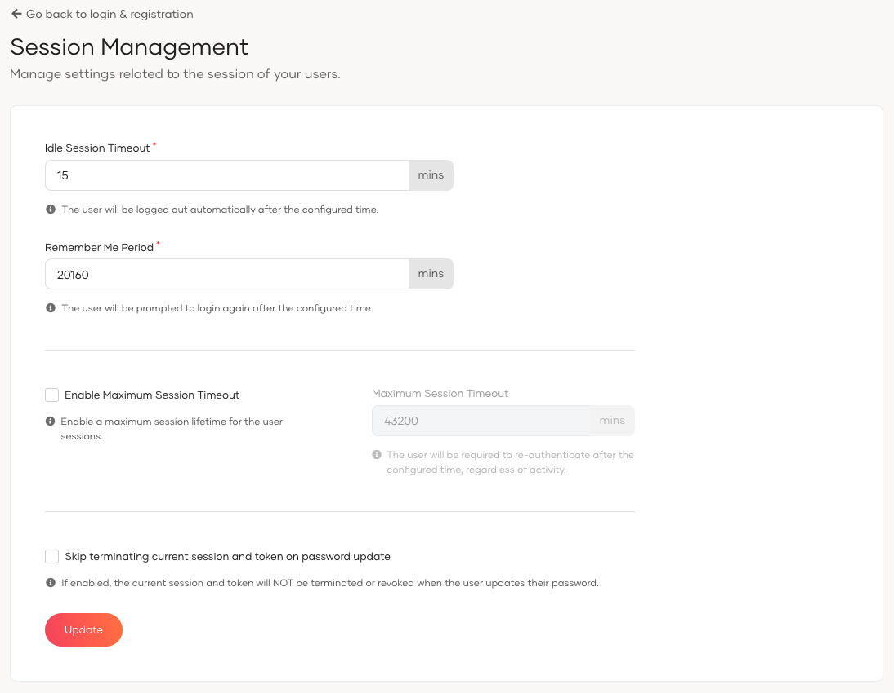

# Session management

<Applies to="WSO2 Cloud">

:::note[Premium feature]

Only customers on the enterprise tier can access this feature.

:::

</Applies>

Customize session timeout and remember me settings to maintain optimal security and user experience in WSO2 Identity Platform.

## Configuration instructions

To adjust session management settings, follow these steps:

1. On the WSO2 Identity Platform Console, go to **Login & Registration** > **Login Security** > **Session Management**.
2. Configure the **Idle Session Timeout** and **Remember Me Period** to suit your security policies.

3. To enforce an absolute session lifetime, select **Enable Maximum Session Timeout** and configure the **Maximum Session Timeout**.
4. Enable **Skip terminating current session and token on password update** to preserve the current session when users update their password.
5. Click **Update** to save the changes.

## Parameters

<table><tbody><tr><th>{"Parameter"}</th><th>{"Description"}</th></tr><tr><td><code>{"Idle Session Timeout"}</code></td><td>{"Time in minutes before an inactive user session is automatically ended."}</td></tr><tr><td><code>{"Remember Me Period"}</code></td><td>{"Duration in minutes that the system will remember a user's session."}</td></tr><tr><td><code>{"Enable Maximum Session Timeout"}</code></td><td>{"When enabled, enforces an absolute maximum lifetime for user sessions regardless of user activity or a valid remember me token. This setting is disabled by default."}</td></tr><tr><td><code>{"Maximum Session Timeout"}</code></td><td>{"The maximum duration in minutes a user session can remain active. The default value is "}<code>{"43200"}</code>{" minutes (30 days). This setting is applicable only when "}<strong>{"Enable Maximum Session Timeout"}</strong>{" is selected."}</td></tr><tr><td><code>{"Skip terminating current session and token on password update"}</code></td><td>{"When enabled, the system does not terminate or revoke the current session and token when the user updates their password. This behavior applies when the password is updated via: "}<ul><li><a href={"/identity/guides/user-self-service/change-password"}>{"My Account"}</a>{" portal."}</li><li><a href={"/identity/apis/self-password-update-rest-api"}>{"Self Password Update API"}</a>{" (using an OAuth2 access token)."}</li><li><applies to={"WSO2 Cloud"}><a href={"/identity/apis/scim2-me/#tag/Me-Endpoint/operation/patchUserMe"}>{"SCIM 2.0 Me API"}</a></applies>{" "}<applies to={"Self-hosted"}><a href={"/identity/apis/scim2-me-rest-apis/#tag/Me-Endpoint/operation/patchUserMe"}>{"SCIM 2.0 Me API"}</a></applies>{" (using an OAuth2 access token)."}</li></ul>{" Password updates via the SCIM 2.0 Me endpoint using Basic Authentication bypass this configuration and terminate the active session and token. "}  {" "}<strong>{"Note:"}</strong>{" For self-service password management, WSO2 recommends using the "}<a href={"/identity/apis/self-password-update-rest-api"}>{"Self Password Update API"}</a>{"."}</td></tr></tbody></table>

### Maximum session timeout

The maximum session timeout enforces an absolute upper bound on how long a user session can remain active. Unlike the idle session timeout, which resets on user activity, the maximum session timeout counts from the moment the session is created.

When both are configured, the following rules apply:

- If the idle session timeout expires first, the session ends and the user must sign in again.
- If the maximum session timeout expires first, the user must re-authenticate even if they have been continuously active.
- The remember me feature does not extend a session beyond the maximum session timeout.

:::warning

When **Enable Maximum Session Timeout** is turned on, users must re-authenticate after the configured maximum session lifetime expires, even if the idle session timeout or the remember me period has not elapsed.

:::
