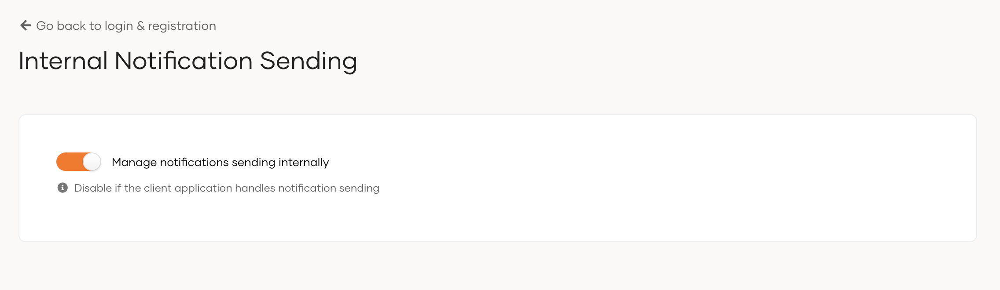

# Notification settings

WSO2 Identity Platform, by default, provides a seamless notification system that handles notifications for the following scenarios.

- Self registration
- Email verification
- Account lock
- Account disable
- Account recovery

If the client application handles notifications and you want to disable the notification features of WSO2 Identity Platform,

1. On the WSO2 Identity Platform Console, go to **Login & Registration**.

2. Under **Notification Settings**, click **Internal Notification Sending**.

3. Turn the toggle off to disable notifications.

    
