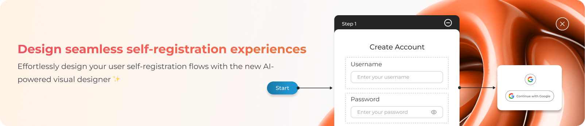
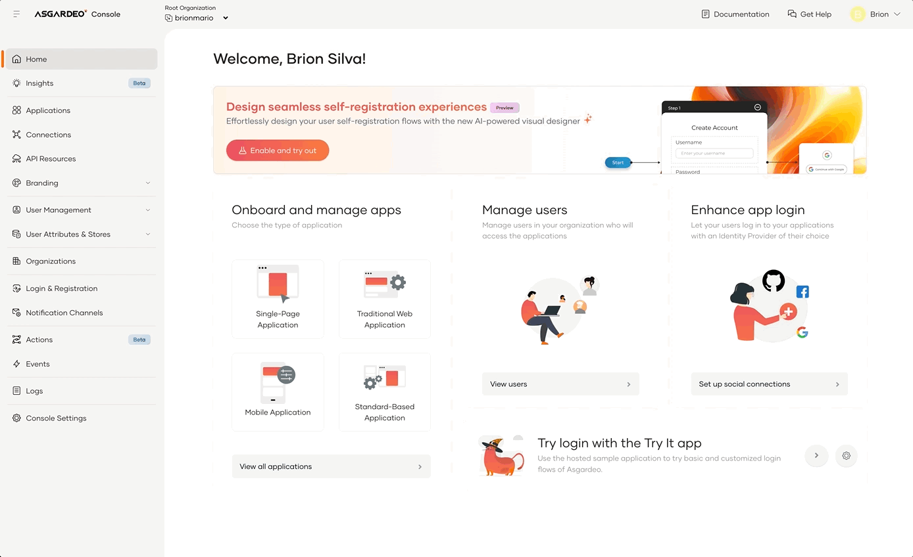
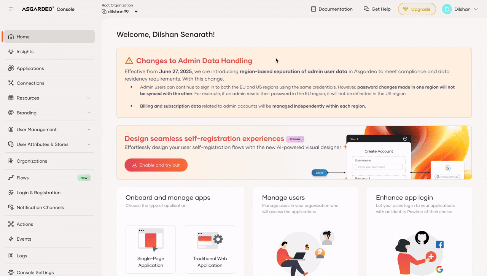
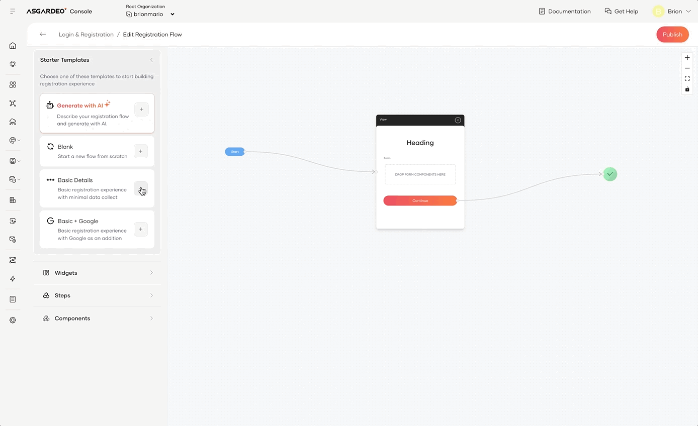
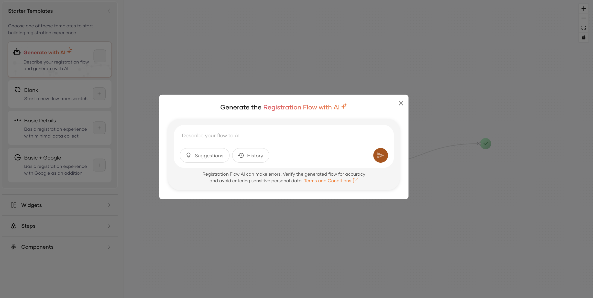
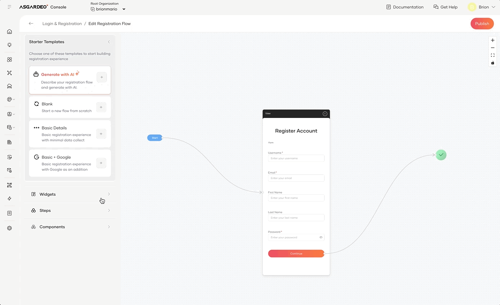
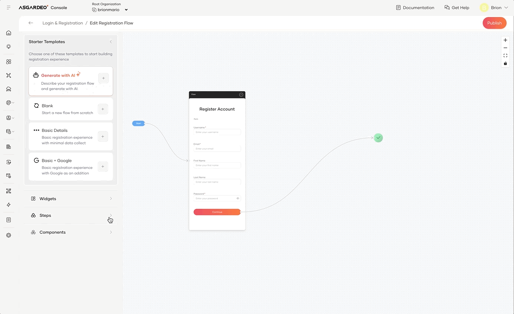
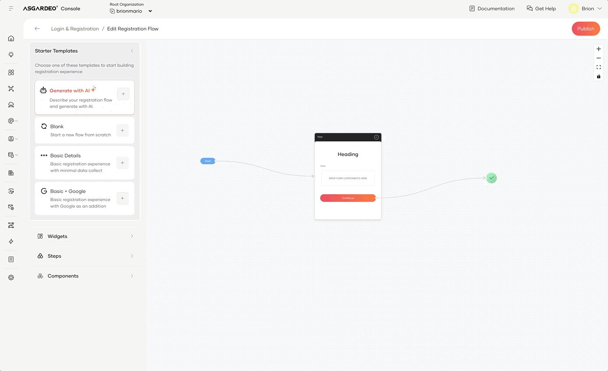

<h1>Self-register Flow Builder</h1>

The self-registration Flow Builder provides administrators with a powerful tool to create fully customizable user registration experiences. Whether you're building a simple registration form or a complex, multi-step flow, the builder gives you complete control over the design and process.

It includes a variety of starter templates, widgets, steps, and components, allowing you to define exactly how users will interact with your registration process.

---

## Pre-requisites

You need to **enable self-registration** inorder to try this out.

:::note

Learn how administrators can [enable self-registration](self-registration.mdx#enabledisable-self-registration) in an organization.

:::

## Get Started

### Enabling the flow builder

:::warning

Enabling the self-registration Flow Builder will override the exitsing self-registration experience in your organization. You can always [revert back to previous experience](#revert-back-to-previous-experience).

:::

To enable the self-registration Flow Builder, you have two options:

#### Option 01: Enable from the Home page

1. Navigate to the **Home** page.
2. Click on the **Enable and try out** button inside the banner.
3. In the feature preview dialog, toggle the feature status switch to **Enabled** mode and close the dialog.
4. Click on the **Try out** button in the banner to access the Flow Builder.

#### Option 02: Enable from the Feature Preview

1. Click on the user dropdown in the top right corner.
2. Select **Feature Preview**.
3. In the feature preview dialog, toggle the feature status switch to **Enabled** mode and close the dialog.
4. Go to **Flows**.
5. Click on the **Self Registration** card.

## Building your first flow

The self-registration Flow Builder is designed to make creating user registration flows intuitive and efficient. With AI ✨ support, you can describe your ideal flow in natural language and let the builder generate it for you.

Alternatively, you can start with pre-defined templates or build from scratch using the drag-and-drop interface. This flexibility allows you to create new flows or extend existing ones effortlessly.

### Starter Templates

Starter templates give you a quick start with pre-defined flows that are easily customizable. You can click on the `+` button next to the template to add it to the flow.

- **Generate with AI ✨**  
  Describe your ideal registration flow in natural language, and WSO2 Identity Platform will automatically generate a customized flow for you.
  
    

- **Blank**
  Start from scratch for full flexibility.

- **Basic Details**  
  Collect only basic user details such as name, email, and password.

- **Basic + Google**  
  Combine a basic form with Google sign-up for users preferring existing credentials.

### Widgets

Widgets are reusable components that enhance the registration flow. You can drag and drop widgets into your desired view to build a flow.

- **Username + Password**  
  Traditional signup with username and password.

- **Continue with Email OTP**  
  Sign up with email and verify using a One-Time Password.

- **Continue with Google**  
  Sign up using Google credentials.

### Steps

Steps are the core building blocks of a registration flow. You can drag and drop steps to create a multi-step registration flow.

- **View**  
  Each step acts as a view or section of the registration process.

### Components

Components are atomic UI elements added to steps. You can drag and drop components inside a step.

:::note

Field components such as **Text Inputs**, **Email Inputs**, etc. has the following constraints:

- They should be added inside a **Form** component.
- They should be mapped to a user Attribute. This can be done by clicking on the pensil icon on the element action panel and selcting the relevant attribute from the `Attribute` dropdown. Only attributes set as display on Self-Registration profile in the [Attribute Configurations](/identity/guides/users/attributes/manage-attributes) will be available for mapping.

:::

- **Form** – Group fields for registration details  
- **Text Input** – Basic input for names/usernames  
- **Password Input** – Hidden input for passwords  
- **Email Input** – Field for email addresses  
- **Phone Input** – Collect phone numbers  
- **Number Input** – For numeric values  
- **Date Input** – Collect dates  
- **OTP Input** – Enter One-Time Passwords  
- **Checkbox** – For agreements like terms and conditions  
- **Button** – Triggers actions (e.g., submit)  
- **Text** – Add static instructions/explanations  
- **Divider** – Visually separate sections  
- **Image** – Add images like logos/icons

## Revert back to previous experience

If you want to revert back to the previous self-registration experience, you can disable the self-registration Flow Builder by following these steps:

1. Click on the user dropdown in the top right corner.
2. Select **Feature Preview**.
3. In the feature preview dialog, toggle the feature status switch to **Disabled** mode and close the dialog.
