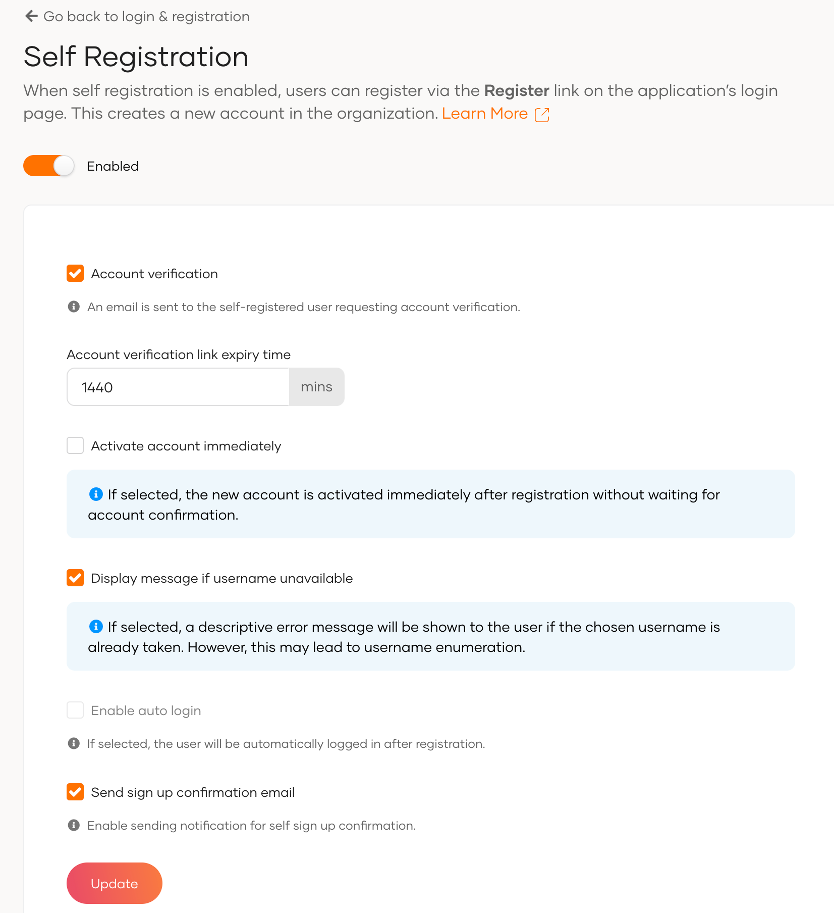
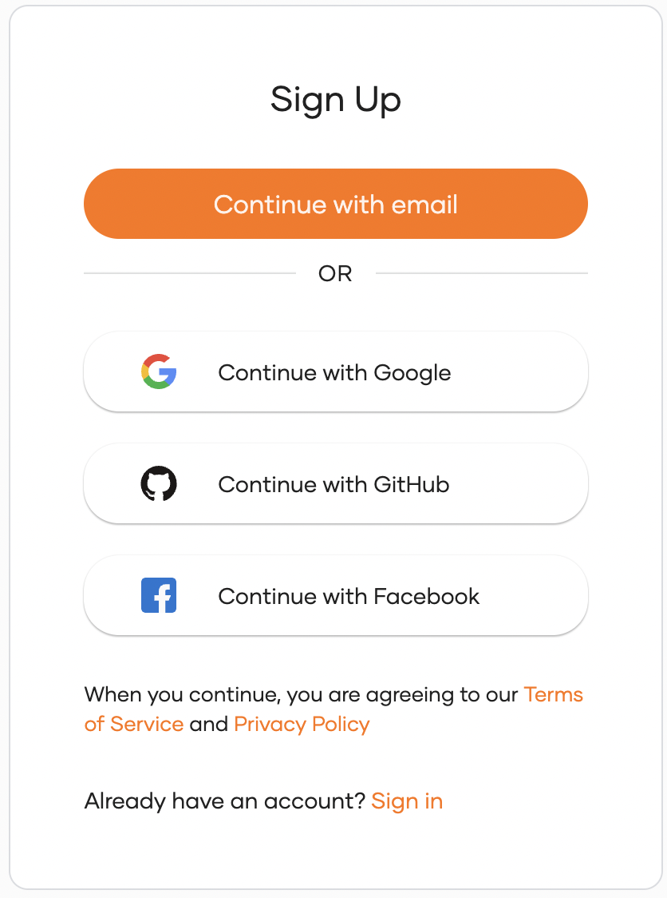
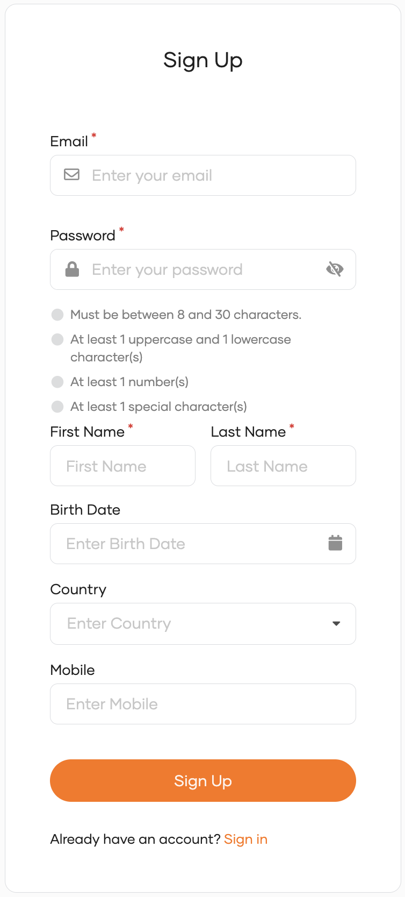
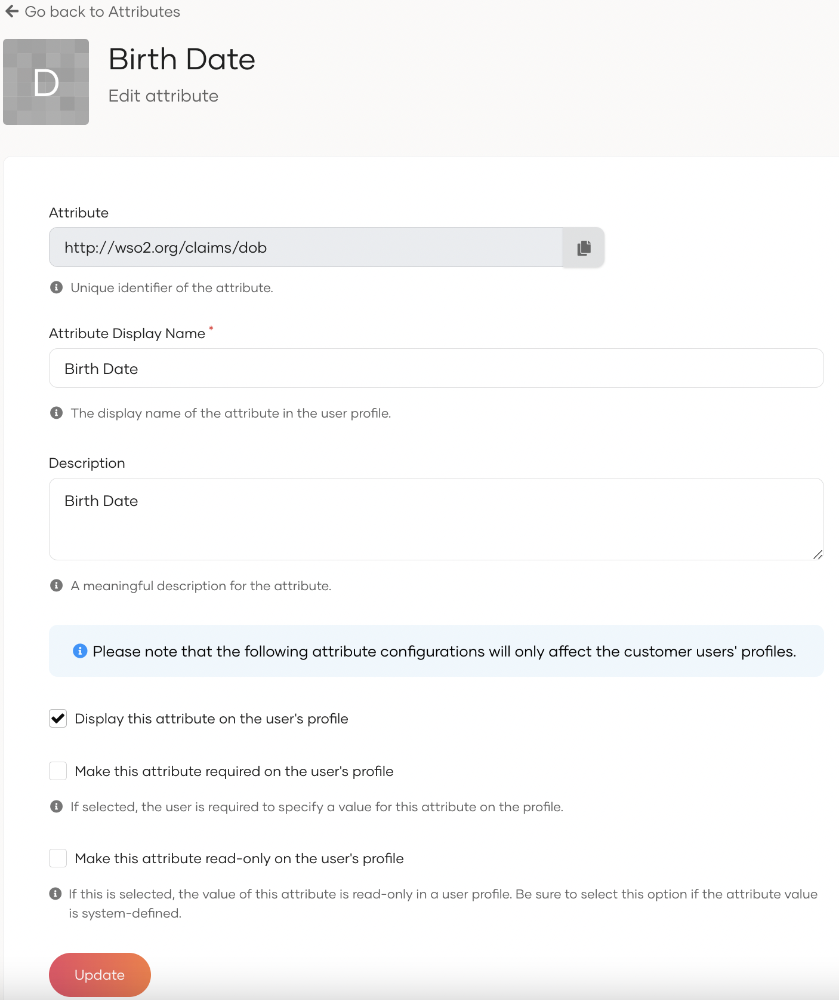

# Self registration


<Applies to="WSO2 Cloud">

!!!note
    For organizations created after 08th March 2026, use the new flow-based self-registration experience. Refer to [Self Registration](../../flows/self-registration.md) for more details.

</Applies>


You can enable users to self-register to your organization from the login page of the application. This creates a new user account for the user.

## Enable/Disable self-registration

To enable/disable user self-registration or to change the default configurations, see the following instructions:

1. On the WSO2 Identity Platform Console, go to **Login & Registration**.

2. Under **User Onboarding**, click **Self Registration**.

    

3. Turn the toggle on to enable self-registration or off to disable it.

4. Configure the settings below.

    <table><tbody><tr><td><b>{"Account verification"}</b></td><td>{"If enabled, an email will be sent to the user's specified email address requesting account confirmation."}<br /><br />{" If this option is enabled along with the "}<b>{"Activate account immediately"}</b>{" option, users will be signed into the application without waiting for verification. However, you may leverage the account verification status to control the user experience and the level of access granted for the user. "}[{"Learn how to get verification status"}](#get-the-verification-status-of-user-accounts){"."}</td></tr><tr><td><b>{"Account verification link expiry time"}</b></td><td>{"Specifies the duration (in minutes) after which the confirmation link expires."}</td></tr><tr><td><b>{"Activate account immediately"}</b></td><td>{"Activates the account without waiting for account verification."}<br /><br />{" However, you may leverage the account verification status to control the user experience and the level of access granted for the user. "}[{"Learn how to get verification status"}](#get-the-verification-status-of-user-accounts){"."}</td></tr><tr><td><b>{"Display message if username unavailable"}</b></td><td>{"Display a message to the user from the registration page if the selected username is already taken. Enable this with caution, as it may lead to username enumeration."}</td></tr><tr><td><b>{"Enable auto login"}</b></td><td>{"When a user self-registers: "}<ul><li>{"If MFA is not configured, the user is redirected straight into the application without having to log in."}</li><li>{"If MFA is configured, the initial level of authentication is bypassed, and the user is directed straight to the next configured authentication steps."}</li></ul>{" Note that if "}<b>{"Account Verification"}</b>{" is enabled, it is mandatory to also enable "}<b>{"Activate account immediately"}</b>{" to enable auto login."}</td></tr></tbody></table>


<Applies to="Self-hosted">

## Configure callback URL validation

When running WSO2 Identity Server behind a proxy or with a different port configuration, you may encounter callback URL validation errors during the self-registration flow. To resolve this, you need to configure a regex pattern to validate the callback URL.

To configure the callback URL validation:

1. Open the `<IS_HOME>/repository/conf/deployment.toml` file.

2. Add the following configuration under the `[identity_mgt.user_self_registration]` section:

    ```toml
    [identity_mgt.user_self_registration]
    callback_url = "${carbon.protocol}:\\/\\/${carbon.host}\\/.*"
    ```

    This regex pattern validates the callback URL sent in the self-registration email.

    :::note

    - The sample regex pattern `${carbon.protocol}:\\/\\/${carbon.host}\\/.*` works for most deployments. Modify it to meet your specific requirements.
    - When testing the product, you can use `^https:\/\/localhost:9443\/.*` as the callback URL regex.
    - For production deployments, ensure the regex pattern matches your actual deployment URLs.

    :::

3. Save the file and restart WSO2 Identity Server for the changes to take effect.

</Applies>


## Configure self-registration methods

Users may self-register to your organization using the same methods configured as sign-in options in your application.

Refer to the documentation on how to [configure sign-in options](../../authentication/index.md) for your application.

:::note

Currently, WSO2 Identity Platform does not support Magic Links for self-registration.

:::

During user self-registration, the available methods are displayed to the user as shown below.



For information on how a user can self-register, refer to [Try self-registration](../../user-self-service/self-register.md).

## Customize the self-registration form

If a user decides to self-register using email, the following form is displayed to the user.



You can follow the instructions below and customize the attributes presented during self-registration.

1. On the WSO2 Identity Platform Console, go to **User Attributes & Stores** > **Attributes**.
2. Under **Manage Attributes**, click on **Attributes**.
2. Click the **Edit** icon on the attribute that you wish to add/remove from the registration form.

    

3. Select **Display this attribute on the user's profile**. The attribute will now appear on the self-registration form presented to the user (Uncheck the attribute to remove from the registration form).
4. Select **Make this attribute required on the user's profile** if it is a mandatory attribute.

:::note

Learn more about [user attributes](/identity/guides/users/attributes/manage-attributes/).

:::

## Get the verification status of user accounts

The verification status of a user account indicates whether or not the user has confirmed the account through email verification. You may leverage this status to enforce access control or tailor the user interface of your application.

This capability is especially useful when you have self-registered users. For example, you may want self-registered users with unverified accounts to only have read access to your application, whereas verified users may get complete access.

:::tip


To implement this scenario, you must enforce account verification for self-registered users and activate accounts immediately without waiting for verification. Learn more in [enable/disable self-registration](#enabledisable-self-registration).

:::

You can get the account verification status of users through the [SCIM2 API](../../../apis/scim2/scim2-users-rest-api.md) as shown below.


<Applies to="WSO2 Cloud">

- To get your own information, invoke the `/scim2/Me` endpoint:

    ```bash
    https://api.asgardeo.io/t/{organization_name}/scim2/Me
    ```

- To get information about other users in your organization, invoke the `/scim2/Users/<user_id>` endpoint:

    ```bash
    https://api.asgardeo.io/t/{organization_name}/scim2/Users/{user_id}
    ```

</Applies>


<Applies to="Self-hosted">

- To get your own information, invoke the `/scim2/Me` endpoint:

    ```bash
    https://localhost:9443/scim2/Me
    ```

- To get information about other users in your organization, invoke the `/scim2/Users/<user_id>` endpoint:

    ```bash
    https://localhost:9443/scim2/Users/{user_id}
    ```

</Applies>


The following is part of the API response:

```text
"roles": [
    {
        "display": "selfsignup",
        "value": "a85d4baf-2e7a-37b1-a722-d4d427039736",
        "$ref": "https://<HOST_NAME>/scim2/v2/Roles/16ba9acb-fa30-42ef-8e25-29b557862124",
        "audienceValue": "<organization id>",
        "audienceType": "organization",
        "audienceDisplay": "<organization name>"
    },
    ......
    ],
"<SCIM_SCHEMA_FOR_WSO2_CUSTOM_CLAIMS>": {
    "emailVerified": "true",
    "accountConfirmedTime": "2023-02-16T03:07:34.392293Z"
    .....
}
```
Note the following details in the response payload:


:::note

- If the `role.display` parameter is set to `selfsignup`, the user has self-registered.
- Under the `urn:scim:wso2:schema` schema, if the `emailVerified` parameter is available, the user has already clicked the email link to verify the account. This parameter will have the following values:

    - `true` - User has successfully verified the account.
    - `false` - User's account verification attempt has failed.

- The `accountConfirmedTime` parameter will only be available under the same schema when email verification is successful for self-registered users.

:::

Once you have identified the `emailVerified` status of the user and the method used to onboard the user (either through self-registration or by an administrator), you can enforce any access restrictions through your application logic.


## Resend account verification email

:::tip


To implement this scenario, you must enforce account verification for self-registered users and activate accounts immediately without waiting for verification. Learn more in [enable/disable self-registration](#enabledisable-self-registration).

:::


<Applies to="WSO2 Cloud">

- To resend the account verification email for the authenticated user, use the curl command shown below.

</Applies>


<Applies to="Self-hosted">

- To resend the account verification email for the authenticated user, use the [Self Resend Code API](../../../apis/use-the-self-sign-up-rest-apis.md#tag/Self-Register/paths/~1me~1resend-code/post) as shown below.

</Applies>


:::note


<Tabs>
<TabItem value="tab-0" label="Request format">


```curl
curl -X 'POST' \
'https://<HOST_NAME>/api/identity/user/v1.0/me/resend-code' \
-H 'Authorization: Bearer <access_token>' \
-H 'Content-Type: application/json' \
-d '{
    "properties": [
        {
            "key": "RecoveryScenario",
            "value": "SELF_SIGN_UP"
        }
    ]
}'
```

</TabItem>
<TabItem value="tab-1" label="Sample request">


```curl
curl -X 'POST' \
'https://<HOST_NAME_EXAMPLE>/api/identity/user/v1.0/me/resend-code' \
-H 'Authorization: Bearer <access_token>' \
-H 'Content-Type: application/json' \
-d '{
    "properties": [
        {
            "key": "RecoveryScenario",
            "value": "SELF_SIGN_UP"
        }
    ]
}'
```

</TabItem>
</Tabs>

---
**Response**
```
HTTP/1.1 201 Created
```

:::


<Applies to="WSO2 Cloud">

- To resend the account verification email for other users, use the curl command shown below.

</Applies>


<Applies to="Self-hosted">

- To resend the account verification email for other users, use the [Resend Code API](../../../apis/use-the-self-sign-up-rest-apis.md#tag/Self-Register/paths/~1resend-code/post) as shown below.

</Applies>


:::note


<Tabs>
<TabItem value="tab-0" label="Request format">


```curl
curl -X 'POST' \
'https://<HOST_NAME>/api/identity/user/v1.0/resend-code' \
-H 'Authorization: Bearer <access_token>' \
-H 'Content-Type: application/json' \
-d '{
    "user": {
        "username": "<USERNAME>",
        "realm": "<REALM>"
    },
    "properties": [{
        "key": "RecoveryScenario",
        "value": "SELF_SIGN_UP"
        }]
    }'
```

</TabItem>
<TabItem value="tab-1" label="Sample request">


```
curl -X 'POST' \
'https://<HOST_NAME_EXAMPLE>/api/identity/user/v1.0/resend-code' \
-H 'Authorization: Bearer <access_token>' \
-H 'Content-Type: application/json' \
-d '{
    "user": {
        "username": "bob",
        "realm": "PRIMARY"
    },
    "properties": [{
        "key": "RecoveryScenario",
        "value": "SELF_SIGN_UP"
        }]
    }'
```

</TabItem>
</Tabs>

Ensure that the username provided is without the user store domain prefix, and the realm parameter specifies the relevant user store domain name.

---
**Response**
```
"HTTP/1.1 201 Created"
```

:::
