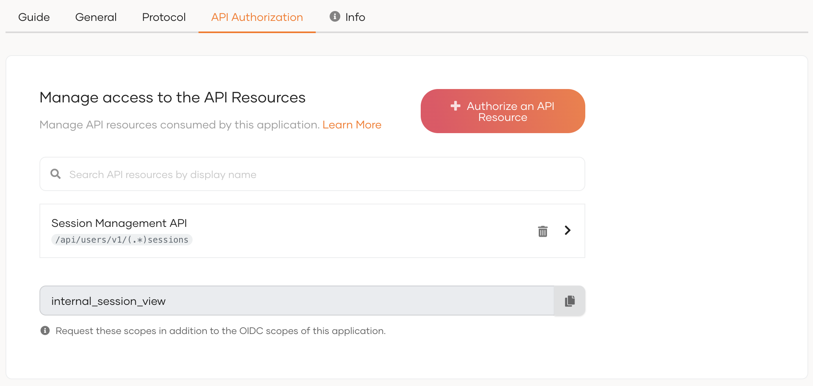
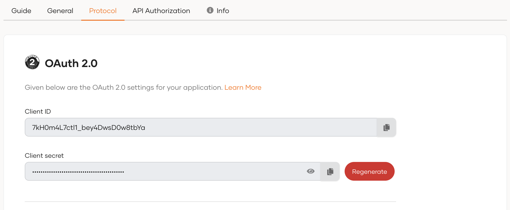

# Register a Machine-to-Machine (M2M) application

To integrate your machine-to-machine (M2M) application with WSO2 Identity Platform, you need to first register your application from the WSO2 Identity Platform Console. 
Then you can authorize your M2M applications to access management APIs of WSO2 Identity Platform or your business APIs.
A client ID and client secret are issued to the application upon registration.

Follow the instructions given below.

## Register the app

To register the app:

1. On the WSO2 Identity Platform Console, click **Applications**.

    

2. Click **New Application** and select **M2M Application**.

3. In the **Name** field, enter a unique name to identify your application.

4. Click **Register** to complete the registration.

5. [Enable the application](index.mdx#enabledisable-an-application) when it is ready for use.

## Authorize the API resources for the app

You can authorize your M2M applications to access APIs and their scopes(permissions) from **API Authorization** tab of the application, as shown below.

Learn more about [API authorization](/identity/guides/api-authorization/).

## Get the client ID and secret

When you register your M2M application, a client ID and client secret are generated. Your M2M application will identify itself to WSO2 Identity Platform with these credentials.

You can get this client ID and client secret from the **Protocol** tab of the application, as shown below.

## What's Next?

<LinkCards>

- [Obtain an M2M token using client credential grant](../../references/grant-types.mdx#client-credentials-grant)

</LinkCards>
