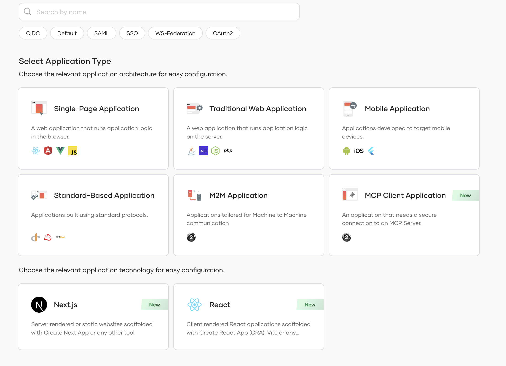
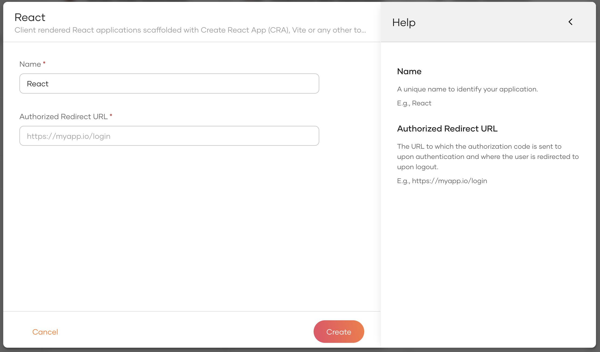

# Register a React Application

WSO2 Identity Platform provides an application template with default configurations to register a React application with minimal effort.

To register a React application,  

1. On the WSO2 Identity Platform Console, go to **Applications**.

2. Click **New Application** and select **React**.

    

3. In the wizard that appears, enter the following details:

    

    <table>
    <thead>
        <tr>
        <th>Parameter</th>
        <th>Description</th>
        </tr>
    </thead>
    <tbody>
        <tr>
            <td>Name</td>
            <td>A unique name to identify your application.</td>
        </tr>
        <tr>
            <td>Authorized redirect URL</td>
            <td>The URL to which the authorization code is sent upon user authentication and where the user is redirected upon logout.</td>
        </tr>
    </tbody>
    </table>

4. Click **Create** to complete the registration.

## What's next?

- Try the [WSO2 Identity Platform React quickstart guide](../../quick-starts/react.mdx).
