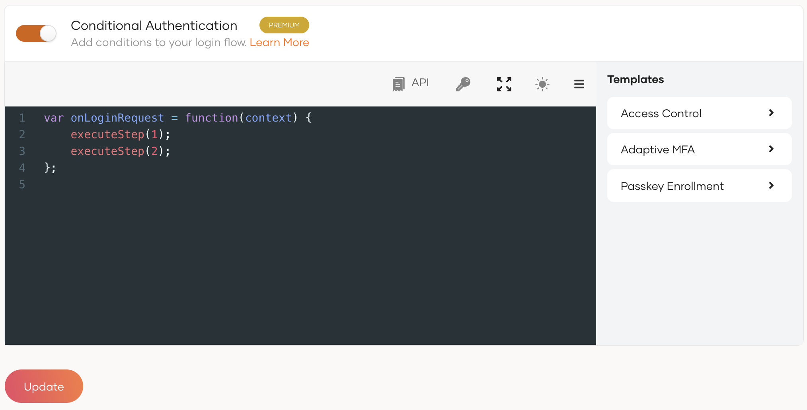
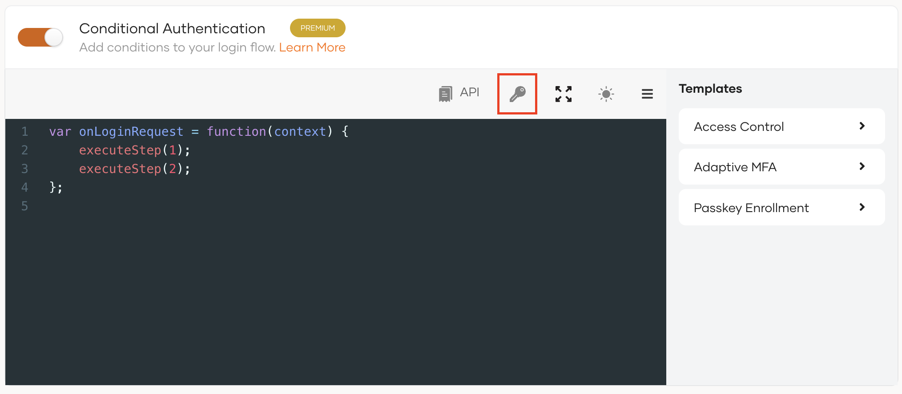
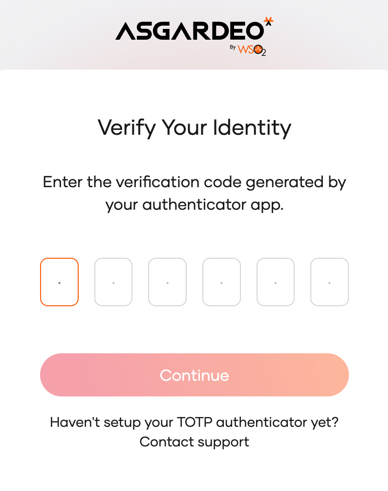

# Add MFA based on advanced conditions (using WSO2 Developer Platform)
You can secure your applications' login flow based on data from an API hosted on [WSO2 Developer Platform](https://wso2.com/engineering-platform/developer-platform/). WSO2 Developer Platform is an integration platform as a service (iPaaS) for innovation, productivity, and simplicity, designed in the cloud for the cloud.

## Scenario
Consider a scenario where the login flow of the application should be stepped up after an API call to an external service endpoint. The API call should be executed after the first authentication step is successfully completed. The second authentication step should be prompted based on the decision made by the service during the API call.

Let's consider an API hosted on WSO2 Developer Platform that reads an IP address from the request body, retrieves geolocation from the IP address, evaluates the risk of the login attempt, and sends back the result in the `hasRisk` parameter in the response. And the second authentication step should be prompted if the `hasRisk` is `true`.


## Prerequisites

- You need to [register an application with WSO2 Identity Platform](../../applications/index.md). You can register your own application or use one of the [sample applications](../../../get-started/try-samples/index.md) provided.

- Get an API key from [ipgeolocation](https://ipgeolocation.io/). For more information, refer to [ipgeolocation documentation](https://ipgeolocation.io/documentation.html).

## Define the MFA conditions

To define the MFA conditions with WSO2 Developer Platform, you need to:

1. [Design your MFA condition in a REST API](#desgin-the-rest-api)

2. [Integrate your REST API with WSO2 Developer Platform](#integrate-the-rest-api-with-wso2-developer-platform)

### Desgin the REST API
You need to implement your REST API in [Ballerina](https://ballerina.io/) or any other language and containerize it. You can use the [Ballerina VS code extension](https://ballerina.io/downloads/) to develop the REST API in Ballerina. [Learn more](https://wso2.com/ballerina/vscode/docs/).

To implement your REST API to fit the explained scenario:

1. On the VS Code editor, create a `.bal` file and add the following code segment.

     <details>
     <summary>Click to expand code snippet</summary>
     ```js
     import ballerina/http;

     type RiskResponse record {
     boolean hasRisk;
     };

     type RiskRequest record {
     string ip;
     };

     type ipGeolocationResp record {
     string ip;
     string country_code2;
     };

     final string geoApiKey = "<API key from ipgeolocation.io>";

     service / on new http:Listener(8090) {
     resource function post risk(@http:Payload RiskRequest req) returns RiskResponse|error? {

          string ip = req.ip;
          http:Client ipGeolocation = check new ("https://api.ipgeolocation.io");
          ipGeolocationResp geoResponse = check ipGeolocation->get(string `/ipgeo?apiKey=${geoApiKey}&ip=${ip}&fields=country_code2`);
          
          RiskResponse resp = {
               // hasRisk is true if the country code of the IP address is not the specified country code.
               hasRisk: geoResponse.country_code2 != "<Specify a country code of your choice>"
          };
          return resp;
     }
     }
     ```
     </details>

2. Update the following details:
     <table>
          <tr>
               <th>Parameter</th>
               <th>Description</th>
          </tr>
          <tr>
               <td><code>geoApiKey</code></td>
               <td>The API key obtained from [ipgeolocation](https://ipgeolocation.io/).</td>
          </tr>
          <tr>
               <td><code>geoResponse.country_code2</code></td>
               <td>Country code you would like to allow login attempts.</td>
          </tr>
     </table>

3. Upload the file to your GitHub repository.

### Integrate the REST API with WSO2 Developer Platform

To create the REST API component and integrate it with your REST API:

1. [Create an application](https://wso2.com/engineering-platform/developer-platform/docs/consuming-services/manage-application/#create-an-application) on WSO2 Developer Platform to integrate your REST API with your WSO2 Identity Platform app.

    :::note

    Note the **Consumer Key** and **Consumer Secret**.

    :::

2. Create a [REST API component on WSO2 Developer Platform](https://wso2.com/engineering-platform/developer-platform/docs/quick-start-guides/deploy-a-web-application-that-consumes-a-backend-service/#step-1-create).

3. [Deploy](https://wso2.com/engineering-platform/developer-platform/docs/quick-start-guides/deploy-a-web-application-that-consumes-a-backend-service/#step-12-deploy-the-rest-api) and [publish](https://wso2.com/engineering-platform/developer-platform/docs/quick-start-guides/deploy-a-web-application-that-consumes-a-backend-service/#step-14-publish-the-rest-api) the REST API.

4. [Subscribe](https://wso2.com/engineering-platform/developer-platform/docs/consuming-services/manage-subscription/#subscribe-to-an-api) the application you created on WSO2 Developer Platform to the REST API.

    :::note

    The WSO2 Developer Platform application exposes the REST API to external clients. Therefore, you can connect to this application from WSO2 Identity Platform and invoke the REST API.

    :::

## Configure the login flow

Follow the steps given below.

1. On the WSO2 Identity Platform Console, click **Applications**.
2. Select the relevant application and go to its **Login Flow** tab.
3. Add MFA based on advanced conditions using your preferred editor:

    ---
    <Tabs>
    <TabItem value="tab-0" label="Classic Editor">

    To add MFA based on advanced conditions using the classic editor:

    1. Click **Add TOTP as a second factor** to define the login flow, starting with `username and password` and stepping up with `TOTP`.
    2. Turn on **Conditional Authentication** by switching the toggle.

    </TabItem>
    <TabItem value="tab-1" label="Visual Editor">

    To add MFA based on advanced conditions using the visual editor:

    1. Switch to the **Visual Editor** tab and go to **Predefined Flows** > **Basic Flows** > **Add Multi-factor login**.
    2. Select `Username + Password -> TOTP` and click **Confirm**.
    3. Expand the **Script Editor** to add the script for MFA based on advanced conditions using WSO2 Developer Platform.

    </TabItem>
    </Tabs>

    ---

    

    You can now define your conditional authentication script.

4. Add the following authentication script.

    :::warning[Important]

    As a security measure, WSO2 Identity Platform does not allow the usage of two consecutive periods (`..`) in authentication scripts.

    :::

    ```js
    var connectionMetadata = {
    "url": "<WSO2 Developer Platform API URL>",
    "consumerKey": "<Consumer key of the application created on WSO2 Developer Platform>",
    "consumerSecret": "<Consumer secret of the application created on WSO2 Developer Platform>",
    "asgardeoTokenEndpoint": "<Token endpoint of the tenant in WSO2 Identity Platform>"
    };    
    var onLoginRequest = function(context) {
    executeStep(1, {
         onSuccess: function(context) {
              // Set the IP address of the authentication request as the body of the API call.
              var requestPayload = {
                   "ip": context.request.ip
              };
              Log.info("Calling the API hosted in WSO2 Developer Platform!");
              callChoreo(connectionMetadata, requestPayload, {
                   onSuccess: function(context, data) {
                        Log.info('Received risk:' + data.hasRisk);
                        if (data.hasRisk === true) {
                        // Prompt the second authentication factor if the hasRisk is true.
                        executeStep(2);
                        }
                   },
                   onFail: function(context, data) {
                        Log.info('Failed to call WSO2 Developer Platform API. Stepping up authentication by    default.');
                        executeStep(2);
                   },
                   onTimeout: function(context, data) {
                        Log.info('Call to WSO2 Developer Platform API timed out. Stepping up authentication by default.');
                        executeStep(2);
                   }
              });
         }
    });
    };
    ```

5. Update the following parameters in the script.
     <table>
          <tr>
               <th>Parameter</th>
               <th>Description</th>
          </tr>
          <tr>
               <td><code>url</code></td>
               <td>The URL of the WSO2 Developer Platform API.</td>
          </tr>
          <tr>
               <td><code>consumerKey</code></td>
               <td>The consumer key of the WSO2 Developer Platform application.</td>
          </tr>
          <tr>
               <td><code>consumerSecret</code></td>
               <td>The consumer secret of the WSO2 Developer Platform application.</td>
          </tr>
          <tr>
               <td><code>asgardeoTokenEndpoint</code></td>
               <td>Token endpoint of the organization in WSO2 Identity Platform. For example: <code>https://api.asgardeo.io/t/\{org_name\}/oauth2/token</code></td>
          </tr>
     </table>

    <details>
    <summary>Use a stored `Secret`</summary>

    If you don't want to enter the `consumerKey` and `consumerSecret` obtained from the WSO2 Developer Platform application every time you use the conditional authentication script, you can store them as **Secret**s on WSO2 Identity Platform.

    - **Using a stored `consumer key` and `consumer secret` in the conditional authentication script.**

         If you are using a stored `consumerSecret`, replace the `connectionMetadata` object of the conditional authentication script as follows:
         ```js
         var connectionMetadata = {
              "url": "<WSO2 Developer Platform API URL>",
              "consumerKeyAlias": "<The name of the secret that stores the consumer key of the WSO2 Developer Platform application>",
              "consumerSecretAlias": "<The name of the secret that stores the consumer secret of the WSO2 Developer Platform application>"
         };
         ```

    - **Add a stored `consumer key` and `consumer secret` to the script.**

         Select the location in the script where the secret should be inserted, click the key icon above the script, and use one of the following options:
         
         

         - If you are adding an existing secret, click "+" next to the secret in the drop-down menu.
         - If you need a new secret, you can first [create a new secret](configure-conditional-auth.md#create-a-new-secret-on-the-console).
              Now the new secret will be listed when you click the key icon. You can click "+" to add it to the script.

    </details>

6. Click **Update** to save the configurations.

## How it works
Let's look at how this script works.

1. The `connectionMetadata` object specifies the required values. The `url`, `consumerKey`, and `consumerSecret` values are obtained from the WSO2 Developer Platform application, and the `asgardeoTokenEndpoint` value is the token endpoint of your organization in WSO2 Identity Platform.

2. On successful completion of the authentication step one, `onSuccess()` callback function is called.

3. `onSuccess` callback function calls the `callChoreo()` function, which sends an API call to the API hosted on WSO2 Developer Platform.

4. If the API call is successful, the `onSuccess` callback function passed as an argument to the `callChoreo( )` function is called.

     1. If the `hasRisk` value in the response is `true`, step two of the authentication flow is executed.
     2. If the API call fails or times out, step 2 of the authentication flow will be executed by default.


## Try it out

Follow the steps given below.

1. Access the application URL.

2. Try to log in from an IP address within the allowed geolocation. You will successfully log in to the application.

3. Log out of the application.

4. Login from an IP address outside the allowed geolocation. TOTP authentication is prompted.

     
