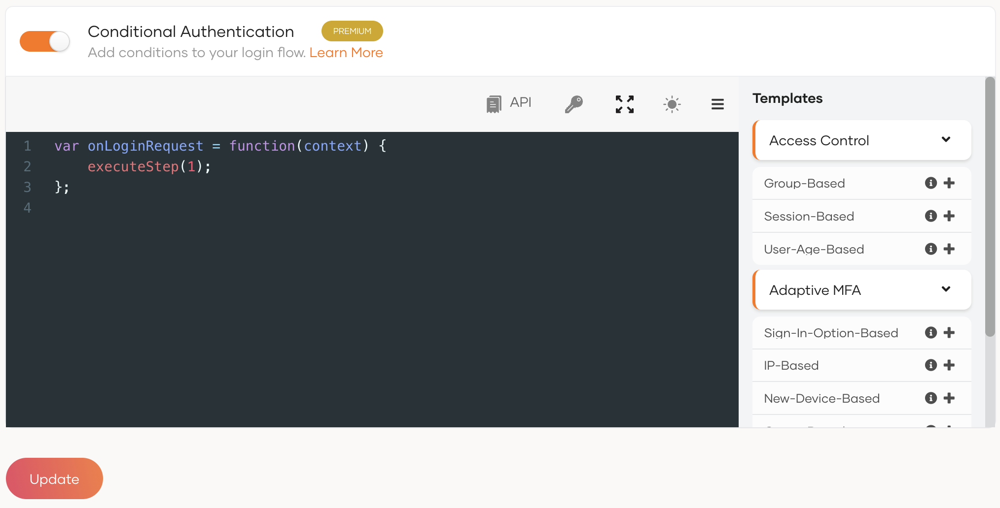

<Applies to="WSO2 Cloud">

# Add conditional authentication

With conditional authentication, the login flow in an application is dependent on the risk factors associated with the user's login request.
This allows you to strengthen the authentication flow when the risk is higher. In WSO2 Identity Platform, conditional authentication is configured using a [script](#authentication-script).


## Authentication script

The authentication script for configuring dynamic authentication flows in WSO2 Identity Platform uses a functional language similar to Javascript. You can configure the script using the script editor in the WSO2 Identity Platform Console. You can either use a [template](#script-templates) or [write a custom script](write-your-first-script.md).

This scripting language supports a set of inbuilt [functions](../../../references/conditional-auth/api-reference.md#utility-functions) and [objects](../../../references/conditional-auth/api-reference.md#object-reference). A simple conditional authentication script will look like the following:

```js
var onLoginRequest = function(context) {
    // Some possible initializations...
    executeStep(1);
        if (doStepUp(context) === true) { 
            executeStep(2);
        }
};

function doStepUp(context) {
    // A function that decides whether to enforce second step based on the request context.
    return true;
}
```

:::note

Find out more about the scripting language in the [Conditional Authentication API Reference](../../../references/conditional-auth/api-reference.md).

:::

## Script templates

The script editor in WSO2 Identity Platform comes with a set of predefined templates to get you started with some of the most common conditional authentication scenarios. These scripts contain inline comments explaining the conditions that are applied.




The available templates are categorized as follows:

- Access Control - These templates restrict user login to the application based on specified conditions.
- Adaptive MFA - These templates prompt two-factor authentication for login attempts based on specific conditions.
- Passkey Enrollment - These templates allows users to progressively enroll with passkey authenticator.

The pre-defined templates are listed below.

| Template  | Description |
|-----------|-------------|
| [User-Age-Based](user-age-based-template.md) | This configures a login flow where users can log in only if their age is over the configured value. The user's age is calculated using the `date of birth` attribute. |
| [Group-Based (Access Control)](group-based-template-access-control.md) | This login flow allows login only for users who belong to any of the given set of groups  |
| [Session Based](concurrent-session-based-template.md)  | This login flow allows login only for users who have less than the configured number of concurrent sessions.  |
| [Sign-In-Option-Based](sign-in-option-based-template.md) | This login flow prompts two-factor authentication (2FA) only for users who are signing in with a given option.  |
| [New-Device-Based](new-device-based-template.md) | This login flow sends an email notification and/or prompts two-factor authentication for users who are logged in from a previously unused device. |
| [Group-Based (Adaptive MFA)](group-based-template.md)  | This login flow prompts two-factor authentication (2FA) for users who belong to any of the given set of groups. |
| [IP-Based](ip-based-template.md) | This login flow prompts two-factor authentication for users who log in from outside the given IP range. |
| [OTP Retry and Resend Limits](otp-retry-resend-limits.md) | Limit how many times users can resend an OTP or enter a wrong OTP per application using the conditional authentication script. |
| [Passkey-Progressive-Enrollment-Based](passkey-progressive-enrollment-based-template.md) | This login flow allows users to progressively enroll with passkey authenticator. |

If required, you can also use the script editor to introduce new functions and fields to an authentication script based on your requirement. See the instructions on [writing a custom authentication script](write-your-first-script.md).

## What's next

- [Configure conditional authentication](configure-conditional-auth.md)
- [Conditional authentication API reference](../../../references/conditional-auth/api-reference.md)

</Applies>


<Applies to="Self-hosted">

# Add conditional authentication

With conditional authentication, the login flow in an application is dependent on the risk factors associated with the user's login request.
This allows you to strengthen the authentication flow when the risk is higher. In WSO2 Identity Server, conditional authentication is configured using a [script](#authentication-script).


## Authentication script

The authentication script for configuring dynamic authentication flows in WSO2 Identity Server uses a functional language similar to Javascript. You can configure the script using the script editor in the WSO2 Identity Server Console. You can either use a [template](#script-templates) or [write a custom script](write-your-first-script.md).

This scripting language supports a set of inbuilt [functions](../../../references/conditional-auth/api-reference.md#utility-functions) and [objects](../../../references/conditional-auth/api-reference.md#object-reference). A simple conditional authentication script will look like the following:

```js
var onLoginRequest = function(context) {
    // Some possible initializations...
    executeStep(1);
        if (doStepUp(context) === true) { 
            executeStep(2);
        }
};

function doStepUp(context) {
    // A function that decides whether to enforce second step based on the request context.
    return true;
}
```

:::note

Find out more about the scripting language in the [Conditional Authentication API Reference](../../../references/conditional-auth/api-reference.md).

:::

## Script templates

The script editor in WSO2 Identity Server comes with a set of predefined templates to get you started with some of the most common conditional authentication scenarios. These scripts contain inline comments explaining the conditions that are applied.


The available templates are categorized as follows:

- User
- Request
- Environment
- Analytics
- IdP

The pre-defined templates are listed below.

| Template  | Description |
|-----------|-------------|
| [Role-Based](role-based-template.md) | This login flow prompts two-factor authentication (2FA) for users who are assigned to any of the given set of roles. |
| [User-Age-Based](user-age-based-template.md) | This configures a login flow where users can log in only if their age is over the configured value. The user's age is calculated using the `date of birth` attribute. |
| [User Store-Based](user-store-based-template.md) | This login flow prompts two-factor authentication (2FA) for users who are from to any of the given set of user stores.  |
| [Login Attempt-Based](login-attempt-based-template.md) | This login flow prompts two-factor authentication (2FA) for users who are from to any of the given set of user stores. |
| [Group-Based](group-based-template.md)  | This login flow prompts two-factor authentication (2FA) for users who belong to any of the given set of groups. |
| [Concurrent Session-Based](concurrent-session-based-template.md) | This login flow prompts adaptive authentication for users who have exceeded the maximum number of allowed sessions.|
| [New-Device-Based](new-device-based-template.md) | This login flow sends an email notification and/or prompts two-factor authentication for users who are logged in from a previously unused device. |
| [IP-Based](ip-based-template.md) | This login flow prompts two-factor authentication for users who log in from outside the given IP range. |
| [OTP Retry and Resend Limits](otp-retry-resend-limits.md) | Limit how many times users can resend an OTP or enter a wrong OTP per application using the conditional authentication script. |
| [Passkey-Progressive-Enrollment-Based](passkey-progressive-enrollment-based-template.md) | This login flow permits users to seamlessly enroll their passkey on-the-fly, when Passkey is designated as the first authentication factor. |

If required, you can also use the script editor to introduce new functions and fields to an authentication script based on your requirement. See the instructions on [writing a custom authentication script](write-your-first-script.md).

## What's next

- [Configure conditional authentication](configure-conditional-auth.md)
- [Conditional authentication API reference](../../../references/conditional-auth/api-reference.md)

</Applies>
