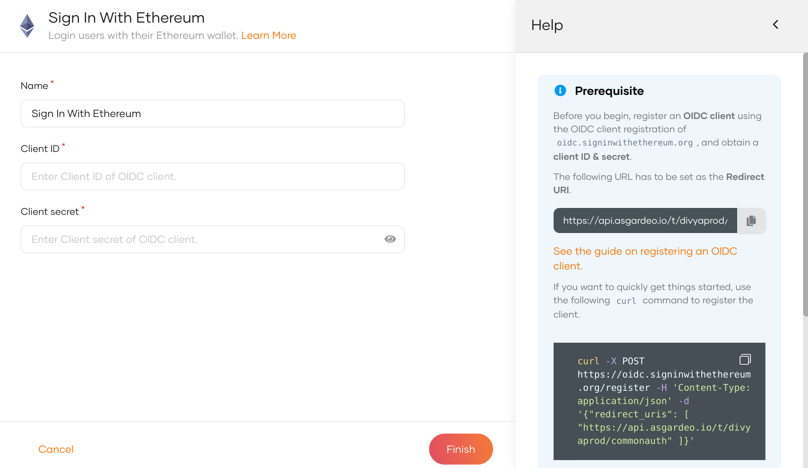
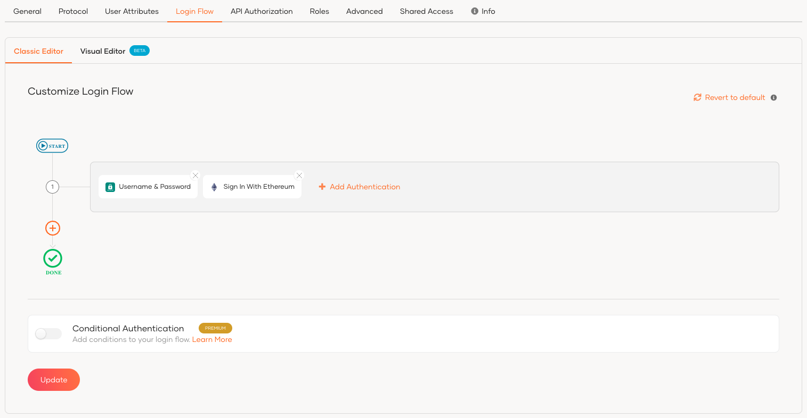
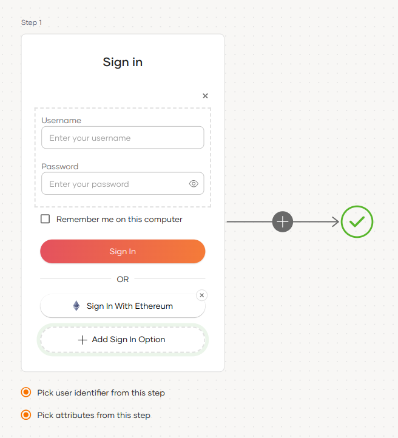
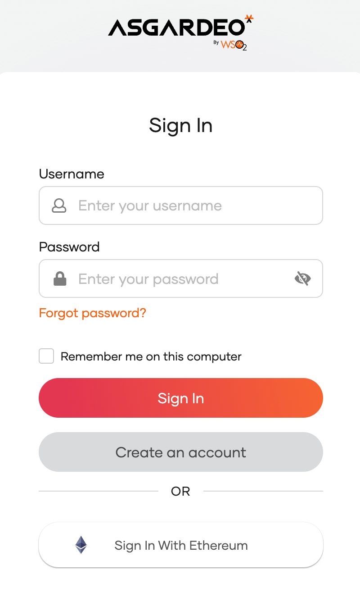
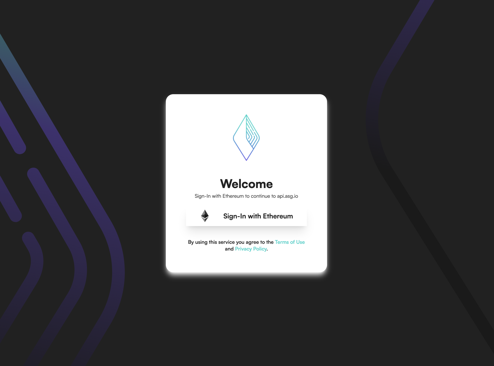
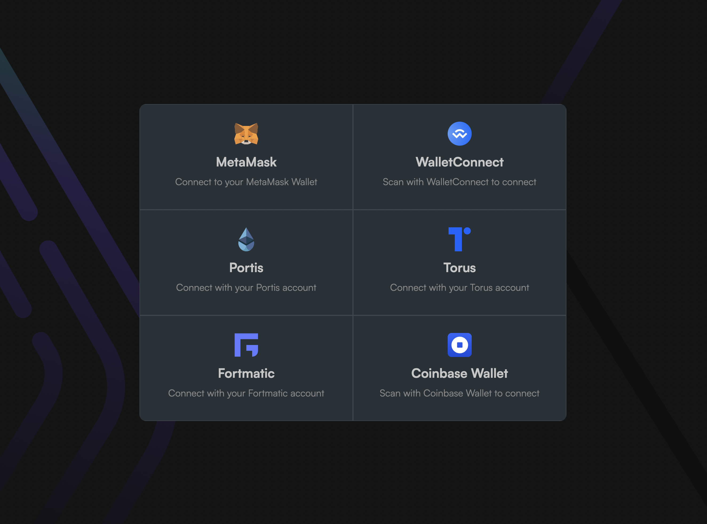
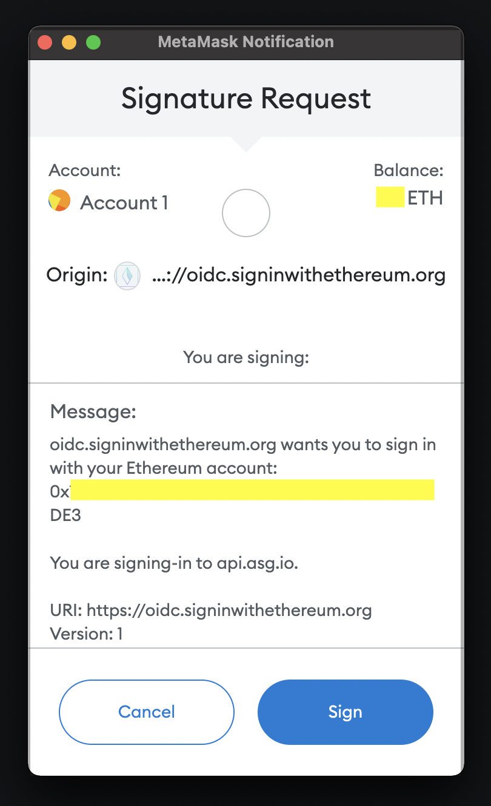

# Sign-In With Ethereum

**Sign-In With Ethereum** is an open standard for authentication that enables users to control their digital identity with their [Ethereum](https://ethereum.org/) account. The integration uses the open-source OIDC Provider built by [Login.xyz](https://login.xyz), which is hosted under [oidc.signinwithethereum.org](https://oidc.signinwithethereum.org).

Follow this guide for instructions on how to set up Sign-In With Ethereum in WSO2 Identity Platform.

## Register WSO2 Identity Platform in Sign-In With Ethereum

You need to register WSO2 Identity Platform as an OIDC client application in `oidc.signinwithethereum.org`.

:::note

Follow the [Sign-In With Ethereum documentation](https://docs.login.xyz/servers/oidc-provider/hosted-oidc-provider) for detailed instructions.

:::

To do so,

1. Use the following curl command to register a new OIDC client.

    ```bash
    curl -X POST https://oidc.signinwithethereum.org/register
    -H 'Content-Type: application/json' -d  '{"redirect_uris": ["https://api.asgardeo.io/t/{organization_name}/commonauth"]}'
    ```

2. Take note of the `client_id` and `client_secret` returned from the response.

    The following is an example response:

    ```json
    {
        "client_id": "9b49de48-d198-47e7-afff-7ee26cbcbc95",
        "client_secret": "{secret}",
        "registration_access_token": "{access_token}",
        "registration_client_uri": "https://oidc.signinwithethereum.org/client/9b49de48-d198-47e7-afff-7ee26cbcbc95",
        "redirect_uris": ["https://api.asgardeo.io/t/{organization_name}/commonauth"]
    }
    ```

## Register the Sign-In With Ethereum IdP

Follow the steps below to register the **Sign-In With Ethereum** IdP in WSO2 Identity Platform.

1. On the WSO2 Identity Platform Console, go to **Connections**.
2. Click **Create Connection** and select **Sign-In With Ethereum**.
3. Enter the following details of the Sign-In With Ethereum identity provider and click **Finish**:

    

    <table>
      <tr>
        <th>Parameter</th>
        <th>Description</th>
      </tr>
      <tr>
        <td>Name</td>
        <td>A unique name for this Sign-In With Ethereum identity provider.</td>
      </tr>
      <tr>
          <td>Client ID</td>
          <td>The client ID obtained from oidc.signinwithethereum.org.</td>
      </tr>
      <tr>
          <td>Client secret</td>
          <td>The client secret obtained from oidc.signinwithethereum.org.</td>
      </tr>
    </table>

5. In the created connection, go to the **Settings** tab and see the list of scopes to which Sign-In With Ethereum has granted permissions.

    - **openid**: Engages the OpenID flow.
    - **profile**: Allows to view the user's basic profile data.

    :::note

    WSO2 Identity Platform needs these scopes to get user information. WSO2 Identity Platform checks the attribute configurations of the application and sends the relevant attributes received from Sign-In With Ethereum to the app.

    :::

## Enable Sign-In With Ethereum

The following guide shows you how to enable **Sign-In With Ethereum** in an application.

:::note[Before you begin]

You need to [register an application with WSO2 Identity Platform](../../applications/index.md). You can register your own application or use one of the [sample applications](../../../get-started/try-samples/index.md) provided.

:::

1. On the WSO2 Identity Platform Console, go to **Applications**.

2. Select your application, go to the **Login Flow** tab and enable **Sign-In With Ethereum** using your preferred editor:

    ---
    <Tabs>
    <TabItem value="tab-0" label="Classic Editor">

    To add enable **Sign-In With Ethereum** using the Classic Editor:

    1. If you haven't defined a sign-in flow for the application, click **Start with Default configuration** to define a login flow with a username and a password.

    2. Click **Add Authentication** in the same step as the default configuration.

    3. From the list of connections that appear, select the **Sign-In With Ethereum** connection that you created and click **Add**.

        

    </TabItem>
    <TabItem value="tab-1" label="Visual Editor">

    To add enable **Sign-In With Ethereum** using the Visual Editor:

    1. Switch to the **Visual Editor** tab, by default the `Username & Password` login flow will be added onto the Visual Editor's workspace.

    2. Click on `+ Add Sign In Option` to add a new authenticator to the same step and select the **Sign-In With Ethereum** connection that you created

        

    </TabItem>
    </Tabs>

    ---

3. Click **Update** to save the changes.

## Try it out

Follow the steps given below.

1. Access the application that you previously registered with WSO2 Identity Platform.
2. Click **Login** to redirect to the WSO2 Identity Platform login page.
3. On the WSO2 Identity Platform login page, choose the **Sign-In With Ethereum** IdP to log in.

    :::note

    You will be redirected to the login interface of **Sign-In With Ethereum**.

    :::

    

4. Click **Sign-In With Ethereum** again to log in.

    

5. Select a preferred Ethereum wallet.

    

6. Sign the login request to log in to the application.

    

## Configure connection

To learn more about other configurations available for the connection, refer to the [add federated login](../federated-login/index.md) documentation.
