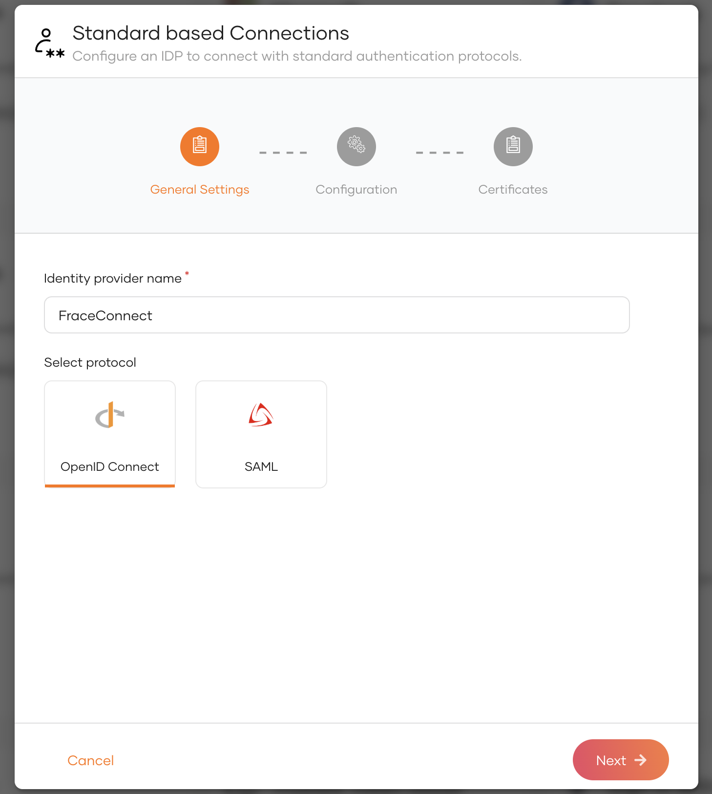
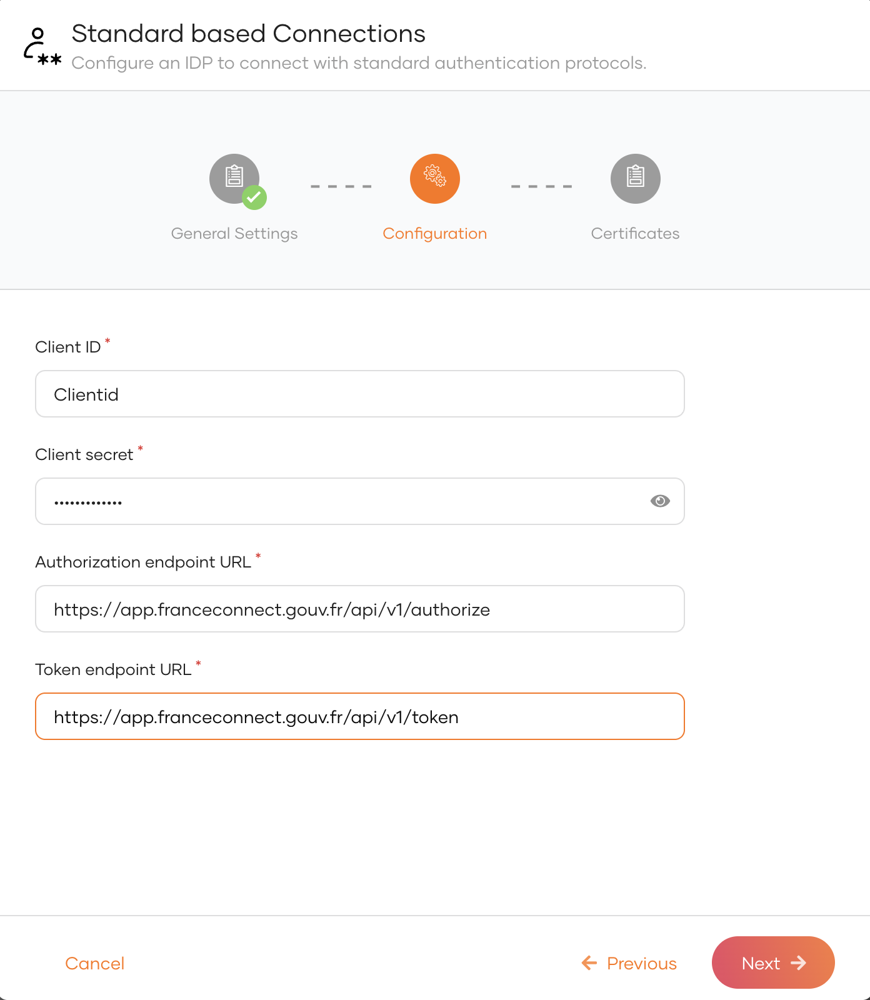
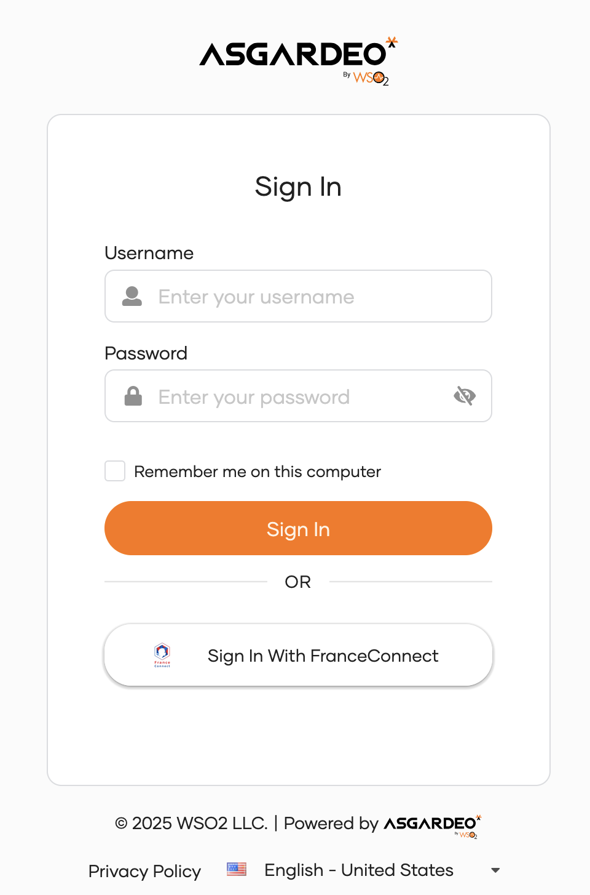
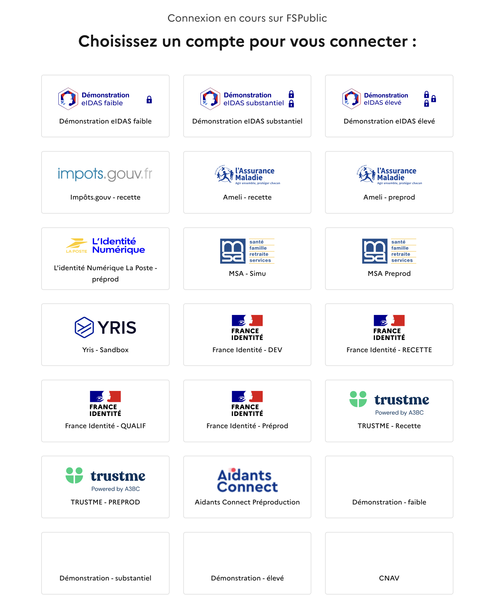

import AddFranceconnectLogin from '../../../_partials/guides/fragments/add-login/eid-login/add-franceconnect-login.mdx';

# Add FranceConnect Login

[FranceConnect](https://franceconnect.gouv.fr/) is a digital authentication solution provided by the French government. It allows users to log in to various online services using their FranceConnect credentials. This guide will help you set up FranceConnect login in WSO2 Identity Server.

## Register WSO2 Identity Server on FranceConnect
1. Log in to the [FranceConnect Portal](https://partenaires.franceconnect.gouv.fr/login). 
2. You will get the Client ID and Client Secret from the FranceConnect application.
3. Enter the following as the Redirect URL:
    - **Authorization callback URL**
      ```bash
      https://localhost:9443/commonauth
      ```

## Register the FranceConnect Login

Now, let's register the FranceConnect in WSO2 Identity Server.

1. On the WSO2 Identity Server Console, go to **Connections**.
2. Click **New Connections** and select **Standard-based Idp**.
3. Click **Create**.
4. Enter a  unique name for your FranceConnect connection.
   
5. Enter the following details and click **Finish**:

       <table><tbody><tr><th>{"Parameter"}</th><th>{"Description"}</th></tr><tr><td>{"Client ID"}</td><td>{"The client ID obtained from FranceConnect."}</td></tr><tr><td>{"Client secret"}</td><td>{"The client secret obtained from FranceConnect."}</td></tr><tr><td>{"Authorised redirect URL"}</td><td>{"Provide the Authorised redirect URL of your FranceConnect connection. For example "}<code>{"https://app.franceconnect.gouv.fr/api/v1/authorize"}</code>{"."}</td></tr><tr><td>{"Token Endpoint URL"}</td><td>{"Provide the Token endpoint URL of your FranceConnect connection. For example "}<code>{"https://app.franceconnect.gouv.fr/api/v1/token"}</code>{"."}</td></tr></tbody></table>
   <br />
       
6. Click **Next**<br />
7. You can enter *JWKS endpoint URL*  of France Connect or upload the public certificate. This step is not mandatory while creating the connection.
      <table><tbody><tr><td>{"JWKS endpoint URL"}</td><td>{"Provide the JWKS endpoint URL of your FranceConnect organization. For example "}<code>{"https://app.franceconnect.gouv.fr/api/v1/jwks"}</code>{"."}</td></tr></tbody></table>
8. Click **Finish**.

## Enable FranceConnect login

<AddFranceconnectLogin />

## Try it out

Follow the steps given below.

1. Access the application URL.

2. Click **Login** to open the WSO2 Identity Server login page.

3. On the WSO2 Identity Server login page, **Sign in with FranceConnect**.

    

4. Log in to FranceConnect with an existing eID.

    

## Configure connection

To learn more about other configurations available for the connection, refer to the [add federated login](../federated-login/index.md) documentation.
