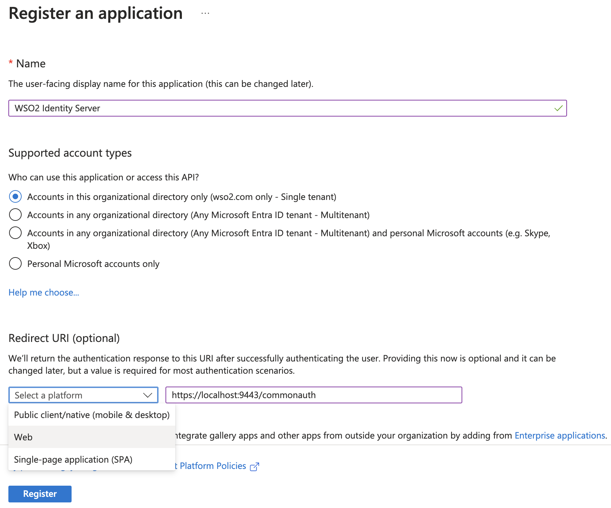
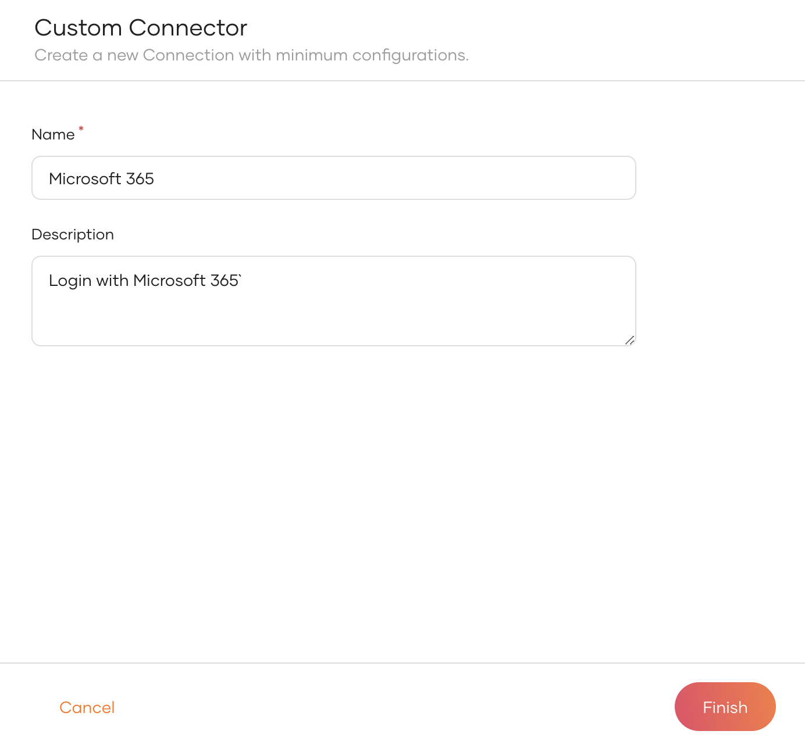
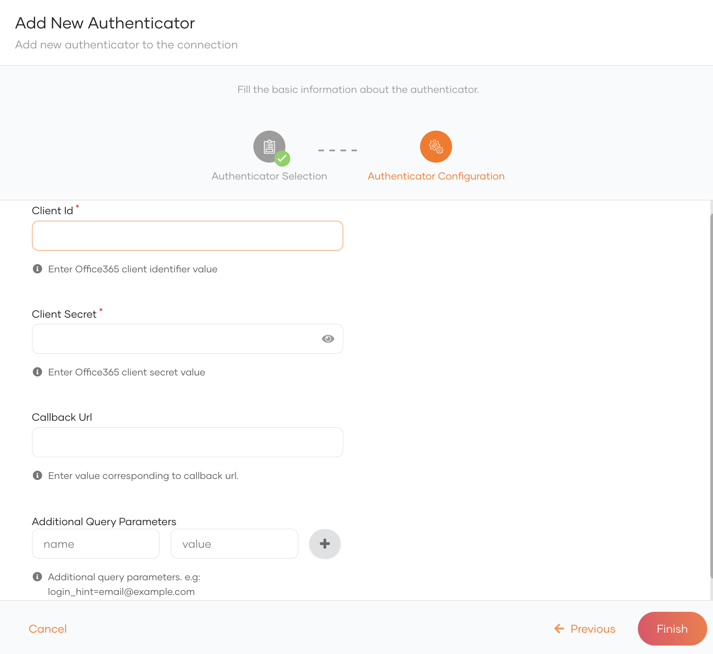
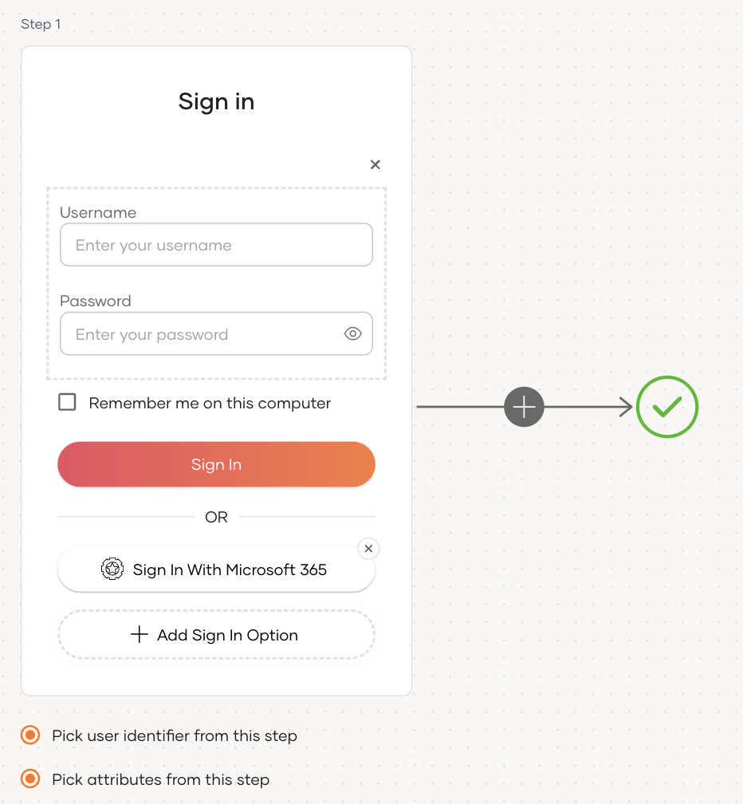
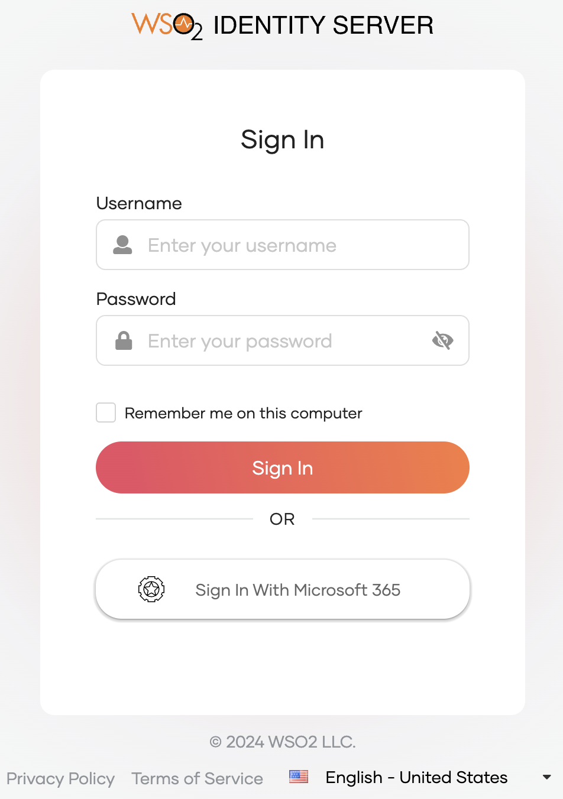

import Recommendation from '../../../_partials/guides/fragments/add-login/recommendation.mdx';
import ManageAttributes from '../../../_partials/guides/fragments/manage-connection/manage-attributes.mdx';

# Add login with Microsoft 365

You can connect Microsoft 365 as an authenticator to your applications using WSO2 Identity Server and enable users to log in with their Microsoft 365 accounts.

Follow this guide for instructions.

## Register WSO2 Identity Server on Microsoft
You need to register WSO2 Identity Server as an OAuth2.0 application on Microsoft.

:::note

For detailed instructions, you can follow the [Microsoft documentation](https://learn.microsoft.com/en-us/power-apps/developer/data-platform/walkthrough-register-app-azure-active-directory).

:::

1. Sign in to the [Azure Portal](https://portal.azure.com/) using an account with administrator permission.

    :::note

    You must use an account in the same Microsoft 365 subscription (tenant) with which you intend to register the app.

    :::

2. On the Azure portal, go to **Azure Services** > **Microsoft Entra ID**.

3. Click **Add** and select **App registration** from the list.

4. Provide the required information for app registration.

    

    <table><tbody><tr><th>{"Parameter"}</th><th>{"Description"}</th></tr><tr><td>{"Name"}</td><td>{"Enter a meaningful name for your application."}</td></tr><tr><td>{"Supported Account Type"}</td><td>{"Select the supported account type. If you wish for users to use only Microsoft 365 accounts, select either the first or the second option. Learn more about account types in the "}[{"Microsoft documentation"}](https://learn.microsoft.com/en-us/security/zero-trust/develop/identity-supported-account-types){"{:target=\"_blank\"}."}</td></tr><tr><td>{"Redirect URI"}</td><td>{"Select "}<b>{"Web"}</b>{" as the platform and provide the URL to redirect after the login is completed."} <b>{"Value:"}</b>{" "}<code>{"https://localhost:9443/commonauth"}</code></td></tr></tbody></table>

5. Click **Register** to create the application.

    :::note

    Take note of the client ID after the application is created.

    :::

Now, let's generate a client secret for the application.

1. Go to **Certificates & secrets** on the left navigation and click **+ New client secret**.

2. Enter a description for the client secret and select the expiry time.

3. Click **Add** to add the client secret.

    :::note[Important]

    Take note of the generated **Value**. Azure will allow copying this value only once. This value is the newly generated client secret for your Microsoft connection in WSO2 Identity Server.

    :::

## Register the Microsoft 365 IdP

Now, let's register the Microsoft IdP in WSO2 Identity Server.

1. On the WSO2 Identity Server Console, go to **Connections**.

2. Click **Create Connection** and select **Custom Connector**.

3. Provide a name and a description for the connector and click **Finish**.

      

4. On the created custom connector, go to the **Settings** tab.

5. Click **New Authenticator**, select **Office 365** and click **Next**.

6. Enter the following details of the Microsoft identity provider and click **Finish**:

    

    <table><tbody><tr><th>{"Parameter"}</th><th>{"Description"}</th></tr><tr><td>{"Name"}</td><td>{"A unique name for this Microsoft identity provider."}</td></tr><tr><td>{"Client ID"}</td><td>{"The client ID obtained from Microsoft."}</td></tr><tr><td>{"Client secret"}</td><td>{"The client secret obtained from Microsoft."}</td></tr><tr><td>{"Additional Query Parameters"}</td><td>{"Additional parameters that will be sent in the authorization request. Learn more about URI parameters in the "}[{"Microsoft documentation"}](https://learn.microsoft.com/en-us/openspecs/windows_protocols/ms-oapx/65aeaef4-5553-43cd-b778-6e89f126717c){"{: target=\"#\"}."}</td></tr></tbody></table>

## Enable Microsoft 365 login

:::note[Before you begin]

You need to [register an application with WSO2 Identity Server](../../applications/index.md). You can register your own application or use one of the [sample applications](../../../get-started/try-samples/index.md) provided.

:::

To enable Microsoft login:

1. On the WSO2 Identity Server Console, go to **Applications**.

2. Select your application, go to the **Login Flow** tab and add Microsoft login from your preferred editor:

    

    1. Go to **Predefined Flows** > **Basic Flows** > **Add Passwordless login**.

    2. Select the Microsoft 365 connection.

    3. Click **Confirm** to add Microsoft 365 to the sign-in flow.

        

    

    <Recommendation />

3. Click **Update** to save your changes.

## Try it out

Follow the steps given below.

1. Access the application URL.

2. Click **Login** to open the WSO2 Identity Server login page.

3. On the WSO2 Identity Server login page, **Sign in with Microsoft 365**.

    

4. Log in using an existing Microsoft 365 account.

:::note

When a user successfully logs in with Microsoft 365 for the first time, a **user** account is created in the WSO2 Identity Server Console with the Microsoft 365 username. Microsoft will manage this new user account.

:::

## Configure user attributes

<ManageAttributes />

## Configure connection

To learn more about other configurations available for the connection, refer to the [add federated login](../federated-login/index.md) documentation.
