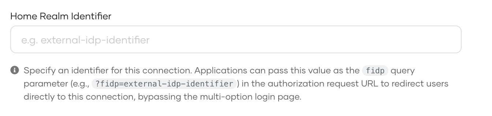

import JitProvisioning from '../../../_partials/guides/fragments/manage-connection/jit-provisioning.mdx';
import AddGroups from '../../../_partials/guides/fragments/manage-connection/add-groups.mdx';
import DeleteConnection from '../../../_partials/guides/fragments/manage-connection/delete-connection.mdx';

# Add federated login

WSO2 Identity Platform lets you add and configure external Identity Providers (IdP) so that users can bring their identities in these external IdPs and log in to applications. Follow the guides below to learn how you can integrate the external IdP of your choice with WSO2 Identity Platform.

## Create a connection

You can register an external IdP in WSO2 Identity Platform by creating a connection. WSO2 Identity Platform supports a variety of connections for your convenience. Select your preferred connection and follow the guide to learn how to configure it.

<div className="center-all">
  <div className="cards-container">
    <a href="/identity/guides/authentication/social-login/add-facebook-login" className="card square">
      
      <span>Facebook</span>
    </a>
    <a href="/identity/guides/authentication/social-login/add-github-login" className="card square">
      
      
      <span>GitHub</span>
    </a>
    <a href="/identity/guides/authentication/social-login/add-google-login" className="card square">
      
      <span>Google</span>
    </a>
    <a href="/identity/guides/authentication/social-login/add-apple-login/" className="card square">
      
      
      <span>Apple</span>
    </a>
    <a href="/identity/guides/authentication/social-login/add-microsoft-login" className="card square">
      
      <span>Microsoft</span>
    </a>
    

    <Applies to="Self-hosted">

    <a href="/identity/guides/authentication/enterprise-login/add-microsoft-365-login" className="card square">
      
      <span>Microsoft 365</span>
    </a>
    <a href="/identity/guides/authentication/enterprise-login/add-iwa-login" className="card square">
      
      <span>IWA</span>
    </a>
    <a href="/identity/guides/authentication/enterprise-login/add-ad-fs-login" className="card square">
      
      <span>AD FS</span>
    </a>
    <a href="/identity/guides/authentication/social-login/add-x-login/" className="card square">
      
      
      <span>X</span>
    </a>

    </Applies>

    
    <a href="/identity/guides/authentication/standard-based-login/add-oidc-idp-login" className="card square">
      
      <span>OpenID Connect</span>
    </a>
    <a href="/identity/guides/authentication/standard-based-login/add-saml-idp-login" className="card square">
      
      <span>SAML</span>
    </a>
    

    <Applies to="Self-hosted">

    <a href="/identity/guides/authentication/standard-based-login/add-ws-federation" className="card square">
      
      <span>WS-Federation</span>
    </a>

    </Applies>

    
    

    <Applies to="WSO2 Cloud">

    <a href="/identity/guides/authentication/decentralized-login/sign-in-with-ethereum" className="card square">
      
      <span>Sign-in with Ethereum</span>
    </a>

    </Applies>

    
  </div>
</div>

## Configure JIT provisioning

<JitProvisioning />

## Map groups with WSO2 Identity Platform

<AddGroups />


## Configure home realm identifier

The home realm identifier is a unique value that identifies a connection when routing users directly to a specific external IdP during login. When a user initiates login, your application can include this identifier as the `fidp` query parameter in the authorization request, which causes WSO2 Identity Platform to skip the login page and route the user directly to the specified external IdP.

To configure the home realm identifier:

1. On the WSO2 Identity Platform Console, click **Connections** and select the relevant connection.

2. Go to the **Advanced** tab of the selected connection.

3. Enter a unique identifier in the **Home Realm Identifier** field.

    

4. Click **Update** to save the changes.

Once configured, use this identifier in your application's authorization request as follows:

```bash
https://<host_name>/t/<org_name>/oauth2/authorize?
  response_type=code
  &client_id=<client_id>
  &redirect_uri=<redirect_uri>
  &scope=openid
  &fidp=<home_realm_identifier>
```

:::note

When the `fidp` parameter is provided, WSO2 Identity Platform bypasses the login page and directly initiates the authentication flow with the matching external IdP.

:::


## Delete a connection

<DeleteConnection />
