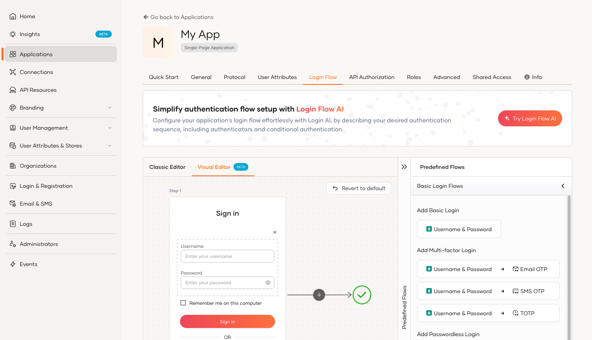

# Login Flow AI

AI-powered login flow generation simplifies the setup of authentication sequences in WSO2 Identity Platform by using an AI-driven approach. This tool allows users to efficiently create tailored authentication sequences without needing in-depth knowledge of the underlying authenticators or scripting languages.

<Applies to="Self-hosted">

:::note[Enable AI-powered features]

To enable AI-powered features, WSO2 Identity Server requires a subscription key from the [WSO2 AI subscription portal](https://ai-subscriptions.wso2.com/). See the [guide](../../get-started/subscribe-to-ai-features.mdx) for step by step instructions.

:::

</Applies>

## Generate login flows with Login Flow AI

To generate your login flow with LoginFlow AI:

1. On the WSO2 Identity Platform Console, go to **Applications**.

2. Select your application and go to its **Login Flow** tab.

3. Click **Try Login Flow AI**.

    

4. Enter the login scenario you want to configure and press enter.

    :::note

    If you wish to add connections to your login sequence, make sure to [set up the required connection](index.mdx#manage-connections). Only existing connections can be incorporated into the login flow.

    :::

    

    The system will analyze the input and generate the appropriate authentication sequence.

## Customize the generated authentication sequence

The AI system processes your input and provides an authentication sequence, you can further customize the authentication sequence by:

- Adding or removing authenticators as needed.
- Modifying the suggested steps.

## Apply Login Flow

Once you've reviewed and customized the generated login flow, click **Update** to apply it to your application.
