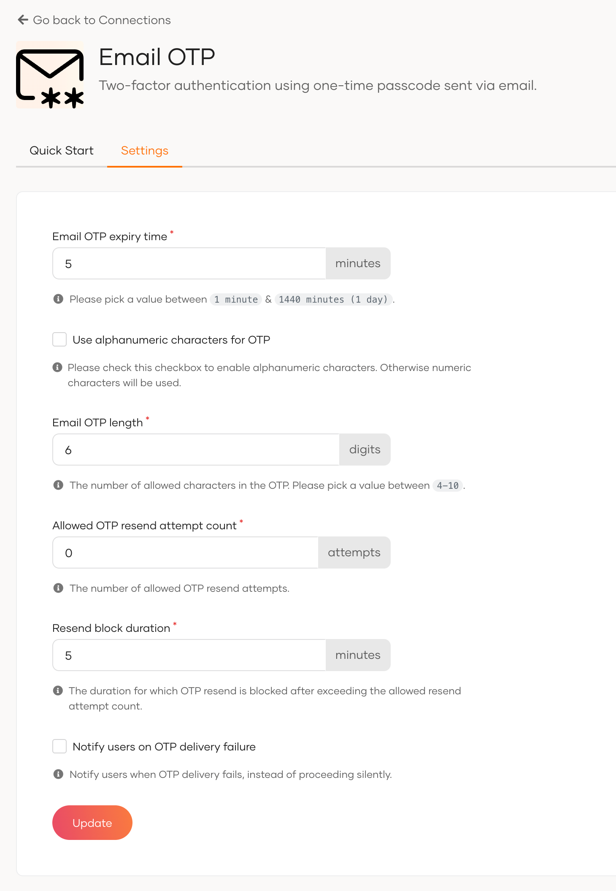
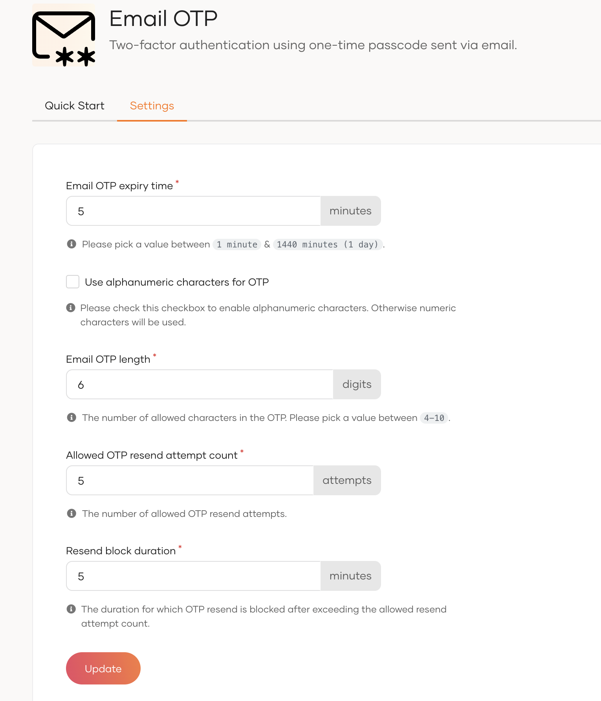
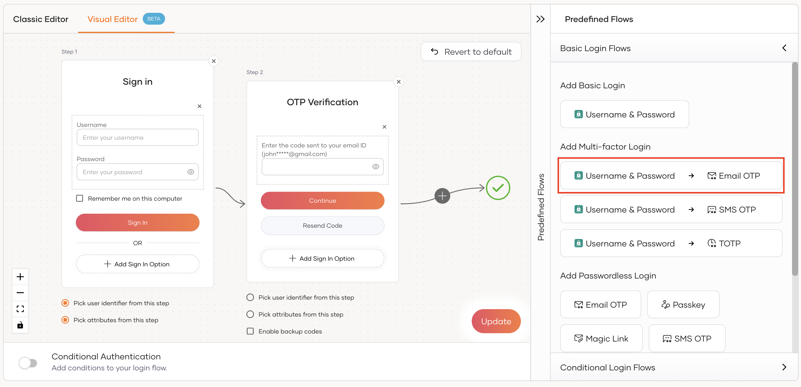
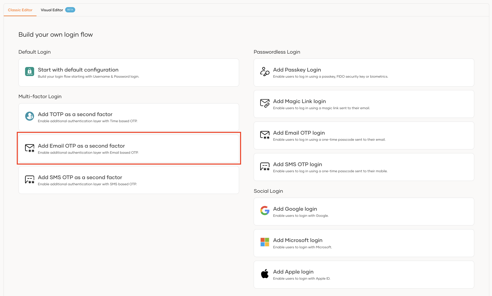
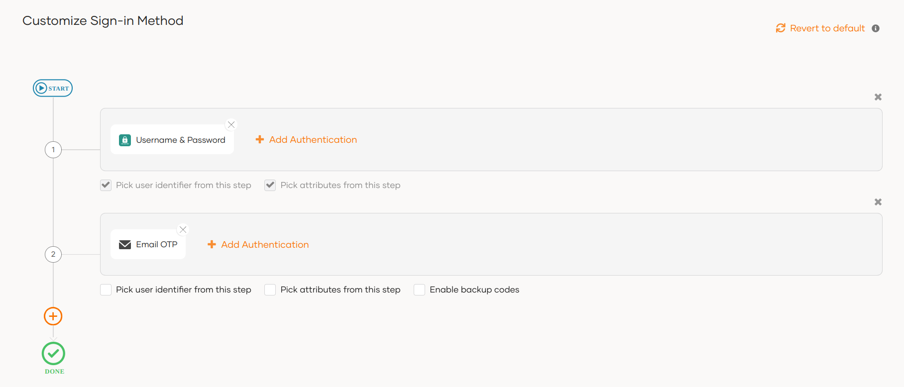
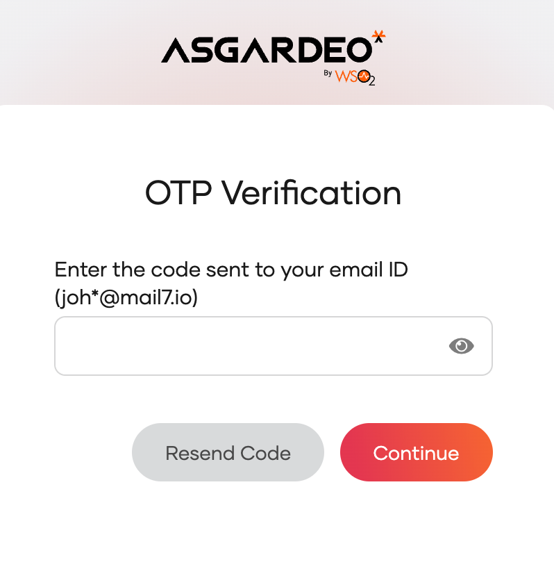

# Add MFA with Email OTP

Email OTP is a One-Time Password (OTP) sent to the user's verified email address, which the user must submit during login (as an additional authentication step). This password is typically valid for a very short period.

During Email OTP authentication, the user is required to access the verified email account within a short time span to get the OTP. This prevents unauthorized users from accessing the OTP and thereby adds an extra layer of security to the authentication process.

Follow the instructions given below to configure Multi-Factor Authentication (MFA) using Email OTP in WSO2 Identity Platform.

## Prerequisites

- [Register an application with WSO2 Identity Platform](../../applications/index.md). You can register your own application or use one of the [sample applications](../../../get-started/try-samples/index.md) provided.

- [Update users' profiles](../../users/manage-users.md#update-the-profile) with email addresses.

<Applies to="Self-hosted">

- [Configure the email provider](../../notification-channels/configure-email-provider.md) in WSO2 Identity Server.

</Applies>

:::note[Info]

You can use Email OTP for multi-factor authentication only if a previous authentication step is configured with **username and password** or another factor that can validate user credentials.

:::

## Set up Email OTP
WSO2 Identity Platform has some default settings for email OTP, which are sufficient for most cases. If required, you can change the default settings, as explained below.

To update the default Email OTP settings:

1. On the WSO2 Identity Platform Console, go to **Connections** and select **Email OTP**.
2. Update the following parameters in the **Settings** tab:

    

    <Applies to="WSO2 Cloud">

    

    </Applies>

    

    <Applies to="Self-hosted">

    

    </Applies>

    
    
    <table>
      <tr>
        <th>Field</th>
        <th>Description</th>
      </tr>
      <tr>
        <td>Email OTP expiry time</td>
        <td>Specifies the expiry time of the OTP. The generated OTP will not be valid after this expiry time.</td>
      </tr>
      <tr>
        <td>Use alphanumeric characters for OTP</td>
        <td>
            Specifies whether to use alphanumeric characters in the OTP. If not selected, the generated OTP contains only digits (0-9).
        </td>
      </tr>
      <tr>
        <td>Email OTP length</td>
        <td>Specifies the number of characters allowed in the OTP.</td>
      </tr>
      <tr>
        <td>Allowed OTP resend attempt count</td>
        <td>Specifies the number of allowed OTP resend attempts.</td>
      </tr>
      <tr>
        <td>Resend block duration</td>
        <td>Specifies the time duration to block OTP resend requests after reaching the maximum allowed resend attempts.</td>
      </tr>
      

      <Applies to="WSO2 Cloud">

      <tr>
        <td>Notify users on OTP delivery failure</td>
        <td>
            If enabled, users are notified when the email OTP fails to send due to a connectivity or provider error. If disabled, the failure occurs silently and users are still prompted to enter the OTP without any error indication. Note that actual delivery failures (e.g., the email not reaching the recipient's inbox) may not be captured, depending on the provider used.
            This is disabled by default.
        </td>
      </tr>

      </Applies>

      
    </table>
    
3. Once you update the Email OTP settings, click **Update**.

## Enable Email OTP for an app

To enable Email OTP for MFA, you need to add **Email OTP** in the authentication flow of the application.

Follow the steps given below.

1. On the WSO2 Identity Platform Console, go to **Applications**.

2. Select the application to which you wish to add Email OTP.

3. Go to the **Login Flow** tab of the application and add the Email OTP authenticator as follows:

    

    <Applies to="WSO2 Cloud">

    <Tabs>
    <TabItem value="tab-0" label="Visual Editor">

    To add Email OTP as a second-factor authenticator using the Visual Editor:

    1. Switch to the **Visual Editor** tab and go to **Predefined Flows** > **Basic Flows** > **Add Multi-factor login**.

    2. Select **Username + Password -> Email OTP**.

    3. Click **Confirm** to add Email OTP as a second factor to the sign-in flow.

        

    4. Select **Enable backup codes** if you wish to allow users to use backup codes to log in to the application. Learn more about [configuring backup codes for users](../../user-self-service/manage-backup-codes.md).

    </TabItem>
    <TabItem value="tab-1" label="Classic Editor">

    - If you don't have a customized login flow, you can click **Add Email OTP as a second factor**.

        

    This opens the customized login flow with Email OTP as a second-factor authenticator:

    - If you have an already customized login flow, you can add a second step and add Email OTP as the authenticator.

        

    - Select **Enable backup codes** if you wish to allow users to use backup codes to log in to the application. Learn more about [configuring backup codes for users](../../user-self-service/manage-backup-codes.md).

    </TabItem>
    </Tabs>

    ---

    </Applies>

    

    <Applies to="Self-hosted">

    1. Go to **Predefined Flows** > **Add Multi-factor Login**.

    2. Select **Username + Password -> Email OTP**.

    3. Click **Confirm** to add passwordless login with email OTP to the sign-in flow.

          

    4. Select **Enable backup codes** if you wish to allow users to use backup codes to log in to the application. Learn more about [configuring backup codes for users](../../user-self-service/manage-backup-codes.md).

    </Applies>

    

4. Click **Update** to save your changes.

## How it works

When Email OTP is enabled in the login flow of your application, the application user will be prompted with the email OTP authentication step once the first authentication step is completed. Given below are the high-level steps that follow:

1. WSO2 Identity Platform sends the OTP to the user's verified email address.
2. WSO2 Identity Platform prompts the user to enter the OTP code.
  
    

3. If required, the user can request WSO2 Identity Platform to resend the OTP. The new OTP invalidates the previously sent OTP.
4. The user enters the OTP and clicks **Continue**.
5. If the authentication is successful, the user can access the application.
