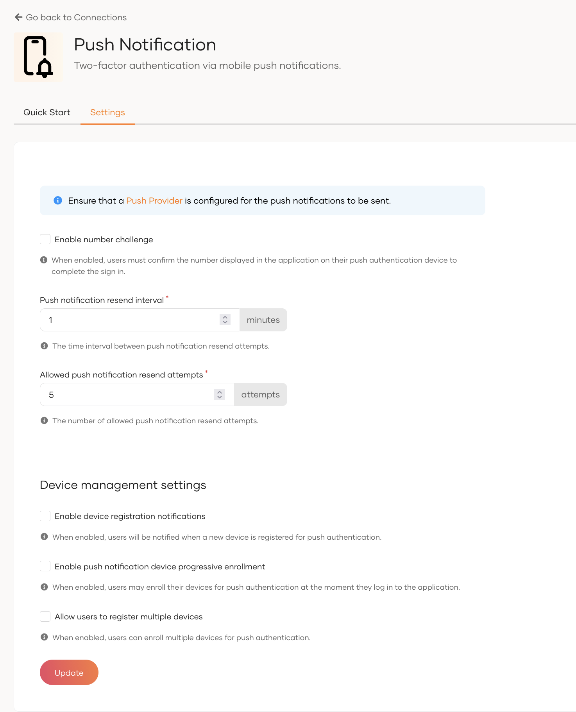
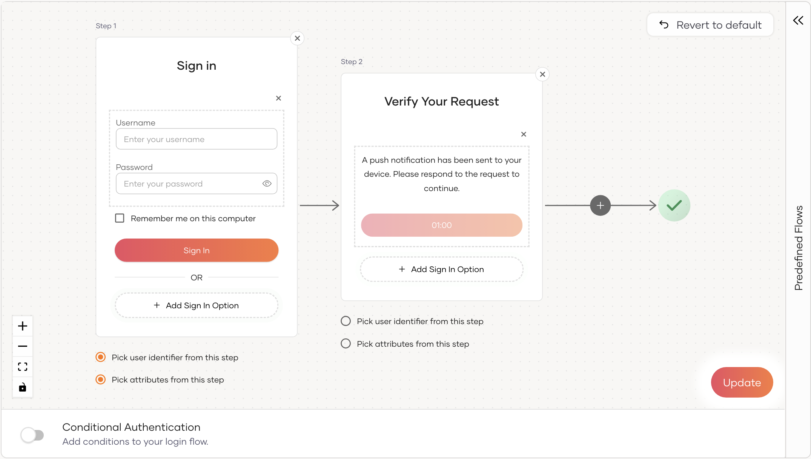
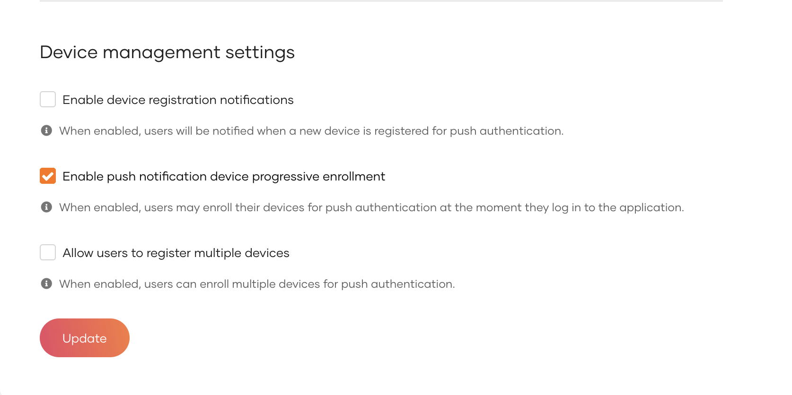
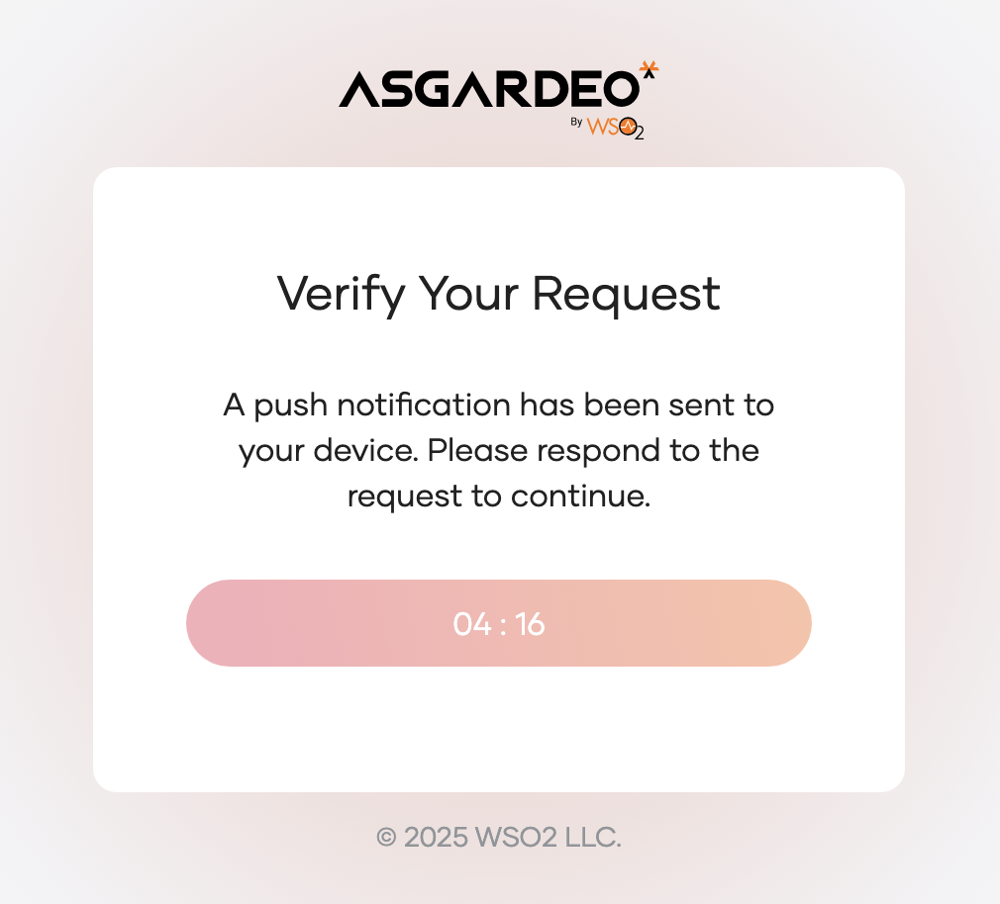
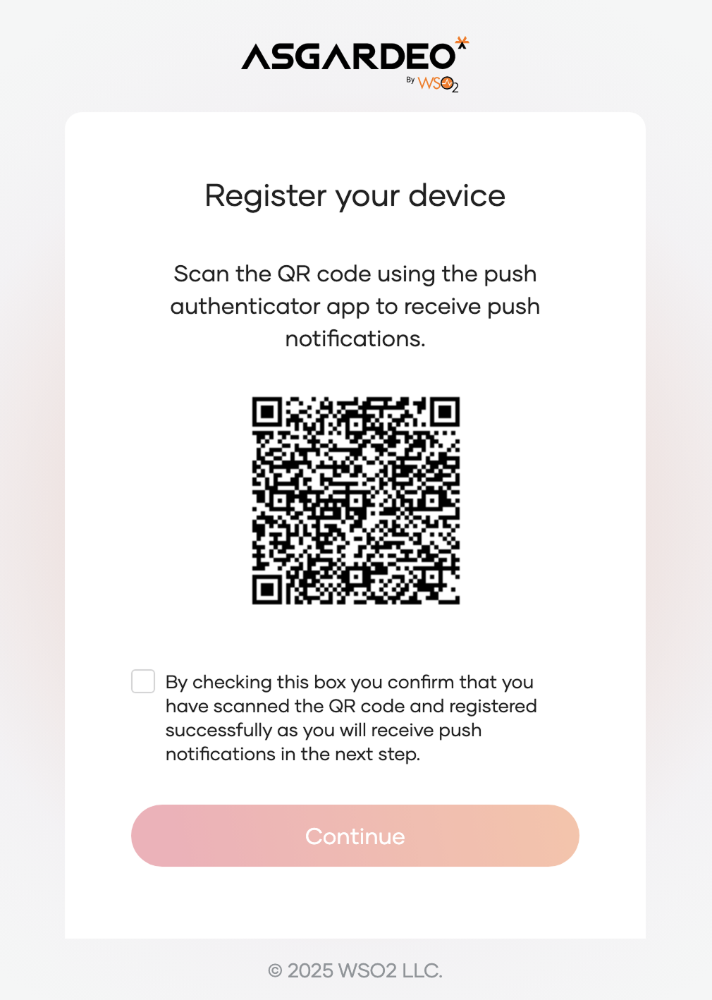

# Add MFA with Push Notification

Push notifications provide a seamless and secure MFA solution by allowing users to verify their identity with a simple tap on their registered device. This real-time authentication method reduces reliance on passwords and one-time passcodes, enhancing security against phishing and credential attacks.

Follow the instructions given below to configure Multi-Factor Authentication (MFA) using Push Notifications in WSO2 Identity Platform.

<Prerequisites>

## Prerequisites

- To get started, you need to [register an application with WSO2 Identity Platform](../../applications/index.mdx). You can register your own application or use one of the [sample applications](../../../get-started/try-samples/index.mdx) provided.

- You need to configure a Push Provider in WSO2 Identity Platform. If you haven't configured a Push Notification Provider yet, follow the instructions in the [Push Provider Configuration](../../notification-channels/configure-push-provider.mdx) guide.

- You need to have a user account in WSO2 Identity Platform. If you don't already have one, [create a user account](../../users/manage-users.mdx#onboard-a-user) in WSO2 Identity Platform.

- A push authenticator application is required for the purpose of receiving push notifications. Learn how to [build your own push authenticator app.](../../../references/tutorials/build-your-own-push-authenticator-app.mdx)

- If push notification device progressive enrollment is disabled, [application users](../../users/manage-users.mdx#onboard-a-user) need to register their push notification devices via the My Account app prior to using push notification based login. Be sure to educate your users on how to [enroll push notification devices via My Account.](../../user-self-service/register-push-notification-device.mdx)

</Prerequisites>

## Set up Push Notifications

WSO2 Identity Platform has some default settings for Push Notifications, which are sufficient for most cases. If required, you can change the default settings, as explained below.

To update the default Push Notification settings:

1. On the WSO2 Identity Platform Console, go to **Connections** and select **Push Notification**.
2. Update the following parameters in the **Settings** tab:

    

    <table>
         <tr>
           <th>Field</th>
           <th>Description</th>
         </tr>
         <tr>
           <td><code>Enable number Challenge</code></td>
           <td>When enabled, users must confirm the number displayed in the application on their push authentication device to complete the sign in.</td>
         </tr>
         <tr>
           <td><code>Enable push notification device progressive enrollment</code></td>
           <td>
               When enabled, users may enroll their devices for push authentication at the moment they log in to the application.
           </td>
         </tr>
         <tr>
           <td><code>Push notification resend interval</code></td>
           <td>Specifies the time interval between the resend attempts. Also, the polling to identify user's response for the push notification will be ended once the timer is completed.</td>
         </tr>
         <tr>
           <td><code>Allowed push notification resend attempts</code></td>
           <td>The number of allowed push notification resend attempts. Once exceeded, the user will not be allowed to send any push notifications.</td>
         </tr>
    </table>

3. Once you update the Push Notification settings, click **Update**.

## Enable push notifications login for an app

Follow the steps given below to enable **Push Notification** login for your application.

1. On the WSO2 Identity Platform Console, go to **Applications**.

2. Select the application to which you wish to add Push Notification.

3. Go to the **Login Flow** tab of the application and add Push Notification from your preferred editor:

    

    <Applies to="Self-hosted">

    1. Click **+** to add a second step to the login flow.

    2. Click **Add Sign In Option**, select **Push Notification** and click **Add**.

    3. Click **Confirm** to add login with push notifications to the sign-in flow.

        

    </Applies>

    

4. Click **Update** to save your changes.

## Enable push notification device progressive enrollment

This feature allows users to enroll their push notification devices seamlessly during the usual login flow, offering a blend of convenience and security. Follow the steps given below to enable **Push Notification Devices progressive enrollment** for your application.

1. On the WSO2 Identity Platform Console, go to **Connections**.

2. Select the **Push Notification** connection.

3. Go to the **Settings** tab of the connection.

4. Enable the option for **Enable push notification device progressive enrollment** by checking its checkbox.

    

5. Click **Update** to save your changes.

:::note

Push notification device progressive enrollment can only be configured at the organizational level and cannot be modified at the application level.

:::

## Enable progressive enrollment for multiple devices

When multiple device registration is enabled, you can also let a user who already has a registered device add another one during sign-in.

:::warning

Anyone who gets past the earlier authentication step can register their own device during sign-in. Enable this option only if your use case requires it.

:::

1. On the WSO2 Identity Platform Console, go to **Connections** > **Push Notification** and open the **Settings** tab.

2. With **Enable push notification device progressive enrollment** and **Allow users to register multiple devices** both enabled, select **Allow progressive enrollment for multiple devices** and confirm the security prompt.

3. Click **Update**.

:::note

For the full walkthrough — enabling multiple device registration, registering additional devices, and device registration notifications — see [Register multiple devices for push notifications](../../../tutorials/register-multiple-devices-for-push-notifications.mdx).

:::

## Try out Push Notification MFA flow with a user already enrolled with a device

In this section, we will guide you through the steps to authenticate using Push Notification MFA with a user who has already enrolled a push notification device.

1. Access the application URL.

2. Click **Login** to access the WSO2 Identity Platform login page.

3. Enter your username and password, then click **Sign In**.

4. You will receive a push notification on your registered device. Approve the authentication request from the registered device. Below shown page will be displayed and will be polling for the user's response.

    

5. Once you approve the authentication request, you will be successfully logged in to the application.

## Try out Push Notification MFA flow with a user not enrolled with a device

In this section, we will guide you through the steps to authenticate using Push Notification MFA with a user who has not enrolled a push notification device when progressive enrollment is enabled.

1. Access the application URL.

2. Click **Login** to access the WSO2 Identity Platform login page.

3. Enter your username and password, then click **Sign In**.

4. You will be displayed with a similar page as shown below. Scan the QR code using your Push Authenticator App to enroll your device. Once the device is enrolled successfully, check the checkbox and click **Continue** to proceed with the authentication.

    

5. You will receive a push notification on your registered device. Approve the authentication request from the registered device.

6. Once you approve the authentication request, you will be successfully logged in to the application.
