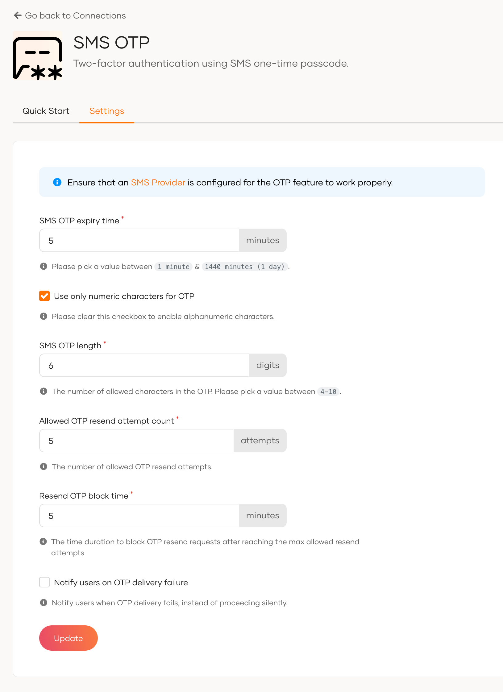
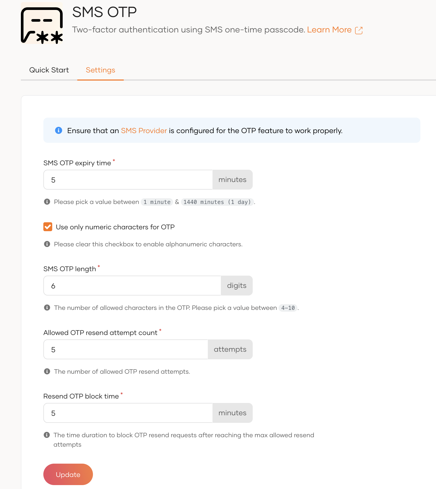
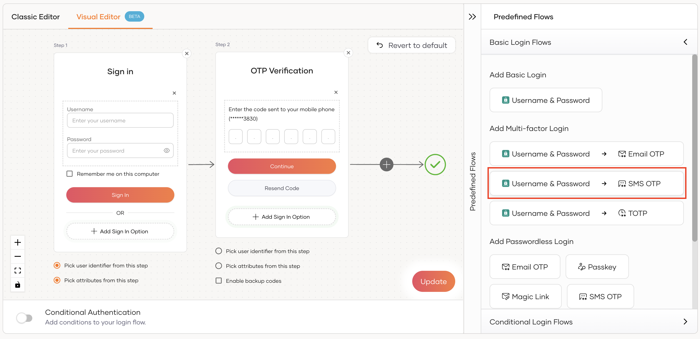
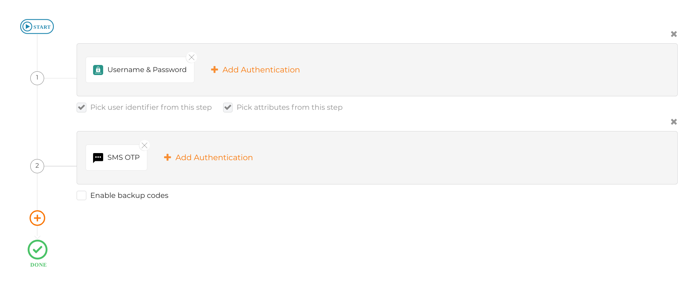
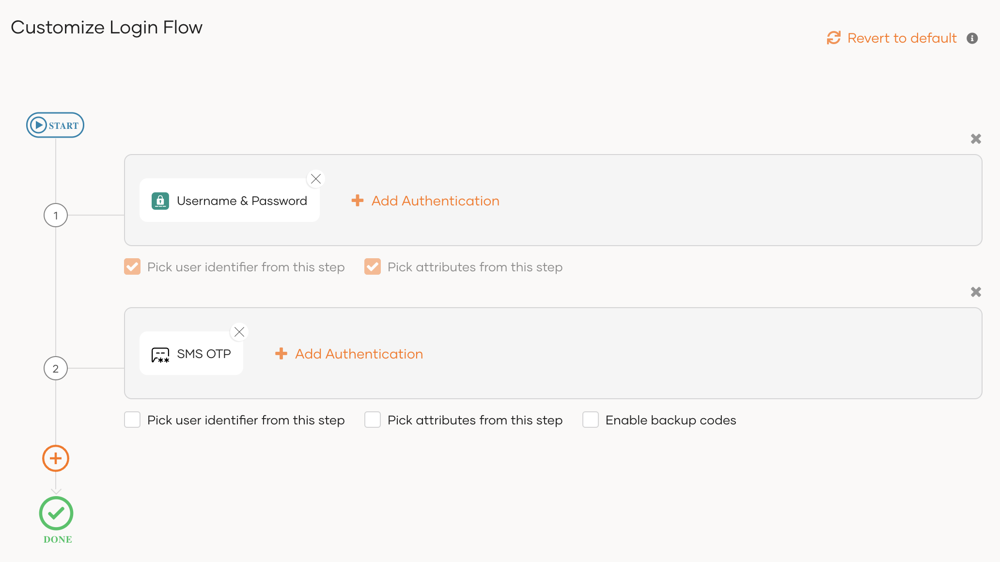
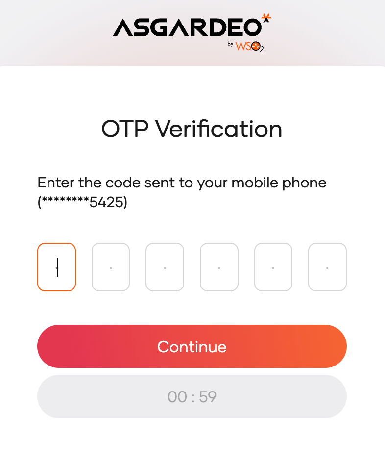

# Add MFA with SMS OTP

SMS OTP (One-Time Password) is a security mechanism where a password is sent to the user's registered mobile number, which they must enter during the login process. This password is typically valid for a short period.

During SMS OTP authentication, the user must access their mobile device to retrieve the OTP. This method ensures that only the person who has access to the registered mobile number can log in, providing an additional layer of security.

Follow the instructions given below to configure Multi-Factor Authentication (MFA) using SMS OTP in WSO2 Identity Platform.

<Prerequisites>

## Prerequisites

- To get started, you need to [register an application with WSO2 Identity Platform](../../applications/index.mdx). You can register your own application or use one of the [sample applications](../../../get-started/try-samples/index.mdx) provided.
- [Update the user profile of the users](../../users/manage-users.mdx#update-the-profile) with a mobile number to which the user will receive the OTP.
- [Configure the SMS provider](../../notification-channels/configure-sms-provider.mdx) in WSO2 Identity Platform.

:::note[Info]

You can use SMS OTP for multi-factor authentication only if a previous authentication step is configured with **username and password** or another factor that can validate user credentials.

:::

</Prerequisites>
  
## Set up SMS OTP
WSO2 Identity Platform has some default settings for SMS OTP, which are sufficient for most cases. If required, you can change the default settings, as explained below.

To update the default SMS OTP settings:

1. On the WSO2 Identity Platform Console, go to **Connections** and select **SMS OTP**.
2. Update the following parameters in the **Settings** tab:

    

    <Applies to="WSO2 Cloud">

    

    </Applies>

    

    <Applies to="Self-hosted">

    

    </Applies>

    

    
    <table>
      <tr>
        <th>Field</th>
        <th>Description</th>
      </tr>
      <tr>
        <td><code>SMS OTP expiry time</code></td>
        <td>Specifies the expiry time of the OTP. The generated OTP will not be valid after this expiry time.</td>
      </tr>
      <tr>
        <td><code>Use only numeric characters for OTP</code></td>
        <td>
            Specifies whether to use only numeric characters in the OTP. If this is selected, the generated OTP contains only digits (0-9).
            If this option is not selected, the OTP will contain alphanumeric characters.
        </td>
      </tr>
      <tr>
        <td><code>SMS OTP length</code></td>
        <td>Specifies the number of characters allowed in the OTP.</td>
      </tr>
      <tr>
        <td><code>Allowed OTP resend attempt count</code></td>
        <td>Specifies the number of allowed OTP resend attempts.</td>
      </tr>
      <tr>
        <td><code>Resend OTP block time</code></td>
        <td>Specifies the time duration to block OTP resend requests after reaching the maximum allowed resend attempts.</td>
      </tr>
      

      <Applies to="WSO2 Cloud">

      <tr>
        <td><code>Notify users on OTP delivery failure</code></td>
        <td>
            If enabled, users are notified when the SMS OTP fails to send due to a connectivity or provider error. If disabled, the failure occurs silently and users are still prompted to enter the OTP without any error indication. Note that actual delivery failures (e.g., the SMS not reaching the recipient's device) may not be captured, depending on the provider used.
            This is disabled by default.
        </td>
      </tr>

      </Applies>

      
    </table>
    

3. Once you update the SMS OTP settings, click **Update**.

## Enable SMS OTP for an app

To enable SMS OTP for MFA, you need to add **SMS OTP** in the authentication flow of the application.

Follow the steps given below.

1. On the WSO2 Identity Platform Console, go to **Applications**.
2. Select the application to which you wish to add SMS OTP.
3. Go to the **Login Flow** tab of the application and add the SMS OTP authenticator from your preferred editor:

    

    <Applies to="WSO2 Cloud">

    <Tabs>
    <TabItem value="tab-0" label="Visual Editor">

    To add SMS OTP as a second-factor authenticator using the Visual Editor:

    1. Switch to the **Visual Editor** tab and go to **Predefined Flows** > **Basic Flows** > **Add Multi-factor login**.

    2. Select **Username + Password -> SMS OTP**.

    3. Click **Confirm** to add SMS OTP as a second factor to the sign-in flow.

        

    4. Select **Enable backup codes** if you wish to allow users to use backup codes to log in to the application. Learn more about [configuring backup codes for users](../../user-self-service/manage-backup-codes.mdx).

    </TabItem>
    <TabItem value="tab-1" label="Classic Editor">

    - If you don't have a customized login flow, you can click **Add SMS OTP as a second factor**.

        

    This opens the customized login flow with SMS OTP as a second-factor authenticator:

    - If you have an already customized login flow, you can add a second step and add SMS OTP as the authenticator.

        

    - Select **Enable backup codes** if you wish to allow users to use backup codes to log in to the application. Learn more about [configuring backup codes for users](../../user-self-service/manage-backup-codes.mdx).

    </TabItem>
    </Tabs>

    </Applies>

    

    <Applies to="Self-hosted">

    1. Go to **Predefined Flows** > **Add Multi-factor Login**.

    2. Select **Username + Password -> SMS OTP**.

    3. Click **Confirm** to add passwordless login with email OTP to the sign-in flow.

          

    4. Select **Enable backup codes** if you wish to allow users to use backup codes to log in to the application. Learn more about [configuring backup codes for users](../../user-self-service/manage-backup-codes.mdx).

    </Applies>

    

4. Click **Update** to save your changes.

## How it works

When SMS OTP is enabled in the login flow of your application, the application user will be prompted with the SMS OTP authentication step once the first authentication step is completed. Given below are the high-level steps that follow:

1. WSO2 Identity Platform sends the OTP to the user's mobile number.
2. WSO2 Identity Platform prompts the user to enter the OTP code.
  
    

3. If required, the user can request WSO2 Identity Platform to resend the OTP. The new OTP invalidates the previously sent OTP.
4. The user enters the OTP and clicks **Continue**.
5. If the authentication is successful, the user can access the application.
