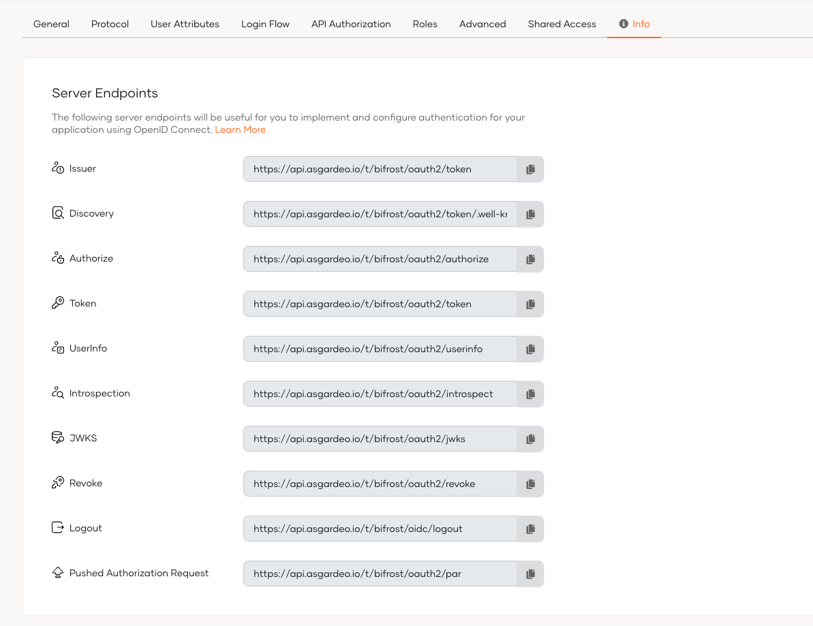

# Discover OpenID Connect endpoints and configurations

When building OpenID Connect (OIDC) login in your application using WSO2 Identity Platform as your identity provider, your application needs the relevant OIDC endpoints and configurations. Your application can get these endpoints in **two main steps**:

1. **Discover the issuer (Optional)**:

    When the issuer URL of the OpenID Provider is not known in advance, your application can dynamically discover it using the **WebFinger** endpoint.

2. **Retrieve the OpenID Connect metadata from the issuer**:

    Once your application discovers the issuer URL (either via WebFinger or because it’s already configured), your application can fetch the OpenID Connect metadata. This includes all the necessary endpoints (authorization, token, introspection, revocation, logout, etc.), supported scopes, response types, claims, and client authentication methods.

For clients or SDKs that cannot dynamically fetch these endpoints, you can get them manually from the WSO2 Identity Platform Console.

This guide explains how to discover the OpenID Connect endpoints of WSO2 Identity Platform using both the API and the Console.

<Prerequisites>

## Prerequisites

To get started, you need to have an application registered in WSO2 Identity Platform:

- Register a [single-page app with OIDC](../../applications/register-single-page-app.mdx).
- Register a [web app with OIDC](../../applications/register-oidc-web-app.mdx).

</Prerequisites>

## Use the API

This section explains how your application can dynamically discover the OpenID Connect endpoints.

<Steps>

### Discover the issuer {/* #step-1-discover-the-issuer */}

OpenID Provider issuer discovery, process allows a client application to automatically find the location (issuer URL) of the OpenID Provider.

You can use the following endpoint to retrieve the issuer information.

```bash
<PRODUCT_URL_FORMAT>/.well-known/webfinger
```

The endpoint accepts the following required parameters.

 <table>
 <thead>
 <tr className="header">
 <th>Parameter</th>
 <th>Description</th>
 <th>Sample Value</th>
 </tr>
 </thead>
 <tbody>
 <tr className="odd">
 <td><code>resource</code></td>
 <td>The identifier of the user whose OpenID Provider (issuer) you want to discover.</td>
 <td>acct:admin@localhost</td>
 </tr>
 <tr className="even">
 <td><code>host</code></td>
 <td>Specify the domain or server that hosts the WebFinger service.</td>
 <td>localhost:9443</td>
 </tr>
 <tr className="odd">
 <td><code>rel</code></td>
 <td>Specify the URI that identifies the type of service you want to locate.</td>
 <td>http://openid.net/specs/connect/1.0/issuer</td>
 </tr>
 </tbody>
 </table>

#### Sample request

<Tabs>
<TabItem value="tab-0" label="cURL">


```bash
curl --location 'https://localhost:9443/.well-known/webfinger/openid-configuration?resource=acct:admin@localhost&rel=http://openid.net/specs/connect/1.0/issuer'
```

</TabItem>
<TabItem value="tab-1" label="JavaScript - jQuery">


```js
var settings = {
     "url": "<PRODUCT_URL_SAMPLE>/.well-known/webfinger/openid-configuration",
     "method": "GET",
     "timeout": 0,
     "headers": { "Accept": "application/json" },
     "data": {
        "resource": "acct:admin@localhost",
        "rel": "http://openid.net/specs/connect/1.0/issuer"
     }
};
  
$.ajax(settings).done(function (response) {
  console.log(response);
});
```

</TabItem>
<TabItem value="tab-2" label="Nodejs - Axios">


```js
var axios = require('axios');

var config = {
     method: 'get',
     url: '<PRODUCT_URL_SAMPLE>/.well-known/webfinger/openid-configuration',
     params: {
        resource: 'acct:admin@localhost',
        rel: 'http://openid.net/specs/connect/1.0/issuer'
     },
     headers: { 'Accept': 'application/json' }
};

axios(config)
    .then(function (response) {
        console.log(JSON.stringify(response.data));
    })
    .catch(function (error) {
        console.log(error);
    });
```

</TabItem>
</Tabs>


#### Sample response

```json
{
   "subject": "acct:admin@localhost",
   "links": [
      {
         "rel": "http://openid.net/specs/connect/1.0/issuer",
         "href": "<PRODUCT_URL_SAMPLE>/oauth2/token"
      }
   ]
}
```

### Discover the issuer metadata {/* #step-2-discover-the-issuer-metadata */}

[OpenID Connect Discovery](https://openid.net/specs/openid-connect-discovery-1_0.html) allows you to discover the metadata such as endpoints, scopes, response types, claims, and supported client authentication methods of identity providers such as WSO2 Identity Platform.

Applications can dynamically discover the OpenID Connect identity provider metadata by calling the OpenID Connect discovery  endpoint. The structure of the request URL is as follows: `<issuer>/.well-known/openid-configuration`.  

- Issuer of WSO2 Identity Platform

    ```bash
    <PRODUCT_URL_FORMAT>/oauth2/token
    ```

- Discovery endpoint of WSO2 Identity Platform

    ```bash
    <PRODUCT_URL_FORMAT>/oauth2/token/.well-known/openid-configuration
    ```

#### Sample request

<Tabs>
<TabItem value="tab-0" label="cURL">


```bash
curl --location --request GET '<PRODUCT_URL_SAMPLE>/oauth2/token/.well-known/openid-configuration'
```

</TabItem>
<TabItem value="tab-1" label="JavaScript - jQuery">


```js
var settings = {
    "url": "<PRODUCT_URL_SAMPLE>/oauth2/token/.well-known/openid-configuration",
    "method": "GET",
    "timeout": 0,
};

$.ajax(settings).done(function (response) {
    console.log(response);
});
```

</TabItem>
<TabItem value="tab-2" label="Nodejs - Axios">


```js
var axios = require('axios');

var config = {
    method: 'get',
    url: '<PRODUCT_URL_SAMPLE>/oauth2/token/.well-known/openid-configuration',
    headers: {}
};

axios(config)
    .then(function (response) {
        console.log(JSON.stringify(response.data));
    })
    .catch(function (error) {
        console.log(error);
    });
```

</TabItem>
</Tabs>

#### Sample response

```json
{
   "introspection_endpoint" : "<PRODUCT_URL_SAMPLE>/oauth2/introspect",
   "end_session_endpoint" : "<PRODUCT_URL_SAMPLE>/oidc/logout",
   "registration_endpoint" : "<PRODUCT_URL_SAMPLE>/api/identity/oauth2/dcr/v1.0/register",
   "token_endpoint" : "<PRODUCT_URL_SAMPLE>/oauth2/token",
   "jwks_uri" : "<PRODUCT_URL_SAMPLE>/oauth2/jwks",
   "revocation_endpoint" : "<PRODUCT_URL_SAMPLE>/oauth2/revoke",
   "authorization_endpoint" : "<PRODUCT_URL_SAMPLE>/oauth2/authorize",
   "issuer" : "<PRODUCT_URL_SAMPLE>/oauth2/token"
}
```

</Steps>

## Use the Console

For applications and SDKs that can't dynamically resolve OpenID Connect endpoints, you can manually copy the relevant information from the Console. To do so,

1. On the WSO2 Identity Platform, go to **Applications**.

2. Select your OIDC application from the list.

3. Go to the **Info** tab of the application and find the server endpoints to your organization.

   

## What's next?

Explore how OpenID Connect endpoints are used when you implement login to your applications:

- Implement login for single-page applications [using the authorization code flow with PKCE](implement-auth-code-with-pkce.mdx).
- Implement login for traditional web applications [using the authorization code flow](implement-auth-code.mdx).
