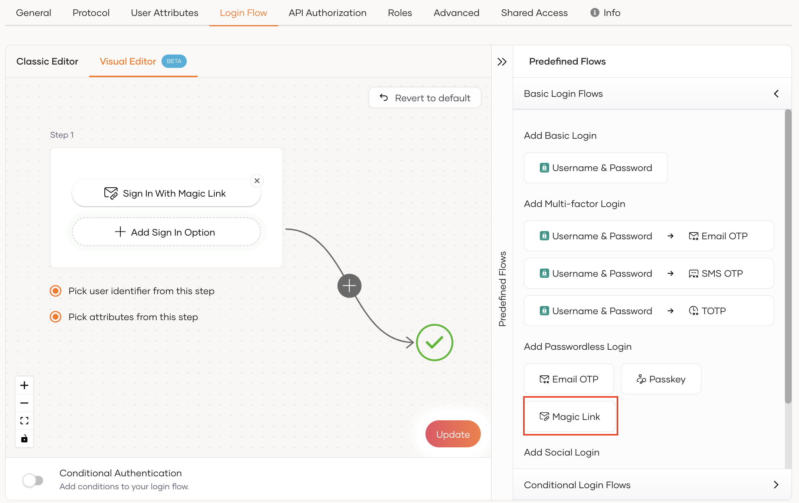
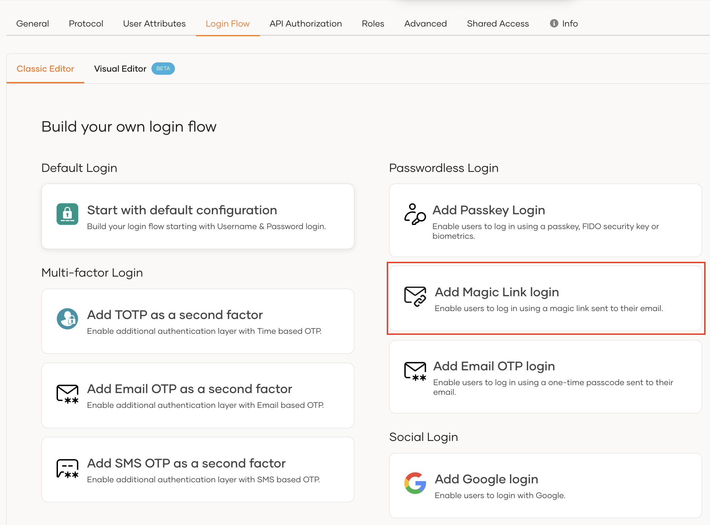
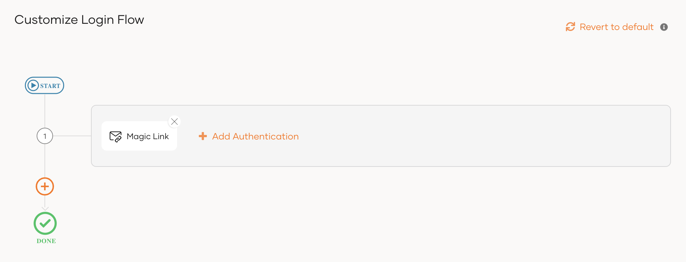

# Add Magic Link login

Magic link is a form of passwordless authentication. It allows users to log in by clicking a link sent to their email instead of entering a password.

<Prerequisites>

## Prerequisites

- To get started, you need to [register an application with WSO2 Identity Platform](../../applications/index.mdx). You can register your own application or use one of the [sample applications](../../../get-started/try-samples/index.mdx) provided.

- You need to have a user account in WSO2 Identity Platform. If you don't already have one, [create a user account](../../users/manage-users.mdx#onboard-a-user) in WSO2 Identity Platform.


<Applies to="WSO2 Cloud">

    :::note

    You cannot use an administrator account to log in to an application.

    :::

</Applies>


<Applies to="Self-hosted">

- You need to [configure the email sending module](../../notification-channels/configure-email-provider.mdx) for the WSO2 Identity Server to send the Magic link to the users.

</Applies>

</Prerequisites>


## Enable Magic link login for an app

Follow the steps given below to add **Magic link** login to the login flow of your application.

1. On the WSO2 Identity Platform Console, go to **Applications**.

2. Select the application to which you wish to add magic link login.

3. Go to the **Login Flow** tab of the application and add magic link login as follows:

    

    <Applies to="WSO2 Cloud">

    <Tabs>
    <TabItem value="tab-0" label="Visual Editor">

    To add passwordless login with magic link using the Visual Editor:

    1. Go to **Predefined Flows** > **Basic Flows** > **Add Passwordless login**.

    2. Select **Magic Link**.

    3. Click **Confirm** to add passwordless login with Magic Link to the sign-in flow.

        

    </TabItem>
    </Tabs>


    <Tabs>
    <TabItem value="tab-0" label="Classic Editor">

    To add passwordless login with magic link using the Classic Editor:

    - Select **Add Magic Link login** from the list if you haven't already built a login flow for the application.

        

    - If you already have a login flow, click **Add authentication**, select **Magic Link** and click **Add** in the first authentication step.

        

    </TabItem>
    </Tabs>

    ---

    </Applies>

    

    <Applies to="Self-hosted">

    1. Go to **Predefined Flows** > **Basic Flows** > **Add Passwordless login**.

    2. Select **Magic Link**.

    3. Click **Confirm** to add passwordless login with magic link to the sign-in flow.

        

    </Applies>

    

4. Click **Update** to save your changes.

## Try it out

Follow the steps given below.

1. Access the application URL.
2. Click **Login** to open the WSO2 Identity Platform login page.
3. On the WSO2 Identity Platform login page, enter your username and press **Continue**.

    

    You will be redirected to the below page.

    

4. Check your inbox for the magic link email. The email reads as follows.

    

5. Open the magic link by clicking the **Sign In** button.

    :::note

    Magic links support cross-browser functionality, allowing you to open the link and log in from any browser of your choice even if it is different from the one you used to initiate the login process.


    <Applies to="Self-hosted">

    If you want to remove the cross-browser functionality, you can do so by adding the following configuration in the `deployment.toml` file found in the &lt;IS_HOME>/repository/conf/ directory.

            ```toml
               [session.nonce.cookie]
               default_whitelist_authenticators=[] 
            ```
            This configuration ensures that the magic link can only be opened using the same browser from which the login was initiated.

    </Applies>

    :::
