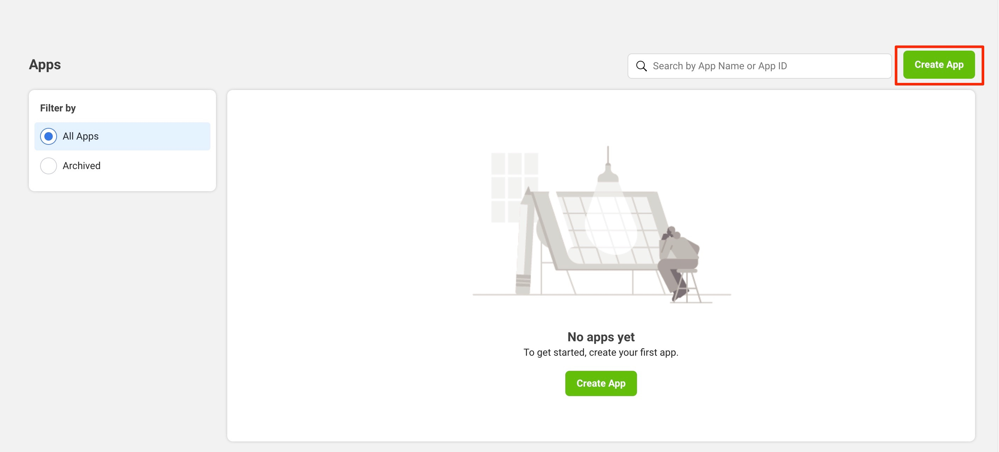
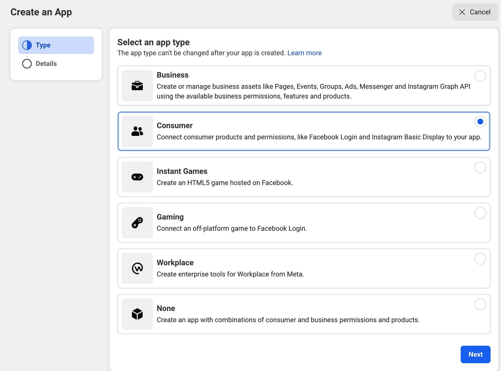
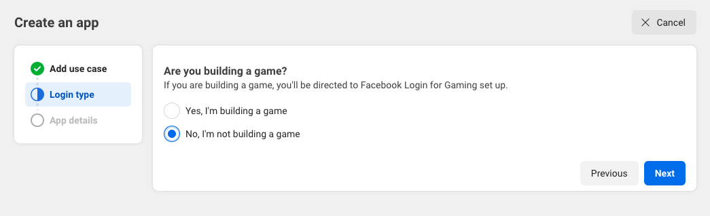
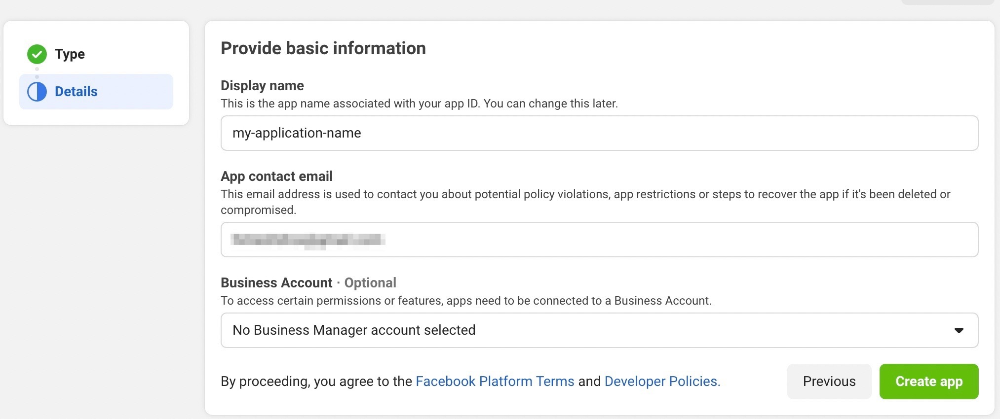
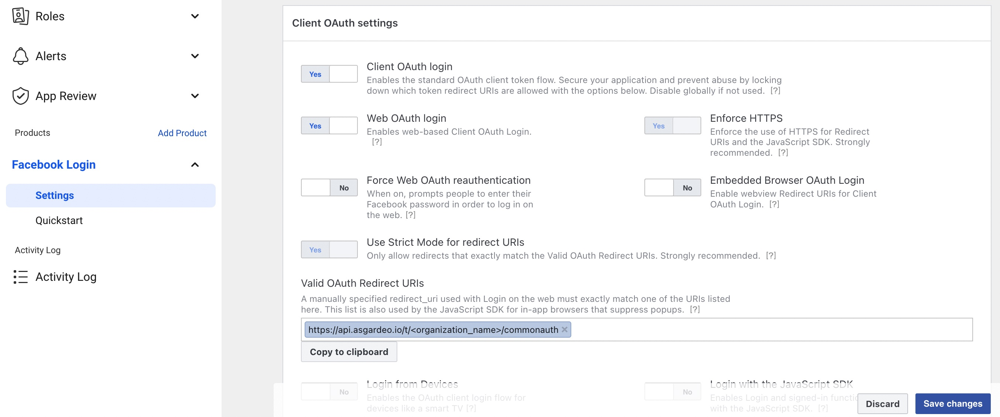
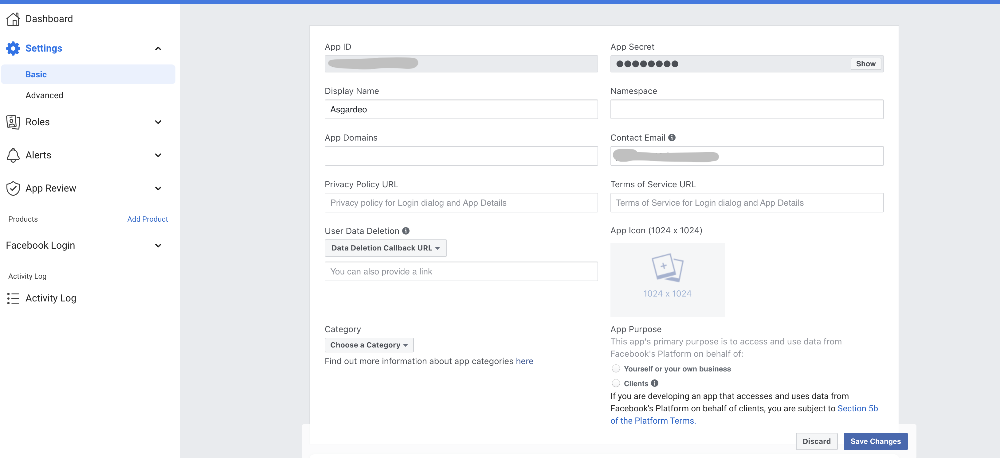
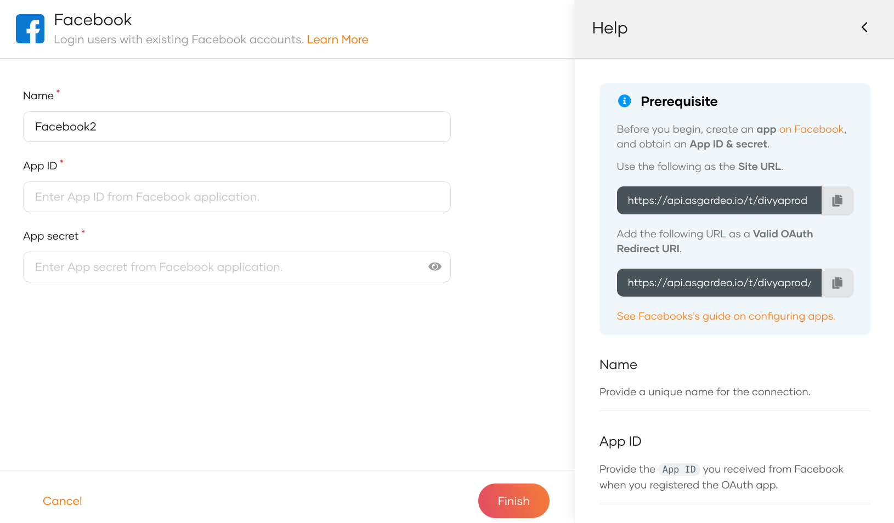
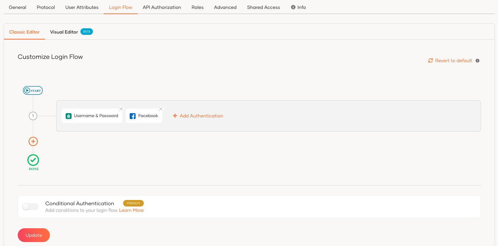
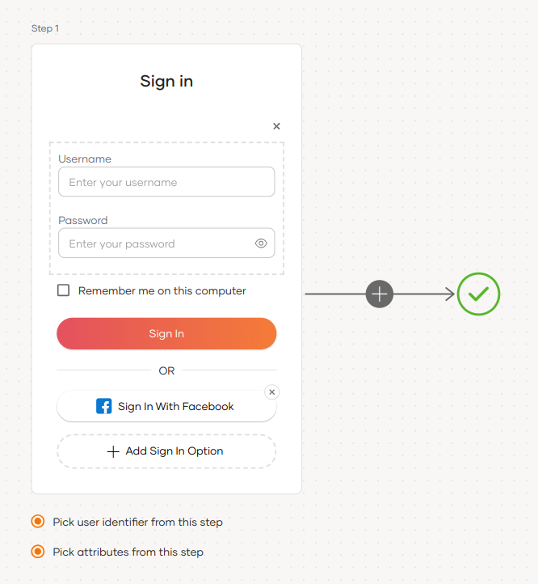
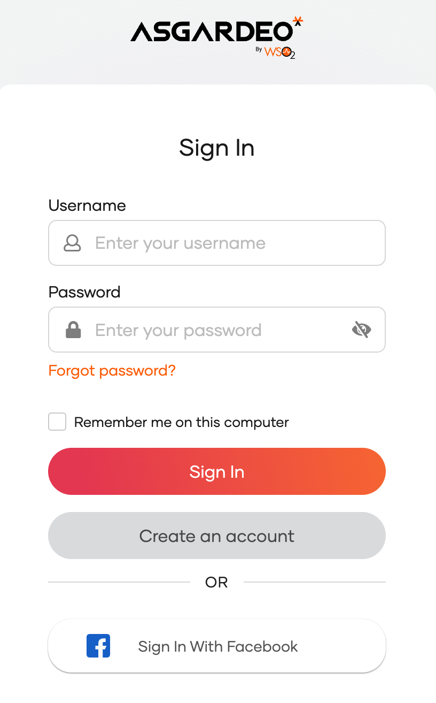

import Recommendation from '../../../_partials/guides/fragments/add-login/recommendation.mdx';

# Add Facebook login

You can add Facebook login to your applications using WSO2 Identity Platform and enable users to log in with their Facebook accounts.

Follow this guide for instructions.

## Register WSO2 Identity Platform on Facebook
You need to register WSO2 Identity Platform as an app on Facebook.

:::note

You can follow the [Facebook Documentation](https://developers.facebook.com/docs/development/create-an-app) for detailed instructions.

:::

To register an app on Facebook:

1. Go to the [My Apps](https://developers.facebook.com/apps) page in **Meta for developers**.

2. Click **Create App**.

    

3. Select the use case as **Authenticate and request data from users with Facebook Login** and click **Next**.

    

4. Select the login type out of the options and click **Next**.

    

5. Provide **Display Name** and click **Create App** to create an application.

    

6. While in the created application, select **Use cases** from the left navigation.

7. Under **Use cases** > **Authentication and account creation**, click **Customize**.

8. Under **Facebook Login** > **Quickstart**, click **Go to quickstart**.

9. Select **Web** as the platform for this app and provide the following **Site URL** and click **Save**.

    ```bash
    <PRODUCT_URL_FORMAT>
    ```

10. Return to the **Use cases** > **Customize** section and under **Facebook login** > **Settings**, click **Go to settings**.

11. Add the following as the **Valid OAuth Redirect URIs** and click **Save changes**.

    ```bash
    <PRODUCT_URL_FORMAT>/commonauth
    ```

12. Enable **Client OAuth Login** and **Web OAuth Login** (these are enabled by default) and save the changes.

    

13. On the left navigation panel, go to **App settings** > **Basic** and take note of the **App ID** and **App Secret**.

    

## Register the Facebook IdP

Now, let's register the Facebook IdP in WSO2 Identity Platform.

1. On the WSO2 Identity Platform Console, go to **Connections**.
2. Click **Create Connection** and select **Facebook**.
3. Enter the following details of the Facebook identity provider and click **Finish**:

    

    <table>
        <tr>
            <th>Parameter</th>
            <th>Description</th>
        </tr>
        <tr>
            <td>Name</td>
            <td>A unique name for this Facebook identity provider.</td>
        </tr>
        <tr>
            <td>App ID</td>
            <td>App ID obtained from Facebook.</td>
        </tr>
        <tr>
            <td>App Secret</td>
            <td>The app secret obtained from Facebook.</td>
        </tr>
    </table>


5. Go to the **Settings** tab and see the list of permissions granted by Facebook to WSO2 Identity Platform.

    - **email**: Grants read access to a user's primary email address.
    - **public_profile**: Grants read access to a user's default public profile details.  

    :::note


    WSO2 Identity Platform needs these permissions to get user information. WSO2 Identity Platform checks the attribute configurations of the application and sends the relevant attributes received from Facebook to the app. You can read the [Facebook documentation](https://developers.facebook.com/docs/permissions/reference) to learn more.

    :::

## Enable Facebook login

<Prerequisites title="Before you begin">

You need to [register an application with WSO2 Identity Platform](../../applications/index.mdx). You can register your own application or use one of the [sample applications](../../../get-started/try-samples/index.mdx) provided.

</Prerequisites>

1. On the WSO2 Identity Platform Console, go to **Applications**.
2. Select your application, go to the **Login Flow** tab and add Facebook login as follows:

    

    <Applies to="WSO2 Cloud">

    <Tabs>
    <TabItem value="tab-0" label="Classic Editor">

    To add Facebook login using the Classic Editor:

    1. If you haven't already defined a sign-in flow, click **Start with Default configuration** to get started.

    2. Click **Add Authentication** on the step, select your Facebook identity provider, and click **Add**.

        

    </TabItem>
    </Tabs>


    <Tabs>
    <TabItem value="tab-0" label="Visual Editor">

    To add Facebook login using the Visual Editor:

    1. Switch to the **Visual Editor** tab, by default the `Username & Password` login flow will be added onto the Visual Editor's workspace.

    2. Click on `+ Add Sign In Option` to add a new authenticator to the same step and select your Facebook connection.

        

    </TabItem>
    </Tabs>

    ---

    </Applies>

    

    <Applies to="Self-hosted">

    1. Click **Add Sign In Option** to add a new authenticator to the first step.

    2. Select the Facebook connection.

    3. Click **Confirm** to add login with Facebook to the sign-in flow.

        

    </Applies>

    

    <Recommendation />

3. Click **Update** to save your changes.

## Try it out

Follow the steps given below.

1. Access the application URL.

2. Click **Login** to open the WSO2 Identity Platform login page.

3. On the WSO2 Identity Platform login page, click **Sign in with Facebook**.

    

4. Log in to Facebook with an existing user account.

5. The user is now redirected to the application and logged in.

:::note

When a user successfully logs in with Facebook for the first time, a **user** account is created in the WSO2 Identity Platform Console with the Facebook username. This new user account will be managed by Facebook.

:::

## Configure connection

To learn more about other configurations available for the connection, refer to the [add federated login](../federated-login/index.mdx) documentation.
