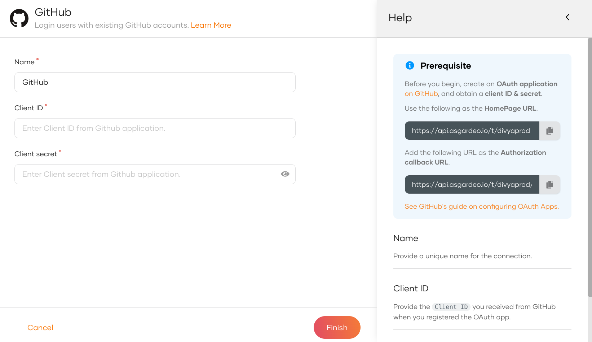
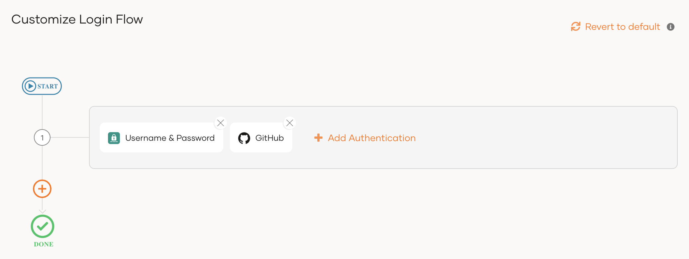
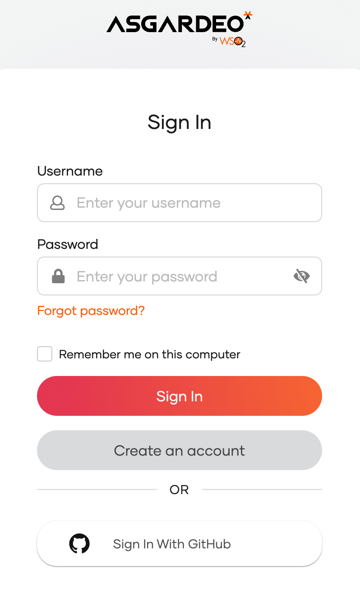

import Recommendation from '../../../_partials/guides/fragments/add-login/recommendation.mdx';

# Add GitHub login

You can add GitHub login to your applications using WSO2 Identity Platform and enable users to log in with their GitHub accounts.

Follow this guide for instructions.

## Register WSO2 Identity Platform on GitHub

You need to register WSO2 Identity Platform as an OAuth app on GitHub.

:::note

You can follow the [GitHub documentation](https://docs.github.com/en/developers/apps/building-oauth-apps/creating-an-oauth-app) for detailed instructions.

:::

1. Log in to [GitHub](https://github.com/), click your profile icon, and click **Settings**.
2. On the left panel of the **Settings** page, click **Developer settings**.
3. Under **OAuth apps**, click **Register a new application**.

    

4. Give the application a name and the following URLs:
    
    - **Homepage URL**
        ```bash
        <PRODUCT_URL_FORMAT>
        ```
    
    - **Authorization callback URL**
        ```bash
        <PRODUCT_URL_FORMAT>/commonauth
        ```

    

5. Click **Register application**.
6. Generate a new client secret and take note of the **Client ID** and **Client secret**.

## Register the GitHub IdP

Now, let's register the GitHub IdP in WSO2 Identity Platform.

1. On the WSO2 Identity Platform Console, go to **Connections**.
2. Click **New Connections** and select **GitHub**.
3. Enter the following details and click **Finish**:

    

    <table>
      <tr>
        <th>Parameter</th>
        <th>Description</th>
      </tr>
      <tr>
        <td>Name</td>
        <td>A unique name for this GitHub identity provider.</td>
      </tr>
      <tr>
          <td>Client ID</td>
          <td>The client ID obtained from GitHub.</td>
      </tr>
      <tr>
          <td>Client secret</td>
          <td>The client secret obtained from GitHub.</td>
      </tr>
    </table>

4. Go to the **Settings** tab and see the list of **scopes** to which GitHub has granted permissions.

    - **email**: Grants read access to a user's primary email address.
    - **public_profile**: Grants read access to a user's default public profile details.  

    :::note


    WSO2 Identity Platform needs these scopes to get user information. WSO2 Identity Platform checks the attribute configurations of the application and sends the relevant attributes received from GitHub to the app. You can read the [GitHub Documentation](https://docs.github.com/en/developers/apps/building-oauth-apps/scopes-for-oauth-apps) to learn more.

    :::

## Enable GitHub login

:::note[Before you begin]

You need to [register an application with WSO2 Identity Platform](../../applications/index.md). You can register your own application or use one of the [sample applications](../../../get-started/try-samples/index.md) provided.

:::

1. On the WSO2 Identity Platform Console, go to **Applications**.
2. Select your application, go to the **Login Flow** tab and add GitHub login from your preferred editor:

    

    <Applies to="WSO2 Cloud">

    <Tabs>
    <TabItem value="tab-0" label="Classic Editor">

    To add GitHub login using the Classic Editor:

    1. If you haven't already defined a sign-in flow, click **Start with Default configuration** to get started.

    2. Click **Add Authentication** on the step, select your GitHub identity provider, and click **Add**.

        

    </TabItem>
    <TabItem value="tab-1" label="Visual Editor">

    To add GitHub login using the Visual Editor:

    1. Switch to the **Visual Editor** tab, by default the `Username & Password` login flow will be added onto the Visual Editor's workspace.

    2. Click on `+ Add Sign In Option` to add a new authenticator to the same step and select your GitHub connection.

        

    </TabItem>
    </Tabs>

    ---

    </Applies>

    

    <Applies to="Self-hosted">

    1. Click **Add Sign In Option** to add a new authenticator to the first step.

    2. Select the GitHub connection.

    3. Click **Confirm** to add login with GitHub to the sign-in flow.

        

    </Applies>

    

    <Recommendation />

3. Click **Update** to save your changes.

## Try it out

Follow the steps given below.

1. Access the application URL.

2. Click **Login** to open the WSO2 Identity Platform login page.

3. On the WSO2 Identity Platform login page, **Sign in with GitHub**.

    

4. Log in to GitHub with an existing user account.

:::note

When a user successfully logs in with GitHub for the first time, a **user** account is created in the WSO2 Identity Platform Console with the GitHub username. This new user account will be managed by GitHub.

:::

## Configure connection

To learn more about other configurations available for the connection, refer to the [add federated login](../federated-login/index.md) documentation.
