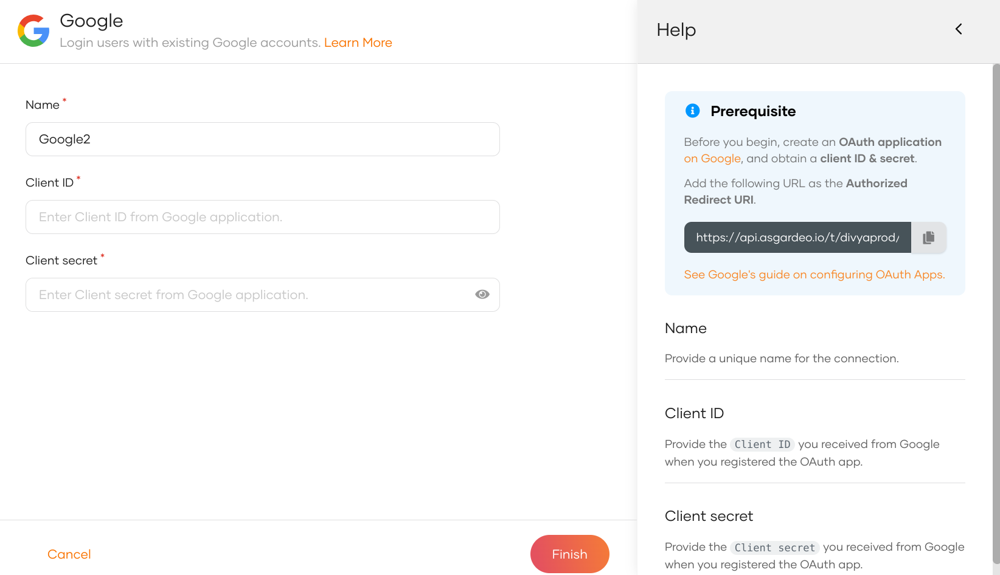
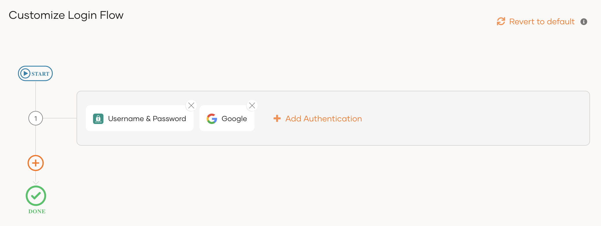
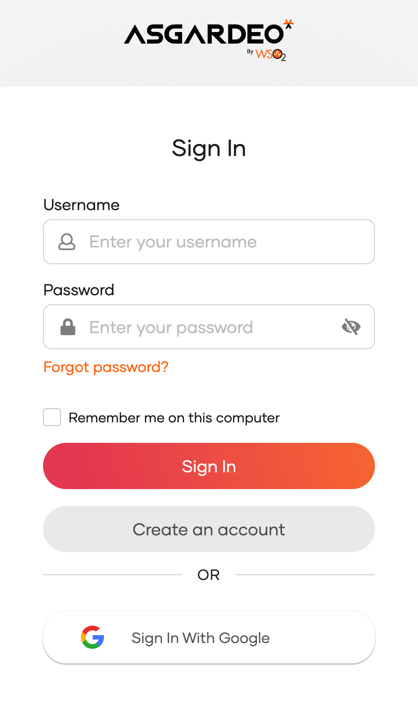

import Recommendation from '../../../_partials/guides/fragments/add-login/recommendation.mdx';

# Add Google login

You can add Google login to your applications using WSO2 Identity Platform and enable users to log in with their Google accounts.  

Follow this guide for instructions.

## Register WSO2 Identity Platform on Google
You need to register WSO2 Identity Platform as an OAuth2.0 application on Google.

:::note

For detailed instructions, you can follow the [Google documentation](https://support.google.com/googleapi/answer/6158849).

:::

1. Go to the [Google Developer console](https://console.developers.google.com/apis/credentials), create a new project, or select an existing project.

2. If the **APIs & services** page isn't already open, do the following:

    1. Open the navigation menu and click **View all products**.

       

    2. Under **Management**, click **APIs & Services**.

       

3. Go to the **Credentials** page, click **Create Credentials**, and select **Oauth client ID**.

    

4. Configure your consent screen by clicking **Configure Consent Screen** and return to **Create OAuth client ID** screen once you are done.

    :::note

    For more information, see [User Consent](https://support.google.com/googleapi/answer/6158849#userconsent&zippy=%2Cuser-consent)

    :::

5. Select the **Web application** as the application type.
6. Provide a name for your app and the following URL as the **Authorized Redirect URI** of the application:

    ```bash
    <PRODUCT_URL_FORMAT>/commonauth
    ```

7. Take note of the client ID and client secret generated for the application.

## Register the Google IdP

Now, let's register the Google IdP in WSO2 Identity Platform.

1. On the WSO2 Identity Platform Console, go to **Connections**.
2. Click **New Connections** and select **Google**.
3. Enter the following details of the Google identity provider and click **Finish**:

    

    <table>
      <tr>
        <th>Parameter</th>
        <th>Description</th>
      </tr>
      <tr>
        <td>Name</td>
        <td>A unique name for this Google identity provider.</td>
      </tr>
      <tr>
          <td>Client ID</td>
          <td>The client ID obtained from Google.</td>
      </tr>
      <tr>
          <td>Client secret</td>
          <td>The client secret obtained from Google.</td>
      </tr>
    </table>

4. Go to the **Settings** tab and see the list of **scopes** to which Google has granted permissions.

    - **email**: Allows to view the user's email address.
    - **openid**: Allows authentication using OpenID Connect and to obtain the ID token.
    - **profile**: Allows to view the user's basic profile data.

    :::note


    WSO2 Identity Platform needs these scopes to get user information. WSO2 Identity Platform checks the attribute configurations of the application and sends the relevant attributes received from Google to the app. You can read the [Google documentation](https://developers.google.com/identity/protocols/oauth2/openid-connect#scope-param) to learn more.

    :::

## Enable Google login

<Prerequisites title="Before you begin">

You need to [register an application with WSO2 Identity Platform](../../applications/index.mdx). You can register your own application or use one of the [sample applications](../../../get-started/try-samples/index.mdx) provided.

</Prerequisites>

1. On the WSO2 Identity Platform Console, go to **Applications**.
2. Select your application, go to the **Login Flow** tab and add Google login from your preferred editor:

    

    <Applies to="WSO2 Cloud">

    <Tabs>
    <TabItem value="tab-0" label="Classic Editor">

    To add Google login using the Classic Editor:

    1. If you haven't already defined a sign-in flow, click **Start with Default configuration** to get started.

    2. Click **Add Authentication** on the step, select your Google identity provider, and click **Add**.

        

    </TabItem>
    <TabItem value="tab-1" label="Visual Editor">

    To add Google login using the Visual Editor:

    1. Switch to the **Visual Editor** tab, by default the `Username & Password` login flow will be added onto the Visual Editor's workspace.

    2. Click on `+ Add Sign In Option` to add a new authenticator to the same step and select your Google connection.

        

    </TabItem>
    </Tabs>

    ---

    </Applies>

    

    <Applies to="Self-hosted">

    1. Click **Add Sign In Option** to add a new authenticator to the first step.

    2. Select the Google connection.

    3. Click **Confirm** to add login with Google to the sign-in flow.

        

    </Applies>

    

    <Recommendation />

3. Click **Update** to save your changes.

## Try it out

Follow the steps given below.

1. Access the application URL.
2. Click **Login** to open the WSO2 Identity Platform login page.
3. On the WSO2 Identity Platform login page, **Sign in with Google**.

    

4. Log in to Google with an existing user account.

:::note

When a user successfully logs in with Google for the first time, a **user** account is created in the WSO2 Identity Platform Console with the Google username. This new user account will be managed by Google.

:::

## Configure connection

To learn more about other configurations available for the connection, refer to the [add federated login](../federated-login/index.mdx) documentation.
