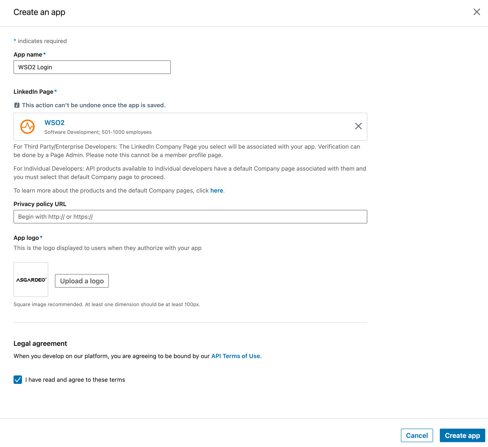
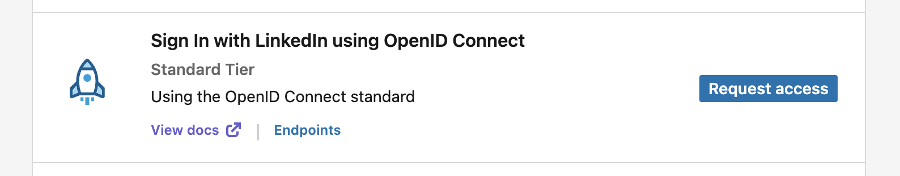
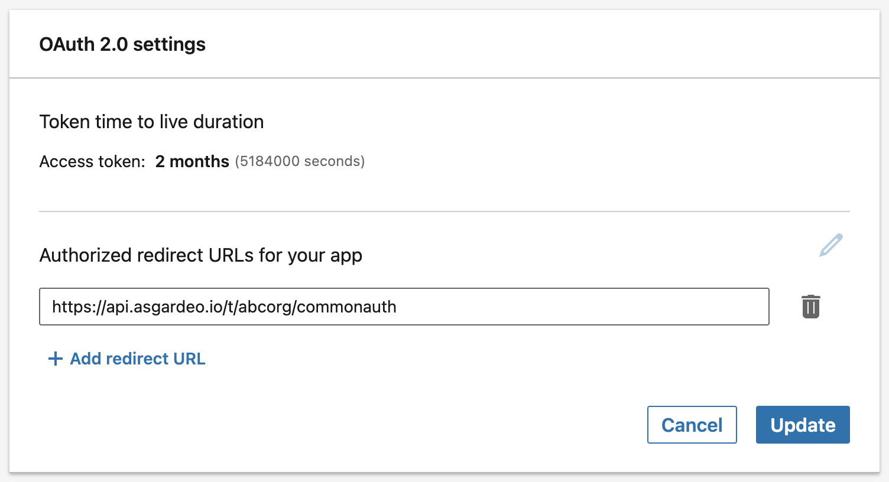
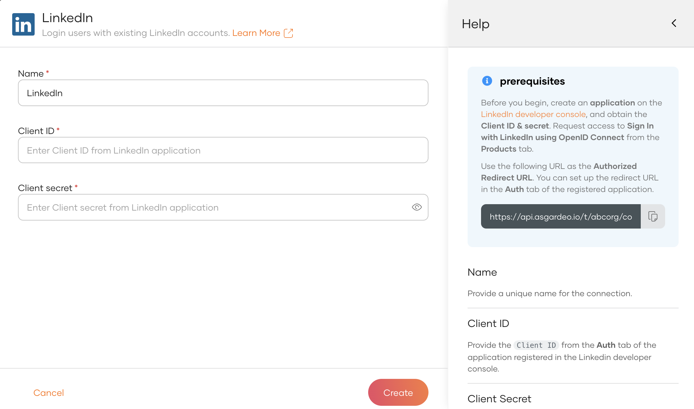
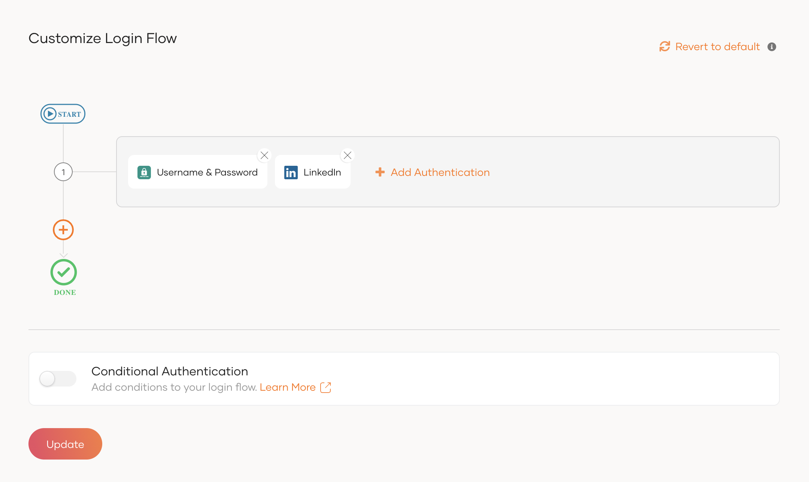
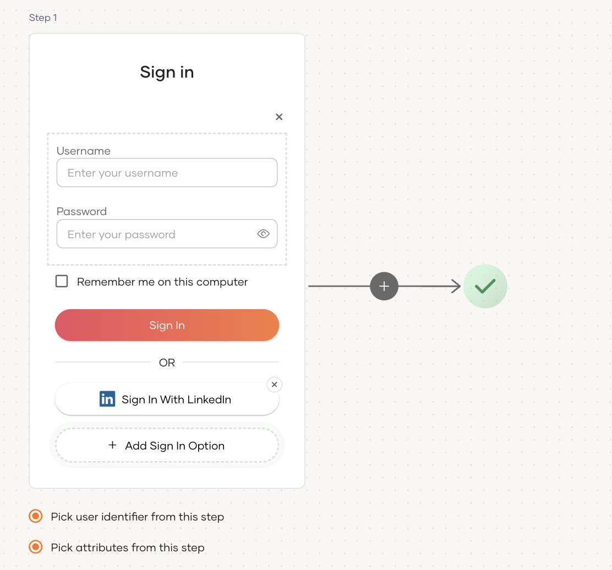
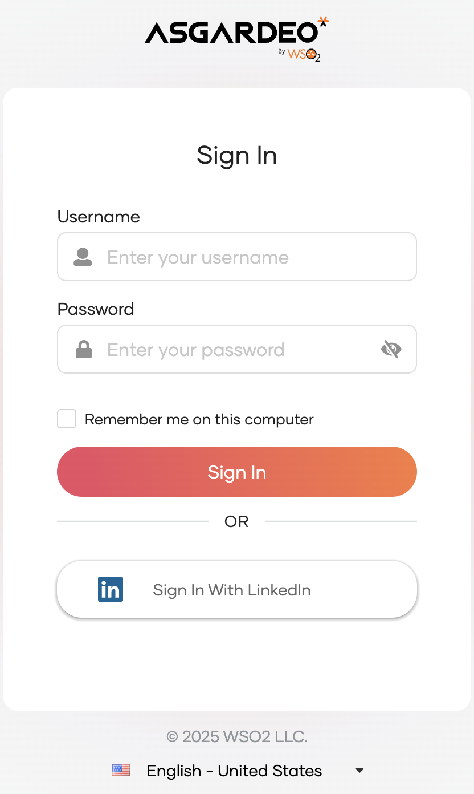

import Recommendation from '../../../_partials/guides/fragments/add-login/recommendation.mdx';

# Add LinkedIn login

You can add LinkedIn login to your applications using WSO2 Identity Platform and enable users to log in with their LinkedIn accounts.  

Follow this guide for instructions.

## Register WSO2 Identity Platform on LinkedIn
You need to register WSO2 Identity Platform as an OAuth2.0 application on LinkedIn.

1. Go to the [LinkedIn Developer console](https://developer.linkedin.com/), click on **Create app** button to create a new application.

    

2. Provide the **App name**, **LinkedIn Page**, and **App logo** for your application. Accept the **Legal agreement** and click on **Create app** to complete the application creation process.

    

3. In the **Products** tab, request access for **Sign In with LinkedIn using OpenID Connect**.

    

4. Navigate to the **Auth** tab and add the following URL as the **Authorized Redirect URL** for your app.

    ```bash
    https://api.asgardeo.io/t/{organization_name}/commonauth
    ```

    

7. Take note of the client ID and client secret generated for the application from the **Auth** tab.

## Register the LinkedIn IdP

Now, let's register the LinkedIn IdP in WSO2 Identity Platform.

1. On the WSO2 Identity Platform Console, go to **Connections**.
2. Click **New Connections** and select **LinkedIn**.
3. Enter the following details of the LinkedIn identity provider and click **Create**:

    

    <table>
      <tr>
        <th>Parameter</th>
        <th>Description</th>
      </tr>
      <tr>
        <td>Name</td>
        <td>A unique name for this LinkedIn identity provider.</td>
      </tr>
      <tr>
          <td>Client ID</td>
          <td>The client ID obtained from LinkedIn.</td>
      </tr>
      <tr>
          <td>Client secret</td>
          <td>The client secret obtained from LinkedIn.</td>
      </tr>
    </table>

## Enable LinkedIn login

:::note[Before you begin]

You need to [register an application with WSO2 Identity Platform](../../applications/index.md). You can register your own application or use one of the [sample applications](../../../get-started/try-samples/index.md) provided.

:::

1. On the WSO2 Identity Platform Console, go to **Applications**.
2. Select your application, go to the **Login Flow** tab and add LinkedIn login from your preferred editor:

    
    <Tabs>
    <TabItem value="tab-0" label="Classic Editor">

    To add LinkedIn login using the Classic Editor:

    1. If you haven't already defined a sign-in flow, click **Start with Default configuration** to get started.

    2. Click **Add Authentication** on the step, select your LinkedIn identity provider, and click **Add**.

        

    </TabItem>
    <TabItem value="tab-1" label="Visual Editor">

    To add LinkedIn login using the Visual Editor:

    1. Switch to the **Visual Editor** tab, by default the `Username & Password` login flow will be added onto the Visual Editor's workspace.

    2. Click on `+ Add Sign In Option` to add a new authenticator to the same step and select your LinkedIn connection.

        

    </TabItem>
    </Tabs>

    ---
    

    <Recommendation />

3. Click **Update** to save your changes.

## Try it out

Follow the steps given below.

1. Access the application URL.
2. Click **Login** to open the WSO2 Identity Platform login page.
3. On the WSO2 Identity Platform login page, **Sign in with LinkedIn**.

    

4. Log in to LinkedIn with an existing user account.

:::note

When a user successfully logs in with LinkedIn for the first time, a **user** account is created in the WSO2 Identity Platform Console with the LinkedIn email. This new user account will be managed by LinkedIn.

:::

## Configure connection

To learn more about other configurations available for the connection, refer to the [add federated login](../federated-login/index.md) documentation.
