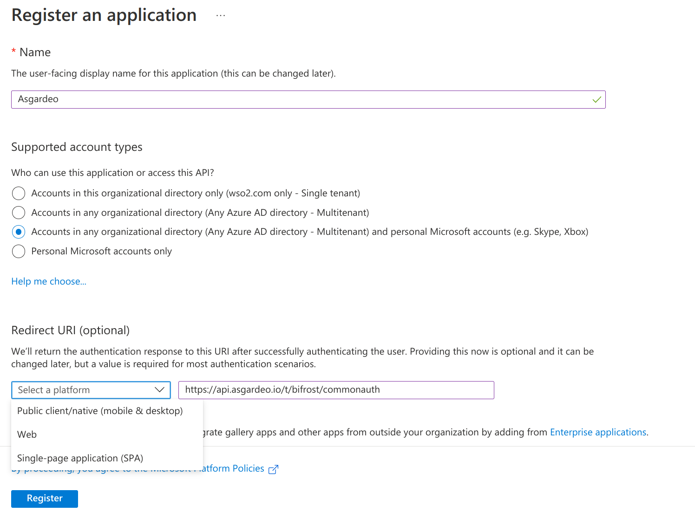
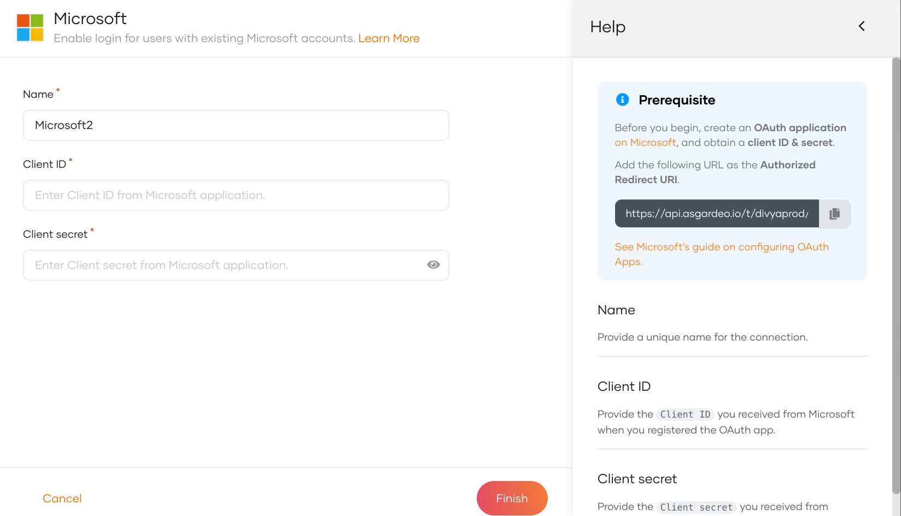
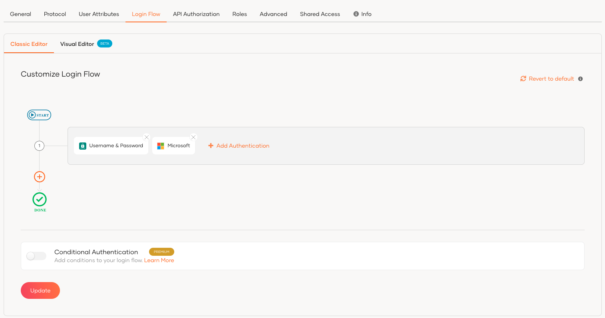
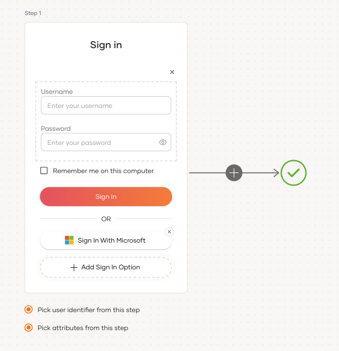
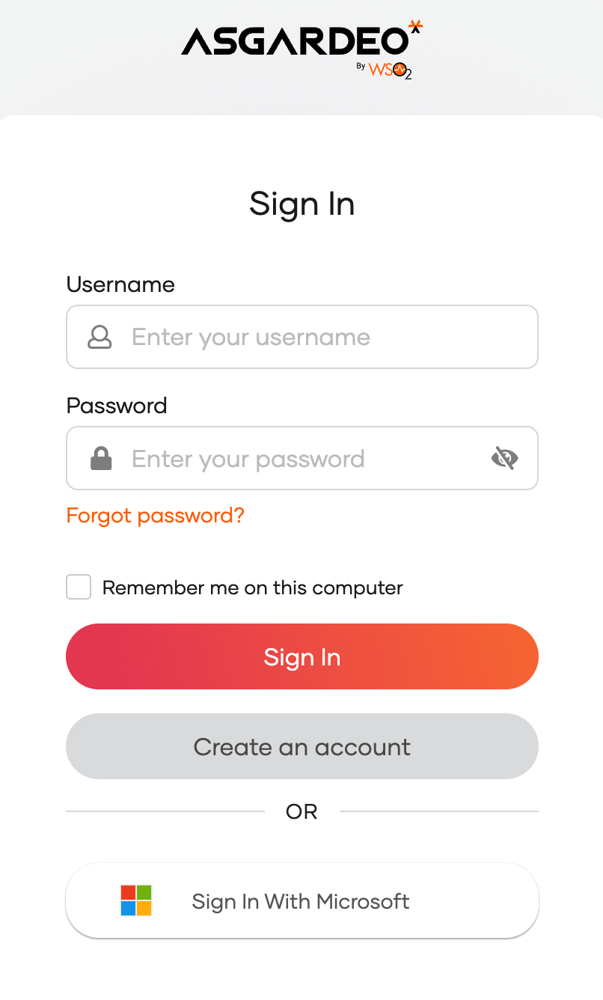

import Recommendation from '../../../_partials/guides/fragments/add-login/recommendation.mdx';

# Add Microsoft login

You can add Microsoft login to your applications using WSO2 Identity Platform and enable users to log in with their Microsoft accounts.

Follow this guide for instructions.

## Register WSO2 Identity Platform on Microsoft

You need to register WSO2 Identity Platform as an OAuth2.0 application on Microsoft Entra ID.

:::note

For detailed instructions, you can follow the [Microsoft documentation](https://learn.microsoft.com/en-us/entra/identity-platform/quickstart-register-app).

:::

1. Sign in to the [Microsoft Entra admin center](https://entra.microsoft.com/) using an account with administrator permission.

    :::note

    You must use an account in the same Microsoft 365 subscription (tenant) with which you intend to register the app.

    :::

2. Go to **Identity** > **Applications** > **App registrations** and select **New registration**.

3. Click **Add** and select **App registration** from the list.

4. Provide the required information for app registration.

    

    <table>
        <tr>
            <th>Parameter</th>
            <th>Description</th>
        </tr>
        <tr>
            <td>Name</td>
            <td>Enter a meaningful name for your application.</td>
        </tr>
        <tr>
            <td>Supported Account Type</td>
            <td>Select the supported account type.  <b>Value: </b><code>Accounts in any organizational directory (Any Microsoft Entra ID tenant - Multitenant) and personal Microsoft accounts (e.g., Skype, Xbox)</code></td>
        </tr>
        <tr>
            <td>Redirect URI</td>
            <td>Select <b>Web</b> as the platform and provide the URL to redirect after the login is completed. <b>Value:</b> <code><DeploymentValue cloud="https://api.asgardeo.io/t/&#123;organization_name&#125;" selfHosted="https://localhost:9443" />/commonauth</code></td>
        </tr>
    </table>

5. Click **Register** to create the application.

    :::note

    Take note of the client ID after the application is created.

    :::

Now, let's generate a client secret for the application.

1. Go to **Certificates & secrets** on the left navigation and click **+ New client secret**.
2. Enter a description for the client secret and select the expiry time.
3. Click **Add** to add the client secret.

    :::note[Important]

    Take note of the generated **Value**. Microsoft Entra will allow copying this value only once. This value is the newly generated client secret for your Microsoft connection in WSO2 Identity Platform.

    :::

## Register the Microsoft IdP

Now, let's register the Microsoft IdP in WSO2 Identity Platform.

1. On the WSO2 Identity Platform Console, go to **Connections**.
2. Click **New Connections** and select **Microsoft**.
3. Enter the following details of the Microsoft identity provider and click **Finish**:

    

    <table>
      <tr>
        <th>Parameter</th>
        <th>Description</th>
      </tr>
      <tr>
        <td>Name</td>
        <td>A unique name for this Microsoft identity provider.</td>
      </tr>
      <tr>
          <td>Client ID</td>
          <td>The client ID obtained from Microsoft.</td>
      </tr>
      <tr>
          <td>Client secret</td>
          <td>The client secret obtained from Microsoft.</td>
      </tr>
    </table>  

4. Go to the **Settings** tab and see the list of **scopes** to which Microsoft has granted permissions.

- **email**: Allows to view the user's email address.
- **openid**: Allows authentication using OpenID Connect and to obtain the ID token.
- **profile**: Allows to view the user's basic profile data.

:::note

WSO2 Identity Platform needs these scopes to get user information. WSO2 Identity Platform checks the attribute configurations of the application and sends the relevant attributes received from Microsoft to the app. You can read the [Microsoft documentation](https://learn.microsoft.com/en-us/entra/identity-platform/scopes-oidc#openid-connect-scopes) to learn more.

:::

## Enable Microsoft login

:::note[Before you begin]

You need to [register an application with WSO2 Identity Platform](../../applications/index.md). You can register your own application or use one of the [sample applications](../../../get-started/try-samples/index.md) provided.

:::

To enable Microsoft login:

1. On the WSO2 Identity Platform Console, go to **Applications**.
2. Select your application, go to the **Login Flow** tab and add Microsoft login from your preferred editor:

    

    <Applies to="WSO2 Cloud">

    <Tabs>
    <TabItem value="tab-0" label="Classic Editor">

    To add Microsoft login using the Classic Editor:

    1. If you haven't already defined a sign-in flow, click **Start with Default configuration** to get started.

    2. Click **Add Authentication** on the step, select your Microsoft identity provider, and click **Add**.

        

    </TabItem>
    <TabItem value="tab-1" label="Visual Editor">

    To add Microsoft login using the Visual Editor:

    1. Switch to the **Visual Editor** tab, by default the `Username & Password` login flow will be added onto the Visual Editor's workspace.

    2. Click on `+ Add Sign In Option` to add a new authenticator to the same step and select your Microsoft connection.

        

    </TabItem>
    </Tabs>

    ---

    </Applies>

    

    <Applies to="Self-hosted">

    1. Click **Add Sign In Option** to add a new authenticator to the first step.

    2. Select the Microsoft connection.

    3. Click **Confirm** to add login with Microsoft to the sign-in flow.

        

    </Applies>

    

    <Recommendation />

3. Click **Update** to save your changes.

## Try it out

Follow the steps given below.

1. Access the application URL.
2. Click **Login** to open the WSO2 Identity Platform login page.
3. On the WSO2 Identity Platform login page, **Sign in with Microsoft**.

    

4. Log in to Microsoft with an existing user account.

:::note

When a user successfully logs in with Microsoft for the first time, a **user** account is created in the WSO2 Identity Platform Console with the Microsoft username. Microsoft will manage this new user account.

:::

## Configure connection

To learn more about other configurations available for the connection, refer to the [add federated login](../federated-login/index.md) documentation.
