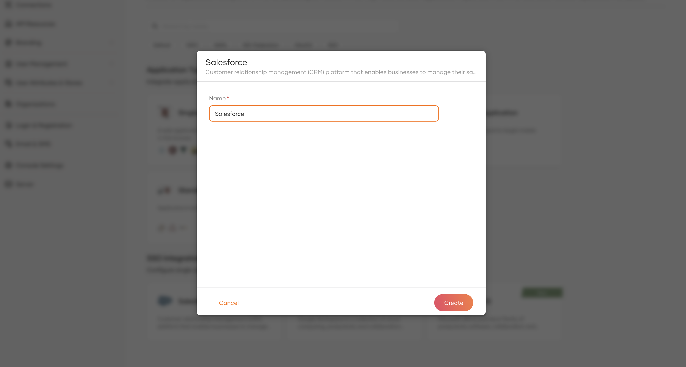
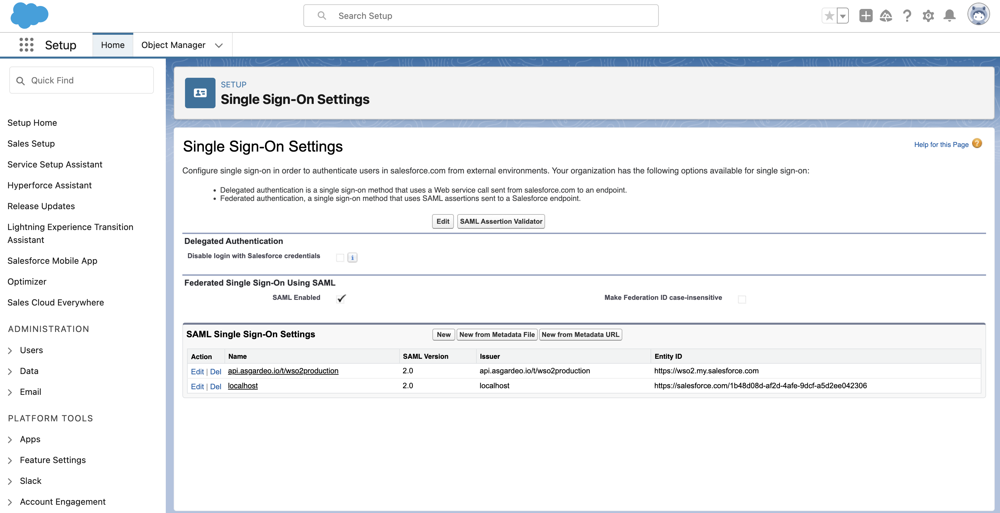
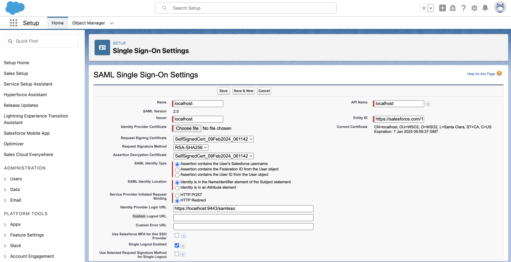

# Log in to Salesforce using WSO2 Identity Platform

This page guides you through integrating WSO2 Identity Platform for Single Sign-On (SSO) with Salesforce.

:::note[Before you begin]

 Ensure your Salesforce edition supports SSO. Check the [Salesforce documentation](https://help.salesforce.com/s/articleView?language=en_US&id=sf.sso_saml_setting_up.htm&type=5).

:::

## Create the Salesforce application

Follow the steps given below to register the Salesforce application in WSO2 Identity Platform.

1. On the WSO2 Identity Platform Console, go to **Applications**.

2. Click **New Application** and under **SSO Integrations**, select **Salesforce**.

    

3. Provide a name for the application.

    

4. Click **Create** to complete the registration.

5. Download the **SAML Metadata file** and copy the **Entity ID** from the `Guide` tab of the created application.

## Configure Salesforce

Follow the steps below to configure Salesforce for SSO authentication with WSO2 Identity Platform.

1. Log in to [Salesforce](https://login.salesforce.com/).

    :::note

    If using a custom domain, access your organization via the `Use Custom Domain` option on the [Salesforce](https://login.salesforce.com/) login page.

    :::

2. Navigate to the **Setup** > **Settings** > **Identity** > **Single Sign-On Settings** page.

3. To enable SAML SSO, select the **SAML Enabled** checkbox under **Federated Single Sign-On Using SAML**.

4. Click on the **New From Metadata file** button and upload the SAML metadata file you downloaded earlier.
  
     

5. In the **SAML Single Sign-On settings** form, replace the **Entity ID** with that you copied earlier.

6. Choose the same certificate for **Assertion Decryption Certificate** and **Request Signing Certificate**. Add your Salesforce organization’s URL in Custom Logout URL, and click **Save**.

     

7. Scroll down to the **Endpoints** section and copy the **Login URL** and **Logout URL**.

8. Download the request signing certificate.

## Apply the settings in WSO2 Identity Platform

Return to the WSO2 Identity Platform Console and do the following.

1. Navigate to **Applications** and select your created Salesforce application.

2. Go to its **Protocol** tab and enter the following details:

     - Under **Assertion consumer service URLs**, paste the login URL.
     - Under the **Single Logout Profile** section, paste the logout URL.
     - Under the **Certificate** section, select the **Provide certificate** option and upload the obtained request signing certificate.

## Try it out

Now that you have integrated WSO2 Identity Platform with Salesforce, follow the steps below to test it.

1. Create the [Salesforce guide](https://help.salesforce.com/s/articleView?id=sf.sso_sp_test_connection.htm&type=5) and add the option to login with WSO2 Identity Platform to your Salesforce login page.
2. Create a user in Salesforce.
3. Using the same email address used to create the Salesforce account, create an account for the user in WSO2 Identity Platform.
4. Access your Salesforce login URL on an incognito or private browser.
5. Log in to Salesforce using WSO2 Identity Platform and enter the user's credentials. The user will be logged in and redirected back to Salesforce.

----

## Troubleshooting guidelines

To troubleshoot SSO failures on the Salesforce side, you may use the Salesforce SAML Assertion Validator. Follow the [Salesforce documentation](https://developer.salesforce.com/docs/atlas.en-us.sso.meta/sso/sso_saml_validation_errors.htm#!) to learn more.
