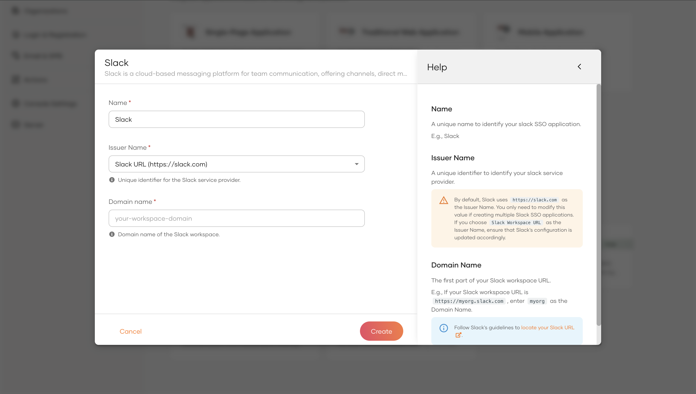
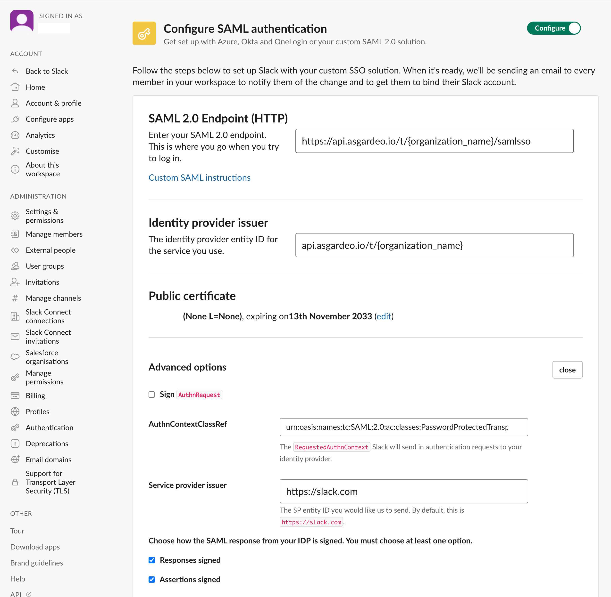

# Log in to Slack using WSO2 Identity Platform

This page guides you through integrating WSO2 Identity Platform for Single Sign-On (SSO) with Slack.

:::note[Before you begin]

You need to have a Slack Workspace account that supports SSO. Refer to the [Slack documentation](https://slack.com/intl/en-gb/help/articles/203772216-SAML-single-sign-on) for more details.

:::

## Create the Slack application

Follow the steps given below to register the Slack application in WSO2 Identity Platform.

1. On the WSO2 Identity Platform Console, go to **Applications**.

2. Click **New Application** and under **SSO Integrations**, select **Salck**.

    

3. Provide a name for your application and the following values:

    - **Issuer Name** - By default, Slack uses `https://slack.com` as the issuer name. You only need to modify this setting if you are creating multiple Slack SSO applications. If you choose to use the `Slack Workspace URL` as the issuer name instead, ensure that the configuration in Slack is updated accordingly to reflect this change.

    - **Domain Name** - Slack domain name is the first part of your Slack workspace URL. For example, if it is `https://myorg.slack.com`, enter `myorg` as the domain name. 
    
        :::note

        Follow Slack's guidelines to [locate your Slack URL](https://slack.com/intl/en-gb/help/articles/221769328-Locate-your-Slack-URL-or-ID).

        :::

    

4. Click **Create** to complete the registration.

## Configure Slack

Follow the steps below to configure Slack for SSO authentication with WSO2 Identity Platform.

1. Sign in to your Slack workspace.

2. Use the following values and configure SSO settings for Slack. Refer to [Slack documentation](https://slack.com/intl/en-gb/help/articles/203772216-SAML-single-sign-on#step-2u58-set-up-saml-sso) for more information.

    - **SAML 2.0 Endpoint** - `<PRODUCT_URL_FORMAT>/samlsso`

    - **Identity provider issuer** - `<ISSUER_NAME>`
   
    - **Public certificate** - Obtain the certificate from the `Guide` tab of the configured Slack application.

    - **Service provider issuer** - This should be the same as the **Issuer Name** you configured when creating the Slack application in WSO2 Identity Platform. If you chose `Slack Workspace URL` instead of the default Slack URL, make sure this value takes the form `https://<domain-name>.slack.com`

    

## Try it out

Now that you have integrated WSO2 Identity Platform with Slack, follow the steps below to test it.

:::note

When the workspace owner enables SSO for the Slack workspace, existing users will receive an email to their registered email addresses to bind their WSO2 Identity Platform account. New users will be auto-provisioned during login. For more details, refer to Slack documentation on [What to expect after SSO is enabled](https://slack.com/intl/en-gb/help/articles/203772216-SAML-single-sign-on#what-to-expect) and [Sign in to Slack](https://slack.com/intl/en-gb/help/articles/212681477-Sign-in-to-Slack).

:::

1. Create a user in WSO2 Identity Platform.

2. Navigate to [https://slack.com/workspace-signin](https://slack.com/workspace-signin) and enter the Slack workspace URL. This will take you to the workspace login page, where you can choose to sign-in with SSO. You will then be redirected to the WSO2 Identity Platform login screen.

3. Enter the username and password of the user you created in WSO2 Identity Platform, and complete the login process.

-----

## Troubleshooting guidelines

To troubleshoot SSO failures on the Slack side, refer to [Slack documentation](https://slack.com/intl/en-gb/help/articles/360037402653-Troubleshoot-SAML-authorisation-errors).
