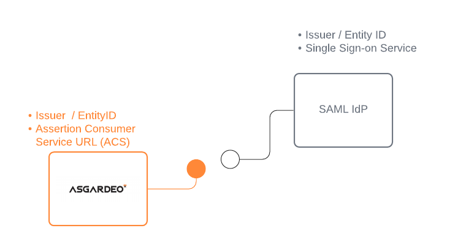
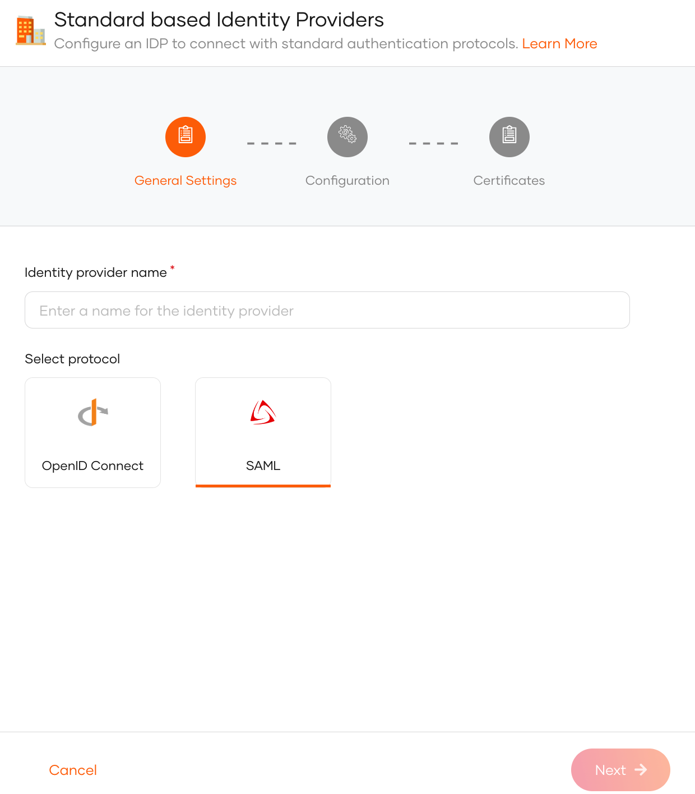
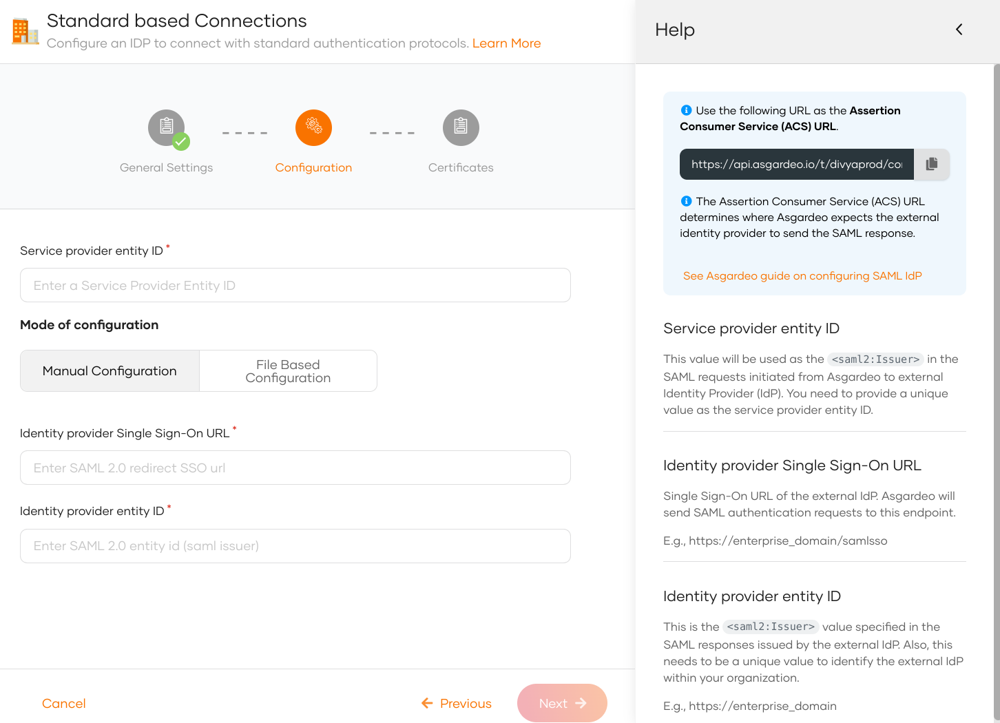
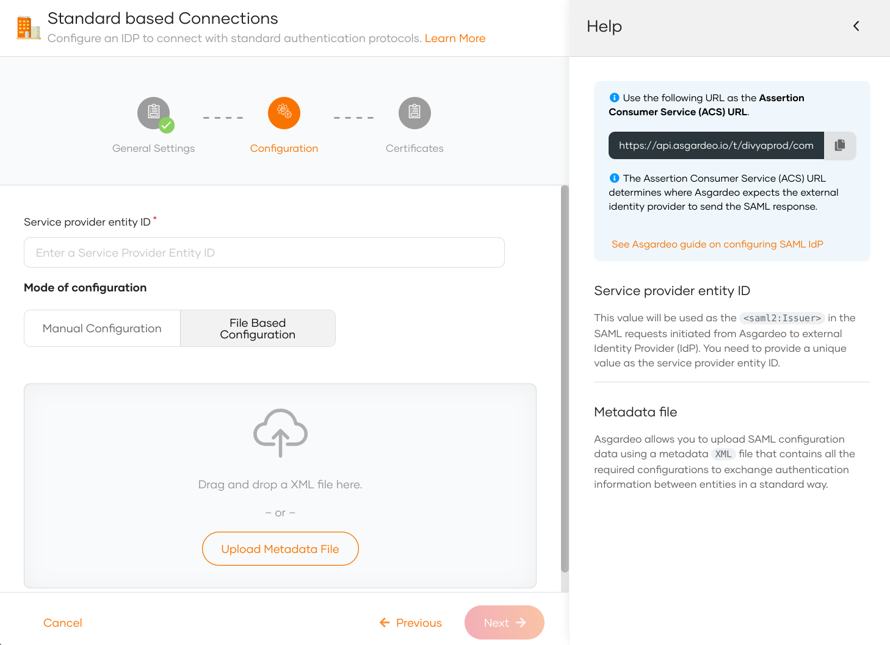
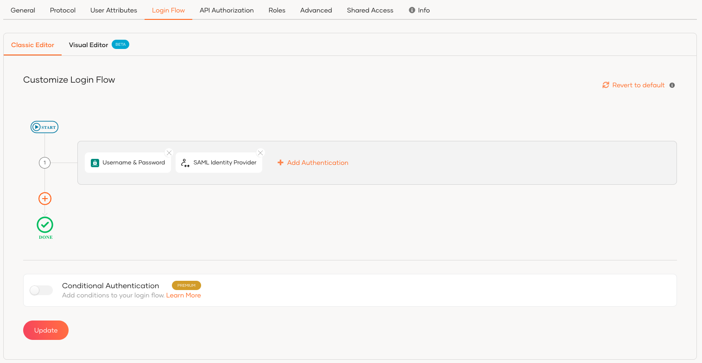
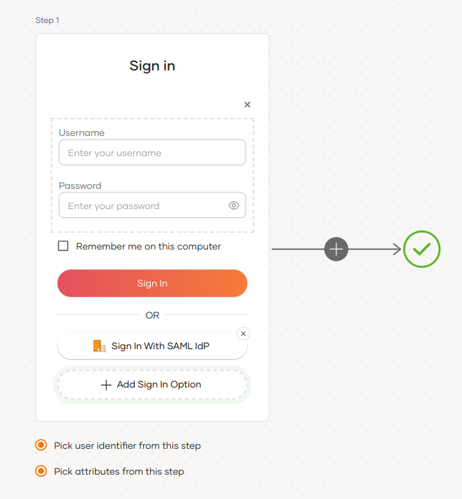
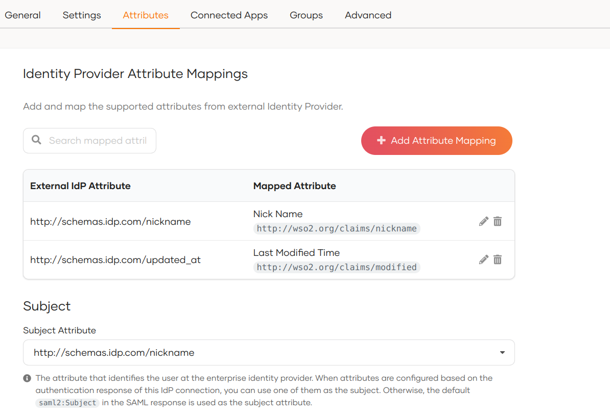

import Recommendation from '../../../_partials/guides/fragments/add-login/recommendation.mdx';
import ManageAttributes from '../../../_partials/guides/fragments/manage-connection/manage-attributes.mdx';

# Add login with a SAML identity provider

You can add standard SAML login to your applications using an external SAML Identity Provider (IdP) and enable users to log in with their external identities.

Follow this guide to register a SAML IdP in WSO2 Identity Platform and add it to the login flow of your application.



## Register WSO2 Identity Platform in the IdP
You need to register WSO2 Identity Platform as a SAML application in the external identity provider. Follow the identity provider's documentation to know how to register a SAML application.

You can use the following URL as the **Assertion Consumer Service URL** (also known as callback URL/ redirect URL/ ACS URL) in the application that represents WSO2 Identity Platform.

```bash
<PRODUCT_URL_FORMAT>/commonauth
```

After you register the app, you should get the required configurations, as explained below.

- If you are manually applying the IdP configurations to WSO2 Identity Platform, you need the following configurations:
    - **Issuer** (also known as entityId)
    - **Single sign on URL** of the identity provider (also known as login URL)
    - **Identity Provider Certificate**

- If you are using metadata to apply the IdP configurations to WSO2 Identity Platform, you need the following:
    - **SAML IdP metadata file** of the identity provider
    - **Identity Provider Certificate**

## Register the SAML IdP

Now, let's register the SAML IdP in WSO2 Identity Platform.

1. On the WSO2 Identity Platform Console, click **Connections**.
2. Click **New Connections** and select **Standard-Based IdP**.
3. Provide a unique **identity provider name**, select **SAML**, and click **Next**.
   

4. Select one of the following methods and add the SAML configurations:

    <table>
        <tr>
            <th>File Based Configuration</th>
            <td><p>Upload a SAML metadata file with the required configurations.</p> See [Use a SAML metadata file](#use-a-saml-metadata-file).</td>
        </tr>
        <tr>
            <th>Manual Configuration</th>
            <td><p>Use this option to manually specify the required SAML configurations.</p> See [Add SAML configs manually](#add-saml-configs-manually).</td>
        </tr>
    </table>

### Add SAML configs manually

If you selected **Manual Configuration** in the previous step, follow the steps given below.

1. Enter the following details and click **Next**.

    

    <table>
        <tr>
            <th>Parameter</th>
            <th>Description</th>
        </tr>
        <tr>
            <td>Service provider entity ID</td>
            <td> This value will be used as the <code>saml2:Issuer</code> in the SAML requests initiated from WSO2 Identity Platform to the external identity provider (IdP).</td>
        </tr>
        <tr>
            <td>Identity provider Single Sign-On URL</td>
            <td>This value specifies the single sign-on URL of the external IdP. This is where WSO2 Identity Platform will send its authentication requests. You need to get this value from the external IdP.</td>
        </tr>
        <tr>
            <td>Identity provider entity ID</td>
            <td>This is the <code>saml2:Issuer</code> value specified in the SAML responses issued by the external IdP. You need to get this value from the external IdP.</td>
        </tr>
    </table>


2. (Optional) Provide the mode of certificate configuration.

    :::note

    You can either configure a SAML metadata endpoint URL or upload a PEM certificate. WSO2 Identity Platform uses the certificate to validate SAML response signatures and federated IdP-initiated logout request signatures.

    :::

    - **SAML metadata endpoint**: Enter the metadata endpoint URL of the external identity provider. WSO2 Identity Platform fetches and caches the signing certificate from this URL. Learn more about [certificate validation with the SAML metadata endpoint](#certificate-validation-with-the-saml-metadata-endpoint).
    - **Use PEM certificate**: Upload or paste the public certificate of the external identity provider. The certificate should be in PEM format.

        ??? note "If you have a certificate in other formats such as `.crt`, `.cer` or `.der`, expand here to see how you can convert them to PEM format using [OpenSSL](https://www.openssl.org/)"
            **Convert CRT to PEM**
            ```bash
            openssl x509 -in cert.crt -out cert.pem

            ```
            **Convert CER to PEM:**
            ```bash
            openssl x509 -in cert.cer -out cert.pem
            ```

            **Convert DER to PEM:**
            ```bash
            openssl x509 -in cert.der -out cert.pem
            ```


3. Click **Finish** to complete the registration.

### Use a SAML metadata file

If you selected **File Based Configuration** in the previous step, follow the steps given below.

:::note

A SAML IdP metadata file contains the following:
- IdP identifiers (`entityID` or `Issuer`)
- Endpoints (single sign-on URLs, single logout URLs, etc.)
- Supported bindings

:::

1. Specify the **service provider entity ID**.

    :::note

    This value will be used as the <code>saml2:Issuer</code> in the SAML requests initiated from WSO2 Identity Platform to the external identity provider (IdP).

    :::

2. Upload the IdP metadata file and click **Next**.

    


3. (Optional) Provide the mode of certificate configuration.

    :::note

    You can either configure a SAML metadata endpoint URL or upload a PEM certificate. WSO2 Identity Platform uses the certificate to validate SAML response signatures and federated IdP-initiated logout request signatures.

    :::

    - **SAML metadata endpoint**: Enter the metadata endpoint URL of the external identity provider. WSO2 Identity Platform fetches and caches the signing certificate from this URL. Learn more about [certificate validation with the SAML metadata endpoint](#certificate-validation-with-the-saml-metadata-endpoint).
    - **Use PEM certificate**: Upload or paste the public certificate of the external identity provider. The certificate should be in PEM format.

        ??? note "If you have a certificate in other formats such as `.crt`, `.cer` or `.der`, expand here to see how you can convert them to PEM format using [OpenSSL](https://www.openssl.org/)"
            **Convert CRT to PEM**
            ```bash
            openssl x509 -in cert.crt -out cert.pem

            ```
            **Convert CER to PEM:**
            ```bash
            openssl x509 -in cert.cer -out cert.pem
            ```

            **Convert DER to PEM:**
            ```bash
            openssl x509 -in cert.der -out cert.pem
            ```


4. Click **Finish** to complete the registration.

:::note

Once the SAML identity provider is created, you can configure [additional SAML settings](../../../references/idp-settings/saml-settings-for-idp.md) from the **Settings** tab.

:::


## Certificate validation with the SAML metadata endpoint

When you configure a SAML metadata endpoint, WSO2 Identity Platform fetches and caches the signing certificate from that URL to validate SAML response signatures and federated IdP-initiated logout request signatures.

### Certificate cache invalidation

WSO2 Identity Platform honors the `validUntil` and `cacheDuration` properties defined at the `EntityDescriptor` or `IDPSSODescriptor` level in the SAML metadata to determine when to invalidate the cached certificate:

- **`validUntil`**: The absolute expiry timestamp of the metadata. WSO2 Identity Platform invalidates the cached certificate when this timestamp is reached.
- **`cacheDuration`**: The duration for which the metadata is considered valid. WSO2 Identity Platform invalidates the cached certificate after this duration.

If neither `validUntil` nor `cacheDuration` is defined, a default maximum cache lifetime of 24 hours applies.


<Applies to="Self-hosted">

You can change this default in `deployment.toml`:

```toml
[authentication.authenticator.saml.parameters]
RemoteCertificateCacheMaxLifetime = "24h"
```

</Applies>


### Automatic certificate refresh for key rotation

If signature validation fails, WSO2 Identity Platform automatically fetches fresh certificates from the metadata endpoint to support key rotation scenarios where the external IdP replaces its signing certificate.

WSO2 Identity Platform applies a default 5-minute block period between consecutive refresh attempts to prevent excessive metadata refresh requests.


<Applies to="Self-hosted">

You can configure this duration in `deployment.toml`:

```toml
[authentication.authenticator.saml.parameters]
RemoteCertificateRefreshRetryBlockDuration = "5m"
```

### HTTP client configuration

The following parameters configure the HTTP client that fetches the SAML metadata. The values shown are the defaults:

```toml
[authentication.authenticator.saml.parameters]
RemoteCertificateClientConnectionTimeout = "1s"
RemoteCertificateClientReadTimeout = "1s"
RemoteCertificateClientConnectionRequestTimeout = "1s"
RemoteCertificateClientConnectionPoolSize = "20"
RemoteCertificateClientMaxConnectionPerRoute = "3"
RemoteCertificateRetryCount = "0"
RemoteCertificateClientResponseLimit = "512000"
```

| Parameter | Description |
|---|---|
| `RemoteCertificateClientConnectionTimeout` | Maximum time to wait to establish a connection to the metadata endpoint. |
| `RemoteCertificateClientReadTimeout` | Maximum time to wait to read data after a connection is established. |
| `RemoteCertificateClientConnectionRequestTimeout` | Maximum time to wait to obtain a connection from the connection pool. |
| `RemoteCertificateClientConnectionPoolSize` | Total number of connections maintained in the pool. |
| `RemoteCertificateClientMaxConnectionPerRoute` | Maximum connections maintained per route. |
| `RemoteCertificateRetryCount` | Number of retry attempts on a failed metadata fetch. |
| `RemoteCertificateClientResponseLimit` | Maximum response size in bytes accepted from the metadata endpoint. |

### Metadata certificate cache configuration

WSO2 Identity Server caches the signing certificates fetched from the metadata endpoint. Configure the cache using the following settings in `deployment.toml`. The values shown are the defaults:

```toml
[cache.saml_cert_cache]
enable = true
timeout = 900
capacity = 100
```

| Parameter | Description | Default |
|---|---|---|
| `enable` | Enables or disables the metadata certificate cache. | `true` |
| `timeout` | Cache entry expiration time in seconds. | `900` (15 minutes) |
| `capacity` | Maximum number of cache entries. | `100` |

</Applies>


## Enable the SAML IdP for login

:::note[Before you begin]

You need to [register an application with WSO2 Identity Platform](../../applications/index.md). You can register your own application or use one of the [sample applications](../../../get-started/try-samples/index.md) provided.

:::

1. On the WSO2 Identity Platform Console, click **Applications**.
2. Select your application, go to the **Login Flow** tab and add SAML identity provider from your preferred editor:

    :::note[Recommendations]

    WSO2 Identity Platform recommends adding your social and enterprise connections to the first authentication step, as they are used for identifying the user.

    :::

    

    <Applies to="WSO2 Cloud">

    <Tabs>
    <TabItem value="tab-0" label="Classic Editor">

    To add SAML identity provider login using the Classic Editor:

    1. If you haven't already defined a sign-in flow, click **Start with Default configuration** to get started.

    2. Click **Add Authentication** on the step, select your SAML identity provider, and click **Add**.

        

    </TabItem>
    <TabItem value="tab-1" label="Visual Editor">

    To add SAML identity provider login using the Visual Editor:

    1. Switch to the **Visual Editor** tab, by default the `Username & Password` login flow will be added onto the Visual Editor's workspace.

    2. Click on `+ Add Sign In Option` to add a new authenticator to the same step and select your SAML identity provider connection.

        

    </TabItem>
    </Tabs>

    ---

    </Applies>

    

    <Applies to="Self-hosted">

    1. Click **Add Sign In Option** to add a new authenticator to the first step.

    2. Select the SAML IdP connection.

    3. Click **Confirm** to add login with an SAML IdP to the sign-in flow.

        

    </Applies>

    

    <Recommendation />

3. Click **Update** to save your changes.


<ManageAttributes />

    :::note

    By default, WSO2 Identity Platform uses the subject attribute sent by the external SAML IdP as the subject identifier. To configure a different attribute as the subject, enable the **Find user ID from requests** from the **Settings** tab of the SAML IdP.

    :::

### How it works

Consider a scenario where a SAML IdP returns the authenticated user's nickname and profile updated time to WSO2 Identity Platform in the SAML authentication response as follows:

- http://schemas.idp.com/nickname   : nickname
- http://schemas.idp.com/updated_at : profile updated time

You may want to convert them to the local attribute URI so that the application can receive them in the local attribute URI. If you don't do that mapping, the application will receive the attributes as sent by the external IdP.

**A sample IdP attribute mapping done from the WSO2 Identity Platform Console**:



**Sample attributes in the SAML assertion of the integrated SAML app**:

```xml
<saml2:AttributeStatement>
    <saml2:Attribute Name="http://wso2.org/claims/modified"
                        NameFormat="urn:oasis:names:tc:SAML:2.0:attrname-format:basic"
                        >
        <saml2:AttributeValue xmlns:xsi="http://www.w3.org/2001/XMLSchema-instance"
                                xsi:type="xsd:string"
                                >Mon Aug 30 2021 07:26:40 GMT+0000 (Coordinated Universal Time)</saml2:AttributeValue>
    </saml2:Attribute>
    <saml2:Attribute Name="http://wso2.org/claims/nickname"
                        NameFormat="urn:oasis:names:tc:SAML:2.0:attrname-format:basic"
                        >
        <saml2:AttributeValue xmlns:xsi="http://www.w3.org/2001/XMLSchema-instance"
                                xsi:type="xsd:string"
                                >John</saml2:AttributeValue>
    </saml2:Attribute>
</saml2:AttributeStatement>
```

**Sample subject attribute** in the assertion looks as shown below:

```xml
<saml2:Subject>
    <saml2:NameID Format="urn:oasis:names:tc:SAML:1.1:nameid-format:emailAddress">John</saml2:NameID>
    <saml2:SubjectConfirmation Method="urn:oasis:names:tc:SAML:2.0:cm:bearer">
        <saml2:SubjectConfirmationData InResponseTo="jimhbeljflkppacldhnjcfjkhoobkddhngnkamom"
                                        NotOnOrAfter="2021-08-30T09:49:21.336Z"
                                        Recipient="http://localhost:8081/sample-app/home.jsp"
                                        />
    </saml2:SubjectConfirmation>
</saml2:Subject>
```

## Configure connection

- To learn more about other configurations available for the connection, refer to the [add federated login](../federated-login/index.md) documentation.

- To learn more about SAML settings available for the IdP, refer to the [SAML settings](../../../references/idp-settings/saml-settings-for-idp.md) documentation.
